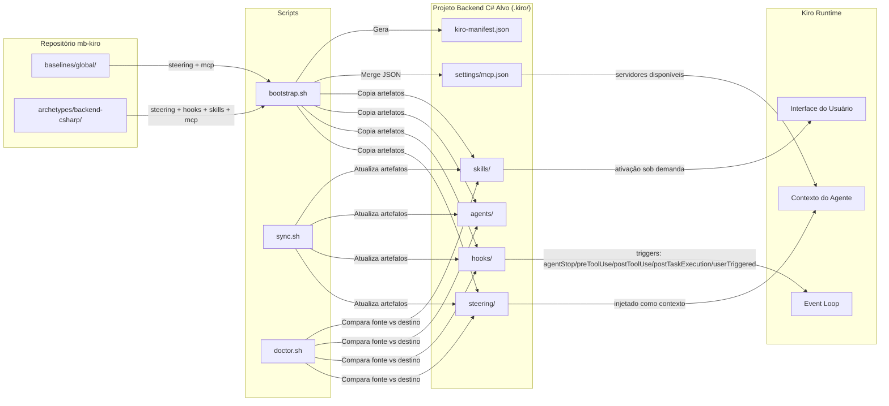
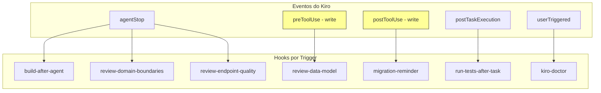

# Design Document — Archetype Backend C#

## Overview

Este design documenta a arquitetura e decisões técnicas do archetype `backend-csharp` — o pacote de configuração Kiro para projetos de serviços de domínio (backend) com .NET/C# da MonteBravo. O archetype é um artefato declarativo composto por documentos markdown e JSON que, quando aplicados a um projeto via `bootstrap.sh`, fornecem ao Kiro todo o contexto necessário para orientar, revisar e gerar código conforme os padrões das RFC-001, RFC-002, RFC-003, ADR-001 e Guia de Padrões de Nomeação.

O archetype opera em 5 categorias complementares:
1. **Steering Files** — Contexto técnico injetado nas interações do Kiro (5 + README)
2. **Hooks** — Automações disparadas por eventos do fluxo de desenvolvimento (7 hooks)
3. **Agents** — Placeholder para revisores especializados (não implementados)
4. **Skills** — Geradores de código padronizado sob demanda (5 skills)
5. **MCP Config** — Configuração de servidores MCP (vazia, herda do baseline global)

**Diferenciais em relação aos demais archetypes:**
- Steering file exclusivo `data-governance.md` (padrões do Chapter de Dados)
- Hooks com triggers `preToolUse` e `postToolUse` para validação em tempo real de modelos de dados
- 5 skills focadas em .NET (module, endpoint, repository, data-model, validation-package)
- Clean Architecture como padrão principal com CQRS/MediatR, Outbox/Inbox via Wolverine e DDD

Versão atual: `0.2.0` | Versionamento semântico independente.

---

## Architecture

### Diagrama de Componentes do Archetype

```mermaid
graph TB
    subgraph "Archetype backend-csharp (Fonte)"
        AR[archetypes/backend-csharp/]
        ST[steering/]
        HK[hooks/]
        AG[agents/]
        SK[skills/]
        MCP[mcp/]
        VER[VERSION]
        CHL[CHANGELOG.md]
        AR --> ST
        AR --> HK
        AR --> AG
        AR --> SK
        AR --> MCP
        AR --> VER
        AR --> CHL
    end

    subgraph "Steering Files (5 + README)"
        ST1[stack-and-tooling.md]
        ST2[architecture.md]
        ST3[naming-conventions.md]
        ST4[ci-cd.md]
        ST5[data-governance.md]
        ST6[README.md]
    end

    subgraph "Hooks (7)"
        H1[build-after-agent]
        H2[review-domain-boundaries]
        H3[review-endpoint-quality]
        H4[review-data-model]
        H5[migration-reminder]
        H6[run-tests-after-task]
        H7[kiro-doctor]
    end

    subgraph "Skills (5)"
        S1[generate-module]
        S2[generate-endpoint]
        S3[generate-repository]
        S4[generate-data-model]
        S5[generate-validation-package]
    end

    ST --> ST1 & ST2 & ST3 & ST4 & ST5 & ST6
    HK --> H1 & H2 & H3 & H4 & H5 & H6 & H7
    SK --> S1 & S2 & S3 & S4 & S5
```



### Diagrama de Fluxo de Dados



### Diagrama de Triggers dos Hooks



> **Nota:** Os triggers `preToolUse` e `postToolUse` (em amarelo) são exclusivos deste archetype — os demais archetypes (bff-fastify, frontend-react) usam apenas `agentStop` para revisões. A razão é que a validação de modelos de dados precisa ocorrer **antes** da escrita (preToolUse) para evitar que código incorreto seja persistido, e o lembrete de migration precisa ocorrer **após** a escrita (postToolUse) quando o arquivo já foi salvo.

### Decisões Arquiteturais

| Decisão | Escolha | Justificativa |
|---------|---------|---------------|
| Formato de steering files | Markdown sem frontmatter YAML | Steering files do backend-csharp usam blockquote de identificação no topo — sem metadados `inclusion` ou `fileMatch`. São copiados integralmente para o projeto alvo |
| Steering exclusivo: data-governance.md | Artefato dedicado à governança de dados | Serviços backend possuem PostgreSQL próprio (Database per Service) e devem seguir padrões do Chapter de Dados — requisito inexistente para BFFs ou frontends |
| Hooks preToolUse/postToolUse para dados | Validação em tempo real de Entity Configurations | Diferente de `agentStop` (pós-fato), o `preToolUse` intercepta **antes** da escrita, permitindo rejeitar código fora do padrão. O `postToolUse` serve como reminder pós-ação |
| Hooks agentStop para revisões gerais | Verificação condicional após sessão | Fronteiras de domínio e qualidade de endpoint não precisam interceptar cada escrita — basta revisar no final da sessão se houve mudanças relevantes |
| 5 skills (vs 3 no bff-fastify) | Mais skills refletem mais padrões a seguir | Backend C# tem Entity Configurations com regras de nomenclatura complexas (prefixos de natureza), fluxo de governança (chapter → DBA), e Clean Architecture com mais camadas |
| Skill generate-validation-package | Artefato complementar ao generate-data-model | O fluxo organizacional exige DDL + dicionário + diagrama ER + checklist para submissão ao chapter de dados — uma skill separada para essa entrega |
| Hook run-tests como `runCommand` | Execução direta `dotnet test` | Testes devem rodar sempre após task — sem condição, sem silêncio condicional |
| MCP vazio (`mcpServers: {}`) | Sem servidores MCP específicos | .NET debugging e profiling são feitos via ferramentas nativas (dotnet-counters, dotnet-trace). A estrutura existe para merge com baseline no bootstrap |
| Diretório agents/ vazio | Apenas README.md placeholder com 5 agents planejados | Agents requerem design mais aprofundado de prompts. Estrutura pronta sem código morto |
| Versionamento independente | Semver por archetype | Projetos consumidores atualizam de forma seletiva e rastreável, sem acoplamento a outros archetypes |
| Skills com `inclusion: manual` | Ativação explícita pelo desenvolvedor | Geração de código requer inputs (nome do domínio, entidades, operações) — não pode ser automática |
| Version file sem prefixo `v` | Apenas `MAJOR.MINOR.PATCH` | Consistência com todos os archetypes. Regex simples para parsing automatizado |

---

## Components and Interfaces

### 1. Steering Files (5 + README)

Documentos markdown que definem as diretrizes técnicas da stack .NET/C#. São a "memória organizacional" do Kiro — fornecem contexto para que o agente tome decisões alinhadas aos padrões das RFC-001, RFC-002, RFC-003, ADR-001 e Guia de Padrões de Nomeação.

| Arquivo | Temas Cobertos |
|---------|----------------|
| `stack-and-tooling.md` | Stack base obrigatória (.NET 8 LTS, C# 12, Minimal APIs, EF Core 8, PostgreSQL, FluentValidation, MediatR, Wolverine, Serilog, Polly, xUnit), infra AWS (Lambda ARM64, API Gateway, RDS), justificativa Minimal APIs, justificativa Wolverine/Outbox, .csproj config, Program.cs, Docker, segurança RFC-002, tecnologias descartadas |
| `architecture.md` | Papel do serviço de domínio, princípios (Bounded Context, Database per Service, mensageria, Outbox/Inbox, CQRS, Dependency Rule), padrões RFC-001 (Clean/Vertical Sliced/Hexagonal), comunicação ADR-001, Outbox/Inbox RFC-003 com Wolverine, CQRS com MediatR, DDD, persistência EF Core + PostgreSQL, resiliência Polly, observabilidade, health checks, glossário financeiro |
| `naming-conventions.md` | Princípios gerais .NET, idioma (inglês código, pt-BR docs), duas camadas (PascalCase C# ↔ snake_case banco), tabela prefixos de natureza (14 prefixos), nomenclatura tabelas/colunas, projetos/solution, diretórios, arquivos (20+ sufixos), namespaces, classes, interfaces (I-prefix), métodos (Async suffix), propriedades, campos (_camelCase), constantes, enums, endpoints/URLs (kebab-case /api/v1/), glossário financeiro, decimal obrigatório, convenções de testes |
| `ci-cd.md` | Princípios (deploy independente, imutabilidade, rollback, zero downtime, migrations seguras), pipeline (GitHub Actions 1ª opção, CodePipeline 2ª), steps por estágio (PR/merge/release), review rules bloqueantes, ambientes (dev/hml/prod), deploy targets (Lambda ARM64/ECS Fargate), migrations backward-compatible (expand-contract), segredos (Secrets Manager/SSM), monitoramento pós-deploy, documentação obrigatória |
| `data-governance.md` | Princípio duas camadas/convenções, tabelas snake_case singular, colunas com prefixo de natureza obrigatório, tabela completa de naturezas (14 prefixos com tipos), auditoria (tmp_creation/tmp_update), HasComment pt-BR obrigatório, constraints (pk_/fk_/ix_/uk_/ak_), decimal(18,8) para monetários, 3FN, migrations como versionamento, escopo transacional, Entity Configuration exemplo, processo chapter de dados (SLA 1 semana) |
| `README.md` | Propósito dos steering files, serviço de domínio (responsabilidades/anti-responsabilidades), stack em tabela RFC-002, estrutura Clean Architecture e alternativa Vertical Sliced, padrões de código (Minimal APIs, Commands/Queries, Domain Entities), fronteiras entre camadas, padrões de teste, checklist Kiro |

**Diferença dos demais archetypes:** O `data-governance.md` é exclusivo — não existe nos archetypes bff-fastify nem frontend-react. Ele reflete o requisito organizacional de governança de dados exigido pelo Chapter de Dados para serviços com persistência própria em PostgreSQL.

**Formato:** Sem frontmatter YAML. Identificação via blockquote no topo do documento:
```markdown
# Título

> **Steering File | Archetype: backend-csharp | Versão: X.Y.Z**
> Descrição...
> Baseado em: RFCs/ADRs
```

### 2. Hooks (7 arquivos)

Automações JSON que disparam ações baseadas em eventos do Kiro. Organizados em 4 categorias funcionais:

#### Categoria A: Build e Compilação (1 hook)

| Hook | Trigger | Ação | Versão |
|------|---------|------|--------|
| `build-after-agent.kiro.hook` | `agentStop` | `askAgent` | `"2"` |

**Padrão:** Verificação condicional — o prompt verifica se houve criação/edição de `.cs` nesta sessão. Se não houve, silêncio total. Se houve, executa `dotnet build --no-restore` e reporta apenas erros.

#### Categoria B: Revisão Arquitetural (2 hooks)

| Hook | Trigger | Escopo de Revisão | Versão |
|------|---------|-------------------|--------|
| `review-domain-boundaries.kiro.hook` | `agentStop` | `.cs` em `src/` | `"2"` |
| `review-endpoint-quality.kiro.hook` | `agentStop` | `*Endpoint*.cs` | `"2"` |

**Padrão:** Mesmo padrão condicional de `agentStop`. Cada hook revisa um aspecto específico:
- **domain-boundaries**: Clean Architecture — Domain sem dependências externas, Application sem Infrastructure, Infrastructure sem regras de negócio, Api sem lógica (usa MediatR), CancellationToken propagado, entidades com construtores privados e factory methods.
- **endpoint-quality**: Documentação OpenAPI completa (WithName/WithTags/Produces/ProducesProblem), ISender para despacho, CancellationToken, RequireAuthorization, nomenclatura {Verb}{Resource}Endpoint.cs, rota /api/v1/{resource} kebab-case, validação via FluentValidation no handler.

#### Categoria C: Governança de Dados (2 hooks) — **Exclusivo deste archetype**

| Hook | Trigger | toolTypes | Escopo | Versão |
|------|---------|-----------|--------|--------|
| `review-data-model.kiro.hook` | `preToolUse` | `["write"]` | `*Configuration.cs` em `Configurations/` ou `Persistence/` | `"1"` |
| `migration-reminder.kiro.hook` | `postToolUse` | `["write"]` | `*Configuration.cs` em `Configurations/` ou `Persistence/` | `"1"` |

**Padrão preToolUse (review-data-model):** Intercepta **antes** da escrita. Valida o conteúdo contra 10 regras do chapter de dados: ToTable snake_case, HasComment pt-BR em tabela e colunas, HasColumnName com prefixo de natureza, HasPrecision(18,8) para monetários, campos de auditoria, constraints nomeadas (pk_/fk_/ix_). Se violações, lista e sugere correções **antes** de permitir a escrita.

**Padrão postToolUse (migration-reminder):** Ativa **após** a escrita. Se o arquivo escrito é uma Entity Configuration, lembra o desenvolvedor de: (1) gerar migration via `dotnet ef migrations add`, (2) usar skill `generate-validation-package`, (3) submeter para chapter de dados antes do DBA.

**Justificativa dos triggers diferenciados:** Entity Configurations têm regras de nomenclatura complexas e impacto irreversível (migrations geram DDL para o DBA). O `preToolUse` evita que código incorreto seja salvo, economizando ciclos de revisão. O `postToolUse` funciona como checklist de próximos passos.

#### Categoria D: Ciclo de Desenvolvimento (2 hooks)

| Hook | Trigger | Ação | Tipo | Versão |
|------|---------|------|------|--------|
| `run-tests-after-task.kiro.hook` | `postTaskExecution` | `runCommand` | `dotnet test` | `"2"` |
| `kiro-doctor.kiro.hook` | `userTriggered` | `askAgent` | Diagnóstico completo | `"1"` |

**Padrão run-tests:** Execução direta via `runCommand` — roda `dotnet test` sempre após task, sem condição.
**Padrão doctor:** Acionado manualmente. Gera relatório markdown com 8 seções comparando projeto vs archetype vs baseline (Resumo, Steering, Hooks, MCP, Skills, Specs, Arquitetura, Recomendações).

### 3. Agents (0 funcionais — placeholder)

O diretório `agents/` contém apenas um `README.md` documentando 5 agents planejados:

| Agent Planejado | Especialidade | Status |
|-----------------|--------------|--------|
| `domain-modeler` | Modelagem de domínio DDD (entidades, value objects, aggregates, eventos) | Não implementado |
| `architecture-reviewer` | Validar Dependency Rule e fronteiras de camada | Não implementado |
| `api-designer` | Design de APIs REST, contratos OpenAPI, versionamento | Não implementado |
| `test-writer` | Geração de testes unitários e de integração | Não implementado |
| `migration-reviewer` | Revisão de backward-compatibility em migrations | Não implementado |

**Decisão:** Manter estrutura com README documentando a intenção futura. A estrutura está pronta para adições sem breaking changes.

### 4. Skills (5 arquivos)

Geradores de código padronizado ativados sob demanda. Cada skill define inputs esperados, regras de geração e exemplos completos de output.

| Skill | Gera | Artefatos Principais |
|-------|------|---------------------|
| `generate-module.md` | Módulo de domínio completo | Endpoints Minimal API, Commands/Queries MediatR, Handlers, Validators FluentValidation, Entidades DDD, Entity Configurations, Repositories, Testes unitários |
| `generate-endpoint.md` | Endpoint ASP.NET Core Minimal API | Classe estática com Map(), handler com ISender, documentação OpenAPI, RequireAuthorization |
| `generate-repository.md` | Repository com interface + implementação | Interface no Domain (I{Entity}Repository), implementação EF Core no Infrastructure, Entity Configuration |
| `generate-data-model.md` | Modelo de dados aderente ao chapter | Entidades com comportamento, Entity Configurations com governança, migration, DDL PostgreSQL, dicionário de dados, diagrama ER |
| `generate-validation-package.md` | Pacote para submissão ao chapter de dados | DDL com COMMENT ON, dicionário markdown, diagrama ER Mermaid, checklist de validação |

**Cadeia de skills:** `generate-module` → cria estrutura completa. `generate-data-model` → modela persistência. `generate-validation-package` → empacota para o chapter. O `migration-reminder` hook faz a ponte entre data-model e validation-package.

**Padrão de frontmatter:**
```yaml
---
name: "Nome Exibível em Português"
description: "Descrição do que a skill gera"
inclusion: manual
---
```

**Estrutura interna de cada skill:**
1. `## Quando usar` — Condições de ativação
2. `## Inputs esperados` — Parâmetros do desenvolvedor
3. `## Regras de geração` — Nomenclatura, estrutura, implementação
4. `## Exemplo de output` — Código completo gerado como referência

### 5. MCP Config (1 arquivo)

Configuração JSON de servidores MCP específicos para projetos backend C#.

```json
{
  "_comment": "MCPs específicos do archetype backend-csharp. Mergeado com o baseline global no bootstrap.",
  "_version": "0.1.0",
  "mcpServers": {}
}
```

**Decisão:** O objeto `mcpServers` está intencionalmente vazio. Projetos backend C# não requerem servidores MCP adicionais além dos definidos no baseline global. Ferramentas de debug e profiling (.NET counters, trace, dump) são nativas do SDK. A estrutura existe para:
- Manter consistência com outros archetypes
- Permitir adições futuras sem mudança estrutural
- Ser mergeado corretamente pelo `bootstrap.sh` com o baseline global

### 6. Integração com Scripts de Automação

#### bootstrap.sh

O script `bootstrap.sh` aplica o archetype a um projeto backend C# novo:

1. Copia steering files para `.kiro/steering/` (exclui READMEs)
2. Copia hooks para `.kiro/hooks/`
3. Copia agents/ para `.kiro/agents/` (apenas README.md no momento)
4. Copia skills para `.kiro/skills/`
5. Mergea `mcp.json` do archetype com baseline global em `.kiro/settings/mcp.json` (archetype vazio → resultado = baseline)
6. Registra archetype no `kiro-manifest.json` com nome `backend-csharp` e versão

#### sync.sh

Atualiza artefatos do archetype em projetos existentes:
- Compara byte-a-byte os arquivos no projeto vs fonte no repositório
- Sobrescreve arquivos desatualizados, adiciona novos
- Atualiza `last_synced_at` no manifest

#### doctor.sh / kiro-doctor hook

Diagnostica conformidade do projeto com o archetype:
- Compara artefatos presentes vs esperados
- Valida steering files, hooks habilitados, skills presentes
- Verifica aderência arquitetural (Clean Architecture, CQRS, DDD, Dependency Rule)
- Gera relatório `kiro-doctor-report.md` com indicadores visuais (✅ ⚠️ ❌) e 8 seções

---

## Data Models

### Steering File Schema (backend-csharp)

```markdown
# Título do Steering File

> **Steering File | Archetype: backend-csharp | Versão: X.Y.Z**
>
> Descrição do propósito e escopo do arquivo.
>
> Baseado em: RFC-001, RFC-002, RFC-003, ADR-001 (conforme aplicável)

---

## Seção 1
...

## Referências
- [Link](url)

---
*Versão: X.Y.Z | Última revisão: YYYY-MM | Próxima revisão: TODO*
```

**Nota:** Diferente do archetype frontend-react, os steering files do backend-csharp **não possuem frontmatter YAML** com campos `inclusion` ou `fileMatchPattern`. A identificação é feita via blockquote no topo do documento.

### Hook Schema

```json
{
  "enabled": true,
  "name": "string — Nome exibível",
  "description": "string — Descrição do que o hook faz",
  "version": "1" | "2",
  "when": {
    "type": "agentStop" | "postTaskExecution" | "userTriggered" | "preToolUse" | "postToolUse",
    "toolTypes": ["write"]
  },
  "then": {
    "type": "askAgent" | "runCommand",
    "prompt": "string (quando askAgent)",
    "command": "string (quando runCommand)"
  }
}
```

**Variantes por trigger type:**

| Trigger | Campos `when` | Ação típica | Hooks |
|---------|---------------|-------------|-------|
| `agentStop` | `{ "type": "agentStop" }` | `askAgent` com verificação condicional | build-after-agent, review-domain-boundaries, review-endpoint-quality |
| `preToolUse` | `{ "type": "preToolUse", "toolTypes": ["write"] }` | `askAgent` com validação antes da escrita | review-data-model |
| `postToolUse` | `{ "type": "postToolUse", "toolTypes": ["write"] }` | `askAgent` com reminder após escrita | migration-reminder |
| `postTaskExecution` | `{ "type": "postTaskExecution" }` | `runCommand` direto | run-tests-after-task |
| `userTriggered` | `{ "type": "userTriggered" }` | `askAgent` com diagnóstico | kiro-doctor |

**Versões:**
- `"1"`: Schema básico (usado em hooks preToolUse/postToolUse/userTriggered)
- `"2"`: Schema com verificação condicional no prompt (usado em hooks agentStop e postTaskExecution)

### Skill Schema

```markdown
---
name: "string — Nome exibível em português"
description: "string — O que a skill gera"
inclusion: manual
---

# Título da Skill

## Quando usar
## Inputs esperados
## Regras de geração
## Exemplo de output
```

**Regras do frontmatter:**
- `name` — obrigatório, string não-vazia, em português
- `description` — obrigatório, string não-vazia
- `inclusion` — obrigatório, valor fixo `"manual"` (skills requerem inputs do usuário)

### MCP Config Schema

```json
{
  "_comment": "string — Identificação do propósito e menção ao merge com baseline",
  "_version": "MAJOR.MINOR.PATCH",
  "mcpServers": {}
}
```

**Regras:**
- `_comment` obrigatório — documentação inline sobre merge com baseline
- `_version` segue semver — rastreabilidade de mudanças
- `mcpServers` objeto vazio — backend C# não requer MCPs específicos

### VERSION File

```
MAJOR.MINOR.PATCH
```

- Sem prefixo `v`, sem espaços, sem trailing newline extra
- Regex: `^(0|[1-9][0-9]*)\.(0|[1-9][0-9]*)\.(0|[1-9][0-9]*)$`

### CHANGELOG.md

```markdown
# Changelog

## X.Y.Z (YYYY-MM-DD)

### Funcionalidades | Correções | Refatoração | Documentação | Manutenção | Performance | CI/CD
- Entrada descritiva
```

**Regras:**
- Versão mais recente no topo
- Header nível 2: `## MAJOR.MINOR.PATCH (YYYY-MM-DD)`
- Seções nível 3: exatamente um dos 7 nomes válidos
- Cada entrada deve ter ao menos uma seção de agrupamento válida

### Estrutura de Diretórios

```
archetypes/backend-csharp/
├── agents/
│   └── README.md
├── hooks/
│   ├── README.md
│   ├── build-after-agent.kiro.hook
│   ├── kiro-doctor.kiro.hook
│   ├── migration-reminder.kiro.hook
│   ├── review-data-model.kiro.hook
│   ├── review-domain-boundaries.kiro.hook
│   ├── review-endpoint-quality.kiro.hook
│   └── run-tests-after-task.kiro.hook
├── mcp/
│   └── mcp.json
├── skills/
│   ├── README.md
│   ├── generate-data-model.md
│   ├── generate-endpoint.md
│   ├── generate-module.md
│   ├── generate-repository.md
│   └── generate-validation-package.md
├── steering/
│   ├── README.md
│   ├── architecture.md
│   ├── ci-cd.md
│   ├── data-governance.md
│   ├── naming-conventions.md
│   └── stack-and-tooling.md
├── CHANGELOG.md
├── README.md
└── VERSION
```

---

## Correctness Properties

*Uma propriedade é uma característica ou comportamento que deve ser verdadeiro em todas as execuções válidas de um sistema — essencialmente, uma afirmação formal sobre o que o sistema deve fazer. Propriedades servem como ponte entre especificações legíveis por humanos e garantias de correção verificáveis por máquina.*

### Property 1: Completude estrutural do archetype

*Para qualquer* estrutura de archetype backend-csharp válida, os diretórios `steering/`, `hooks/`, `agents/`, `skills/` e `mcp/` SHALL existir, cada um contendo um `README.md` (exceto `mcp/`), e além disso: `steering/` SHALL conter exatamente 5 arquivos `.md` (excluindo README), `hooks/` SHALL conter exatamente 7 arquivos `.kiro.hook`, `skills/` SHALL conter exatamente 5 arquivos `.md` (excluindo README), `mcp/` SHALL conter um `mcp.json`, e `agents/` SHALL conter apenas `README.md`.

**Validates: Requirements 1.1, 1.2, 1.3, 1.4, 1.5, 1.9, 10.1, 10.2**

### Property 2: Formato de versão semântica

*Para qualquer* conteúdo do arquivo `VERSION`, a validação SHALL aceitar se e somente se a string seguir o formato `MAJOR.MINOR.PATCH` onde cada segmento é um inteiro não-negativo sem zeros à esquerda (exceto o próprio `0`), sem prefixo `v`, sem espaços e sem quebra de linha adicional.

**Validates: Requirements 1.6, 11.1**

### Property 3: Hooks habilitados e schema válido

*Para qualquer* arquivo `.kiro.hook` no diretório `hooks/` do archetype, o conteúdo SHALL ser JSON válido contendo os campos obrigatórios: `enabled` (com valor `true`), `name` (string não-vazia), `version` (string `"1"` ou `"2"`), `when.type` (um de `agentStop`, `postTaskExecution`, `userTriggered`, `preToolUse`, `postToolUse`) e `then.type` (um de `askAgent`, `runCommand`), com `then.prompt` presente quando `then.type` é `askAgent`, `then.command` presente quando `then.type` é `runCommand`, e `when.toolTypes` presente quando `when.type` é `preToolUse` ou `postToolUse`.

**Validates: Requirements 3.1, 4.1, 4.2, 5.1, 5.2, 6.1, 7.1**

### Property 4: Frontmatter de skills

*Para qualquer* arquivo `.md` no diretório `skills/` (excluindo `README.md`), o frontmatter YAML SHALL conter exatamente os campos `name` (string não-vazia), `description` (string não-vazia) e `inclusion` com valor `"manual"`.

**Validates: Requirements 8.6**

### Property 5: Schema de configuração MCP

*Para qualquer* arquivo `mcp.json` válido do archetype backend-csharp, ele SHALL conter: um campo `_comment` (string não-vazia), um campo `_version` (semver válido no formato `MAJOR.MINOR.PATCH`) e um campo `mcpServers` (objeto — pode estar vazio).

**Validates: Requirements 9.1, 9.2**

### Property 6: Formato de changelog

*Para qualquer* arquivo `CHANGELOG.md` válido do archetype, a primeira entrada de versão SHALL seguir o formato `## MAJOR.MINOR.PATCH (YYYY-MM-DD)`, e cada seção de agrupamento dentro de uma entrada SHALL usar exclusivamente um dos 7 nomes válidos: Funcionalidades, Correções, Documentação, Refatoração, Manutenção, Performance, CI/CD.

**Validates: Requirements 1.7, 11.2**

### Property 7: Precedência de version bump

*Para qualquer* conjunto de mudanças em uma release que se enquadram em múltiplas categorias de incremento (MAJOR: remoção/renomeação de steering ou hook; MINOR: adição de steering, skill ou diretriz; PATCH: correção de texto/prompt), a função de cálculo de bump SHALL retornar apenas o incremento de maior precedência (MAJOR > MINOR > PATCH).

**Validates: Requirements 11.3, 11.4, 11.5, 11.6**

### Property 8: Ausência de agents funcionais

*Para qualquer* arquivo no diretório `agents/` do archetype backend-csharp, se o arquivo não for `README.md`, então ele SHALL não existir (ou seja, o único arquivo permitido é `README.md`).

**Validates: Requirements 10.1, 10.2**

### Property 9: Ausência de frontmatter YAML nos steering files

*Para qualquer* arquivo `.md` no diretório `steering/` do archetype backend-csharp, o conteúdo SHALL iniciar diretamente com markdown (cabeçalho de nível 1 `#`) sem frontmatter YAML delimitado por `---`.

**Validates: Requirements 2.8**

---

## Error Handling

### Erros de Estrutura (detectados pelo doctor)

| Cenário | Detecção | Ação |
|---------|----------|------|
| Steering file ausente | `doctor.sh` / hook kiro-doctor | Reporta ❌ + instrui sync |
| Hook desabilitado | `doctor.sh` / hook kiro-doctor | Reporta ⚠️ + sugere reabilitar |
| Skill ausente | `doctor.sh` / hook kiro-doctor | Reporta ❌ + instrui sync |
| MCP desalinhado com baseline | `doctor.sh` / hook kiro-doctor | Reporta ⚠️ + sugere merge |
| VERSION inválido | Validação do release | Bloqueia + reporta formato |
| CHANGELOG sem entrada | Validação do release | Bloqueia + instrui criar |
| data-governance.md ausente | `doctor.sh` / hook kiro-doctor | Reporta ❌ — crítico para governança |

### Erros de Bootstrap

| Cenário | Comportamento |
|---------|---------------|
| Archetype `backend-csharp` não encontrado | Exit 1 + lista archetypes válidos |
| Target não existe | Exit 1 + mensagem de erro |
| Manifest já existe (sem --force) | Pergunta ao usuário se deseja continuar |
| Arquivo já existe no destino | Skip + WARNING (sem --force) ou sobrescreve (com --force) |
| jq indisponível | Gera manifest via heredoc, sem validação JSON |

### Erros de Hooks em Runtime

| Cenário | Comportamento |
|---------|---------------|
| `dotnet build --no-restore` falha (exit ≠ 0) | Hook reporta erros de compilação ao usuário |
| Nenhum arquivo `.cs` editado na sessão | Hook silencioso — não produz saída |
| `dotnet test` falha após task | Resultados de teste exibidos ao desenvolvedor |
| Violação de fronteiras Clean Architecture detectada | Hook sugere correções específicas por camada |
| Violação de qualidade de endpoint | Hook sugere correções com referência aos padrões |
| Entity Configuration não conforme ao chapter | Hook `review-data-model` lista violações antes da escrita |
| Entity Configuration editada com sucesso | Hook `migration-reminder` exibe checklist de governança |

---

## Testing Strategy

### Abordagem

O archetype backend-csharp é um pacote de configuração declarativo (documentos markdown + JSON). A estratégia de testes foca em **validação estrutural e de schema** dos artefatos, não em lógica algorítmica complexa. Property-based testing é aplicável para validações de formato que devem ser universalmente verdadeiras.

### Testes de Propriedade (property-based)

**Biblioteca:** bats-core com funções auxiliares de geração aleatória (padrão do repositório mb-kiro).

**Configuração:**
- Mínimo 100 iterações por property test
- Cada property test referencia a propriedade do design document
- Tag format: **Feature: archetype-backend-csharp, Property {number}: {property_text}**

| Property | Foco | Iterações |
|----------|------|-----------|
| 1 - Completude estrutural | Diretórios, artefatos obrigatórios, contagens exatas e READMEs | 100 |
| 2 - Formato semver | Validação de strings VERSION (aceita/rejeita) | 100 |
| 3 - Hooks habilitados + schema | JSON válido, enabled=true, campos obrigatórios, toolTypes quando preToolUse/postToolUse | 100 |
| 4 - Frontmatter skills | Campos name, description, inclusion: manual | 100 |
| 5 - Schema MCP | Validação de mcp.json (_comment, _version, mcpServers) | 100 |
| 6 - Formato changelog | Estrutura de headers, ordem e seções com nomes válidos | 100 |
| 7 - Precedência bump | Lógica MAJOR > MINOR > PATCH para combinações de mudanças | 100 |
| 8 - Ausência de agents | Apenas README.md em agents/ | 100 |
| 9 - Ausência de frontmatter | Steering files iniciam com `#`, não com `---` | 100 |

### Testes Unitários (example-based)

Focam em verificações específicas que não justificam geração aleatória:

| Cenário | O que verifica |
|---------|----------------|
| Steering files existem | 5 arquivos + README presentes com nomes corretos |
| Conteúdo de stack-and-tooling | Seções: stack base, Minimal APIs, Wolverine/Outbox, .csproj, Program.cs, Docker, segurança, descartadas |
| Conteúdo de architecture | Seções: papel do serviço, princípios, Clean Architecture, comunicação ADR-001, Outbox/Inbox RFC-003, CQRS, DDD, persistência, resiliência, observabilidade |
| Conteúdo de naming-conventions | Tabela com 14+ prefixos de natureza, tabela de sufixos com 20+ tipos, regras de banco |
| Conteúdo de ci-cd | Seções: princípios, pipeline GitHub Actions, steps PR/merge/release, review rules, ambientes, Lambda/ECS, migrations, monitoramento |
| Conteúdo de data-governance | Duas camadas/convenções, tabela de naturezas completa (14 prefixos), auditoria, HasComment, constraints, decimal(18,8), 3FN, processo chapter |
| data-governance exclusivo | Arquivo NÃO existe em bff-fastify nem frontend-react |
| Hook build executa dotnet build | Prompt contém `dotnet build --no-restore` |
| Hook domain-boundaries revisa 5 camadas | Prompt lista Domain, Application, Infrastructure, Api e regras gerais |
| Hook endpoint-quality revisa 7 aspectos | Prompt lista OpenAPI, separação, CancellationToken, autorização, nomenclatura, rota, validação |
| Hook review-data-model valida 10 regras | Prompt lista ToTable, HasComment, HasColumnName com prefixo, HasPrecision, auditoria, PK, FK, índices |
| Hook migration-reminder cita 3 passos | Prompt lista gerar migration, gerar pacote de validação, submeter ao chapter |
| Hook review-data-model é preToolUse | Campo `when.type` = `preToolUse`, `when.toolTypes` = `["write"]` |
| Hook migration-reminder é postToolUse | Campo `when.type` = `postToolUse`, `when.toolTypes` = `["write"]` |
| Hook run-tests usa runCommand | Campo `then.type` = `runCommand`, `then.command` = `dotnet test` |
| Hook doctor gera 8 seções | Prompt lista Resumo, Steering, Hooks, MCP, Skills, Specs, Arquitetura, Recomendações |
| Hook doctor salva relatório | Prompt contém `kiro-doctor-report.md` |
| Skill generate-module gera em 4 camadas | Documenta Api/Application/Domain/Infrastructure e testes |
| Skill generate-endpoint padrões Minimal API | Documenta Map(), ISender, WithName, RequireAuthorization, CancellationToken |
| Skill generate-repository interface + implementação | Documenta I{Entity}Repository no Domain, implementação no Infrastructure |
| Skill generate-data-model padrões chapter | Documenta entidades, configurations, DDL, dicionário, diagrama ER |
| Skill generate-validation-package 4 artefatos | Documenta ddl.sql, data-dictionary.md, er-diagram.md, validation-checklist.md |
| MCP mcpServers vazio | Campo `mcpServers` é `{}` |
| Agents README lista 5 planejados | README menciona domain-modeler, architecture-reviewer, api-designer, test-writer, migration-reviewer |

### Testes de Integração

| Cenário | O que verifica |
|---------|----------------|
| Bootstrap aplica archetype backend-csharp | Todos os artefatos copiados para `.kiro/` do projeto alvo |
| Bootstrap mergea MCP com baseline | `.kiro/settings/mcp.json` contém baseline global (archetype vazio) |
| Sync atualiza archetype | Steering desatualizado é sobrescrito, novo hook/skill é adicionado |
| Doctor detecta artefatos ausentes | Relatório marca como ❌ steering ou hook faltante |
| Doctor passa com projeto completo | Relatório mostra ✅ em todas as categorias |
| Doctor detecta hook desabilitado | Relatório marca como ⚠️ hook com enabled=false |
| Doctor valida aderência arquitetural | Relatório identifica violações de Clean Architecture |
| Doctor detecta data-governance ausente | Relatório marca como ❌ crítico para governança |

### Estrutura de Testes

```
tests/
├── unit/
│   ├── test_archetype_csharp_steering.bats
│   ├── test_archetype_csharp_hooks.bats
│   ├── test_archetype_csharp_skills.bats
│   ├── test_archetype_csharp_mcp.bats
│   └── test_archetype_csharp_agents.bats
├── properties/
│   ├── prop_csharp_structure.bats
│   ├── prop_semver.bats
│   ├── prop_hooks_schema.bats
│   ├── prop_frontmatter_skills.bats
│   ├── prop_mcp_schema.bats
│   ├── prop_changelog_format.bats
│   ├── prop_version_bump.bats
│   ├── prop_agents_empty.bats
│   └── prop_steering_no_frontmatter.bats
└── integration/
    ├── test_bootstrap_csharp.bats
    ├── test_sync_csharp.bats
    └── test_doctor_csharp.bats
```
