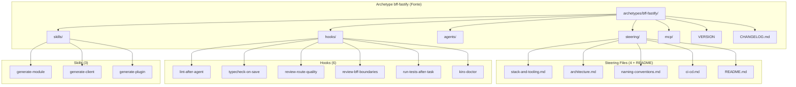
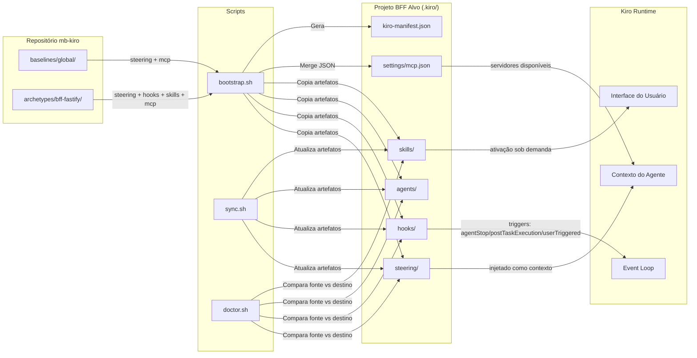

# Design Document — Archetype BFF Fastify

## Overview

Este design documenta a arquitetura e decisões técnicas do archetype `bff-fastify` — o pacote de configuração Kiro para projetos BFF (Backend for Frontend) com Fastify + TypeScript da MonteBravo. O archetype é um artefato declarativo composto por documentos markdown e JSON que, quando aplicados a um projeto via `bootstrap.sh`, fornecem ao Kiro todo o contexto necessário para orientar, revisar e gerar código conforme os padrões das RFC-0013 e RFC-0014.

O archetype opera em 5 categorias complementares:
1. **Steering Files** — Contexto técnico injetado nas interações do Kiro
2. **Hooks** — Automações disparadas por eventos do fluxo de desenvolvimento
3. **Agents** — Placeholder para revisores especializados (não implementados)
4. **Skills** — Geradores de código padronizado sob demanda
5. **MCP Config** — Configuração de servidores MCP (vazia, herda do baseline global)

Versão atual: `0.1.0` | Versionamento semântico independente.

---

## Architecture

### Diagrama de Componentes do Archetype



### Diagrama de Fluxo de Dados



### Decisões Arquiteturais

| Decisão | Escolha | Justificativa |
|---------|---------|---------------|
| Formato de steering files | Markdown sem frontmatter de inclusão | BFF-fastify usa steering files sem metadados `inclusion` — são copiados integralmente para o projeto alvo e injetados pelo Kiro conforme configuração do runtime |
| Formato de hooks | JSON (`.kiro.hook`) | Schema determinístico, validável, sem ambiguidade de parsing |
| Diretório agents/ vazio | Apenas README.md placeholder | Agents requerem design mais aprofundado (bff-architect, api-designer, resilience-reviewer, test-writer estão planejados mas não implementados) — manter estrutura pronta sem código morto |
| Skills com `inclusion: manual` | Ativação explícita pelo desenvolvedor | Geração de código requer inputs do usuário (nome do módulo, endpoints) — não pode ser automática |
| MCP vazio (`mcpServers: {}`) | Sem servidores MCP específicos | BFF Fastify não requer ferramentas MCP além do baseline global — Node.js debugging e profiling são feitos via ferramentas nativas |
| Hooks com verificação condicional | Prompt `askAgent` com check prévio de arquivos editados | Evita execuções desnecessárias — hooks silenciosos quando não há mudanças em `.ts` dentro de `src/` |
| Hook run-tests como `runCommand` | Execução direta sem lógica condicional | Testes devem rodar sempre após task de spec — sem exceção |
| Hooks de revisão separados | route-quality vs bff-boundaries | Separação de concerns — cada hook foca um aspecto (qualidade de API vs fronteiras arquiteturais), facilitando habilitação/desabilitação granular |
| Versionamento independente | Semver por archetype | Projetos consumidores atualizam de forma seletiva e rastreável |
| Sem design-system steering | Não aplicável para BFF | BFF não tem UI — diferente do archetype frontend-react que precisa de design-system.md |

---

## Components and Interfaces

### 1. Steering Files (4 + README)

Documentos markdown que definem as diretrizes técnicas da stack BFF Fastify. São a "memória organizacional" do Kiro — fornecem contexto para que o agente tome decisões alinhadas aos padrões da RFC-0013 e RFC-0014.

| Arquivo | Temas Cobertos |
|---------|----------------|
| `stack-and-tooling.md` | Stack base obrigatória (Node.js 20, Fastify 5, TS 5, Zod), justificativas RFC, ESM-first, tsconfig, scripts, packages compartilhados, Docker, tecnologias descartadas |
| `architecture.md` | Papel do BFF, princípios fundamentais, monólito modular, módulo como plugin, anatomia, fluxo de request, padrões de agregação, fronteiras, resiliência, observabilidade, health checks, versionamento API |
| `naming-conventions.md` | Diretórios kebab-case, sufixos por tipo de arquivo, módulos, rotas, schemas Zod, funções, classes, variáveis, tipos, plugins, variáveis de ambiente |
| `ci-cd.md` | Princípios (deploy independente, imutabilidade, rollback, zero downtime), estágios de pipeline (PR, merge, release), ambientes, container Docker multi-stage, monitoramento pós-deploy |
| `README.md` | Propósito dos steering files, modelo BFF por vertical, stack em tabela, estrutura de pastas, packages, comunicação downstream, error model, padrões de código, fronteiras, testes, checklist Kiro |

**Diferença do frontend-react:** Não há metadados `inclusion` (auto/fileMatch) no frontmatter dos steering files do bff-fastify. Os documentos não possuem frontmatter YAML — são markdown puro com header de identificação no formato blockquote.

### 2. Hooks (6 arquivos)

Automações JSON que disparam ações baseadas em eventos do Kiro. Organizados em 3 categorias funcionais:

#### Categoria A: Qualidade de Código (2 hooks)

| Hook | Trigger | Ação | Comando |
|------|---------|------|---------|
| `lint-after-agent.kiro.hook` | `agentStop` | `askAgent` | `pnpm lint` |
| `typecheck-on-save.kiro.hook` | `agentStop` | `askAgent` | `pnpm typecheck` |

**Padrão:** Verificação condicional — o prompt instrui o agente a primeiro checar se houve escrita em `.ts` dentro de `src/`. Se não houve, silêncio total. Se houve, executa o comando e reporta apenas erros.

#### Categoria B: Revisão Arquitetural (2 hooks)

| Hook | Trigger | Escopo de Revisão |
|------|---------|-------------------|
| `review-route-quality.kiro.hook` | `agentStop` | `.ts` em `src/modules/**/routes/` ou `src/modules/**/schemas/` |
| `review-bff-boundaries.kiro.hook` | `agentStop` | `.ts` em `src/modules/` |

**Padrão:** Mesmo padrão condicional. Cada hook revisa um aspecto específico:
- **route-quality**: Schemas Zod, separação de responsabilidades, plugin pattern, error handling, nomenclatura, prefixo de módulo.
- **bff-boundaries**: Zero regras de negócio, services orquestram clients, mappers puros, sem acesso a banco, módulos encapsulados.

Sugere correções quando encontra violações. Silencioso quando tudo está conforme.

#### Categoria C: Ciclo de Desenvolvimento (2 hooks)

| Hook | Trigger | Ação | Tipo |
|------|---------|------|------|
| `run-tests-after-task.kiro.hook` | `postTaskExecution` | `runCommand` | `pnpm test` |
| `kiro-doctor.kiro.hook` | `userTriggered` | `askAgent` | Diagnóstico completo |

**Padrão run-tests:** Execução direta via `runCommand` — sem lógica condicional, roda sempre após task.
**Padrão doctor:** Acionado manualmente. Gera relatório markdown com 8 seções comparando projeto vs archetype vs baseline.

### 3. Agents (0 funcionais — placeholder)

O diretório `agents/` contém apenas um `README.md` documentando os agents planejados:

| Agent Planejado | Especialidade | Status |
|-----------------|--------------|--------|
| `bff-architect` | Design de módulos e padrões de agregação | Não implementado |
| `bff-api-designer` | Design de contratos e DX para frontend | Não implementado |
| `bff-resilience-reviewer` | Circuit breakers, timeouts, retry, logs, tracing | Não implementado |
| `bff-test-writer` | Geração de testes unitários e de integração | Não implementado |

**Decisão:** Manter o diretório com README documentando a intenção futura. Agents não foram implementados porque requerem mais iteração no design de seus prompts e validação com times. A estrutura está pronta para adições sem breaking changes.

### 4. Skills (3 arquivos)

Geradores de código padronizado ativados sob demanda. Cada skill define inputs esperados, regras de geração e exemplos completos de output.

| Skill | Gera | Artefatos Principais |
|-------|------|---------------------|
| `generate-module.md` | Módulo BFF completo | `index.ts` (plugin), `routes/index.ts`, `routes/<verbo>-<recurso>.ts`, `schemas/<route>.schema.ts`, `services/<domain>.service.ts`, `services/<domain>.mapper.ts` |
| `generate-client.md` | Client HTTP tipado | Client class com timeout/retry/circuit breaker, plugin `clients.ts` com decorator, tipagem via `declare module 'fastify'` |
| `generate-plugin.md` | Plugin Fastify encapsulado | Arquivo em `src/app/plugins/`, função com sufixo `Plugin`, uso de `fp`, tipagem de decorators, JSDoc |

**Padrão de frontmatter:**
```yaml
---
name: "Nome Exibível em Português"
description: "Descrição do que a skill gera"
inclusion: manual
---
```

**Estrutura interna de cada skill:**
1. `## Quando usar` — Condições de ativação
2. `## Inputs esperados` — Parâmetros do desenvolvedor
3. `## Regras de geração` — Nomenclatura, estrutura, implementação
4. `## Exemplo de output` — Código completo gerado como referência

### 5. MCP Config (1 arquivo)

Configuração JSON de servidores MCP específicos para projetos BFF Fastify.

```json
{
  "_comment": "MCPs específicos do archetype bff-fastify. Mergeado com o baseline global no bootstrap.",
  "_version": "0.1.0",
  "mcpServers": {}
}
```

**Decisão:** O objeto `mcpServers` está intencionalmente vazio. Projetos BFF Fastify não requerem servidores MCP adicionais além dos definidos no baseline global. Ferramentas de debug (Node.js inspector, Fastify logger) são nativas. A estrutura existe para:
- Manter consistência com outros archetypes
- Permitir adições futuras sem mudança estrutural
- Ser mergeado corretamente pelo `bootstrap.sh` com o baseline global

### 6. Integração com Scripts de Automação

#### bootstrap.sh

O script `bootstrap.sh` aplica o archetype a um projeto BFF novo:

1. Copia steering files para `.kiro/steering/` (exclui READMEs)
2. Copia hooks para `.kiro/hooks/`
3. Copia agents/ para `.kiro/agents/` (apenas README.md no momento)
4. Copia skills para `.kiro/skills/`
5. Mergea `mcp.json` do archetype com baseline global em `.kiro/settings/mcp.json` (archetype vazio, então resultado = baseline)
6. Registra archetype no `kiro-manifest.json` com nome `bff-fastify` e versão

#### sync.sh

Atualiza artefatos do archetype em projetos existentes:
- Compara byte-a-byte os arquivos no projeto vs fonte no repositório
- Sobrescreve arquivos desatualizados, adiciona novos
- Atualiza `last_synced_at` no manifest

#### doctor.sh / kiro-doctor hook

Diagnostica conformidade do projeto com o archetype:
- Compara artefatos presentes no projeto vs esperados pelo archetype
- Identifica steering files ausentes, hooks desabilitados, skills faltantes
- Valida aderência arquitetural do código-fonte contra steering files
- Gera relatório com indicadores visuais (✅ ⚠️ ❌) e 8 seções

---

## Data Models

### Steering File Schema (bff-fastify)

```markdown
# Título do Steering File

> **Steering File | Archetype: bff-fastify | Versão: X.Y.Z**
>
> Descrição do propósito e escopo do arquivo.
>
> Baseado em: RFC-0013, RFC-0014 (quando aplicável)

---

## Seção 1
...

## Referências
- [Link](url)

---
*Versão: X.Y.Z | Última revisão: YYYY-MM | Próxima revisão: TODO*
```

**Nota:** Diferente do archetype frontend-react, os steering files do bff-fastify **não possuem frontmatter YAML** com campos `inclusion` ou `fileMatchPattern`. A identificação é feita via blockquote no topo do documento.

### Hook Schema

```json
{
  "enabled": true,
  "name": "Nome Exibível",
  "description": "Descrição do que o hook faz",
  "version": "1" | "2",
  "when": {
    "type": "agentStop" | "postTaskExecution" | "userTriggered"
  },
  "then": {
    "type": "askAgent" | "runCommand",
    "prompt": "string (quando askAgent)",
    "command": "string (quando runCommand)"
  }
}
```

**Versões:**
- `"1"`: Schema básico (usado em `run-tests-after-task` e `kiro-doctor`)
- `"2"`: Schema com suporte a verificação condicional no prompt (usado em hooks `agentStop` com check de arquivos editados)

### Skill Schema

```markdown
---
name: "string — Nome exibível em português"
description: "string — O que a skill gera"
inclusion: manual
---

# Título da Skill

## Quando usar
## Inputs esperados
## Regras de geração
## Exemplo de output
```

### MCP Config Schema

```json
{
  "_comment": "string — Identificação do propósito",
  "_version": "MAJOR.MINOR.PATCH",
  "mcpServers": {}
}
```

**Regras:**
- `_comment` obrigatório — documentação inline sobre merge com baseline
- `_version` segue semver — rastreabilidade de mudanças
- `mcpServers` objeto vazio — BFF não requer MCPs específicos

### VERSION File

```
MAJOR.MINOR.PATCH
```

- Sem prefixo `v`, sem espaços, sem trailing newline extra
- Regex: `^(0|[1-9][0-9]*)\.(0|[1-9][0-9]*)\.(0|[1-9][0-9]*)$`

### CHANGELOG.md

```markdown
# Changelog

## X.Y.Z (YYYY-MM-DD)

### Funcionalidades | Correções | Refatoração | Documentação | Manutenção | Performance | CI/CD
- Entrada descritiva
```

**Regra:** Versão mais recente no topo. Cada entrada deve ter ao menos uma seção de agrupamento válida.

### Estrutura de Diretórios

```
archetypes/bff-fastify/
├── agents/
│   └── README.md
├── hooks/
│   ├── README.md
│   ├── kiro-doctor.kiro.hook
│   ├── lint-after-agent.kiro.hook
│   ├── review-bff-boundaries.kiro.hook
│   ├── review-route-quality.kiro.hook
│   ├── run-tests-after-task.kiro.hook
│   └── typecheck-on-save.kiro.hook
├── mcp/
│   └── mcp.json
├── skills/
│   ├── README.md
│   ├── generate-client.md
│   ├── generate-module.md
│   └── generate-plugin.md
├── steering/
│   ├── README.md
│   ├── architecture.md
│   ├── ci-cd.md
│   ├── naming-conventions.md
│   └── stack-and-tooling.md
├── CHANGELOG.md
├── README.md
└── VERSION
```

---

## Correctness Properties

*Uma propriedade é uma característica ou comportamento que deve ser verdadeiro em todas as execuções válidas de um sistema — essencialmente, uma afirmação formal sobre o que o sistema deve fazer. Propriedades servem como ponte entre especificações legíveis por humanos e garantias de correção verificáveis por máquina.*

### Property 1: Completude estrutural do archetype

*Para qualquer* estrutura de archetype bff-fastify válida, os diretórios `steering/`, `hooks/`, `agents/`, `skills/` e `mcp/` SHALL existir, cada um contendo um `README.md`, e além disso: `steering/` SHALL conter ao menos 4 arquivos `.md` (excluindo README), `hooks/` SHALL conter ao menos 1 arquivo `.kiro.hook`, `skills/` SHALL conter ao menos 1 arquivo `.md` (excluindo README), e `mcp/` SHALL conter um `mcp.json`.

**Validates: Requirements 1.1, 1.2, 1.3, 1.4, 1.5, 1.9**

### Property 2: Formato de versão semântica

*Para qualquer* conteúdo do arquivo `VERSION`, a validação SHALL aceitar se e somente se a string seguir o formato `MAJOR.MINOR.PATCH` onde cada segmento é um inteiro não-negativo sem zeros à esquerda (exceto o próprio `0`), sem prefixo `v`, sem espaços e sem quebra de linha adicional.

**Validates: Requirements 1.6, 10.1**

### Property 3: Hooks habilitados e schema válido

*Para qualquer* arquivo `.kiro.hook` no diretório `hooks/` do archetype, o conteúdo SHALL ser JSON válido contendo os campos obrigatórios `enabled` (com valor `true`), `name` (string não-vazia), `version` (string `"1"` ou `"2"`), `when.type` (um de `agentStop`, `postTaskExecution`, `userTriggered`) e `then.type` (um de `askAgent`, `runCommand`), com `then.prompt` presente quando `then.type` é `askAgent` e `then.command` presente quando `then.type` é `runCommand`.

**Validates: Requirements 3.1, 3.2, 3.3, 3.4, 4.1, 4.2, 5.1, 6.1**

### Property 4: Frontmatter de skills

*Para qualquer* arquivo `.md` no diretório `skills/` (excluindo `README.md`), o frontmatter YAML SHALL conter exatamente os campos `name` (string não-vazia), `description` (string não-vazia) e `inclusion` com valor `"manual"`.

**Validates: Requirements 7.4**

### Property 5: Schema de configuração MCP

*Para qualquer* arquivo `mcp.json` válido do archetype bff-fastify, ele SHALL conter: um campo `_comment` (string não-vazia), um campo `_version` (semver válido no formato `MAJOR.MINOR.PATCH`) e um campo `mcpServers` (objeto — pode estar vazio).

**Validates: Requirements 8.1, 8.2**

### Property 6: Formato de changelog

*Para qualquer* arquivo `CHANGELOG.md` válido do archetype, a primeira entrada de versão SHALL seguir o formato `## MAJOR.MINOR.PATCH (YYYY-MM-DD)`, e cada seção de agrupamento dentro de uma entrada SHALL usar exclusivamente um dos 7 nomes válidos: Funcionalidades, Correções, Documentação, Refatoração, Manutenção, Performance, CI/CD.

**Validates: Requirements 1.7, 10.2**

### Property 7: Precedência de version bump

*Para qualquer* conjunto de mudanças em uma release que se enquadram em múltiplas categorias de incremento (MAJOR: remoção/renomeação de steering ou hook; MINOR: adição de steering, skill ou diretriz; PATCH: correção de texto/prompt), a função de cálculo de bump SHALL retornar apenas o incremento de maior precedência (MAJOR > MINOR > PATCH).

**Validates: Requirements 10.3, 10.4, 10.5, 10.6**

### Property 8: Ausência de agents funcionais

*Para qualquer* arquivo no diretório `agents/` do archetype bff-fastify, se o arquivo não for `README.md`, então ele SHALL não existir (ou seja, o único arquivo permitido é `README.md`).

**Validates: Requirements 9.1, 9.2**

---

## Error Handling

### Erros de Estrutura (detectados pelo doctor)

| Cenário | Detecção | Ação |
|---------|----------|------|
| Steering file ausente | `doctor.sh` / hook kiro-doctor | Reporta ❌ + instrui sync |
| Hook desabilitado | `doctor.sh` / hook kiro-doctor | Reporta ⚠️ + sugere reabilitar |
| Skill ausente | `doctor.sh` / hook kiro-doctor | Reporta ❌ + instrui sync |
| MCP desalinhado com baseline | `doctor.sh` / hook kiro-doctor | Reporta ⚠️ + sugere merge |
| VERSION inválido | Validação do release | Bloqueia + reporta formato |
| CHANGELOG sem entrada | Validação do release | Bloqueia + instrui criar |

### Erros de Bootstrap

| Cenário | Comportamento |
|---------|---------------|
| Archetype `bff-fastify` não encontrado | Exit 1 + lista archetypes válidos |
| Target não existe | Exit 1 + mensagem de erro |
| Manifest já existe (sem --force) | Pergunta ao usuário se deseja continuar |
| Arquivo já existe no destino | Skip + WARNING (sem --force) ou sobrescreve (com --force) |
| jq indisponível | Gera manifest via heredoc, sem validação JSON |

### Erros de Hooks em Runtime

| Cenário | Comportamento |
|---------|---------------|
| `pnpm lint` falha (exit ≠ 0) | Hook reporta erros de lint ao usuário |
| `pnpm typecheck` falha | Hook reporta erros de tipo ao usuário |
| Nenhum arquivo `.ts` em `src/` editado | Hook silencioso — não produz saída |
| `pnpm test` falha após task | Resultados de teste exibidos ao desenvolvedor |
| Violação de fronteiras detectada | Hook sugere correções específicas |
| Violação de qualidade de rota | Hook sugere correções com referência à RFC-0014 |

---

## Testing Strategy

### Abordagem

O archetype bff-fastify é um pacote de configuração declarativo (documentos markdown + JSON). A estratégia de testes foca em **validação estrutural e de schema** dos artefatos, não em lógica algorítmica complexa. Property-based testing é aplicável para validações de formato que devem ser universalmente verdadeiras.

### Testes de Propriedade (property-based)

**Biblioteca:** bats-core com funções auxiliares de geração aleatória (padrão do repositório mb-kiro).

**Configuração:**
- Mínimo 100 iterações por property test
- Cada property test referencia a propriedade do design document
- Tag format: **Feature: archetype-bff-fastify, Property {number}: {property_text}**

| Property | Foco | Iterações |
|----------|------|-----------|
| 1 - Completude estrutural | Diretórios, artefatos obrigatórios e READMEs | 100 |
| 2 - Formato semver | Validação de strings VERSION | 100 |
| 3 - Hooks habilitados + schema | JSON válido, enabled=true, campos obrigatórios | 100 |
| 4 - Frontmatter skills | Campos name, description, inclusion: manual | 100 |
| 5 - Schema MCP | Validação de mcp.json (_comment, _version, mcpServers) | 100 |
| 6 - Formato changelog | Estrutura, ordem e seções válidas | 100 |
| 7 - Precedência bump | Lógica MAJOR > MINOR > PATCH | 100 |
| 8 - Ausência de agents | Apenas README.md em agents/ | 100 |

### Testes Unitários (example-based)

Focam em verificações específicas que não justificam geração aleatória:

| Cenário | O que verifica |
|---------|----------------|
| Steering files existem | 4 arquivos + README presentes com nomes corretos |
| Conteúdo de stack-and-tooling | Seções: stack base, Fastify justificativa, Zod justificativa, ESM, tsconfig, scripts, packages, Docker, descartadas |
| Conteúdo de architecture | Seções: papel do BFF, princípios, monólito modular, módulo como plugin, anatomia, fluxo request, agregação, fronteiras, resiliência, observabilidade |
| Conteúdo de naming-conventions | Tabela com sufixos mapeados (.schema.ts, .service.ts, .mapper.ts, etc.) |
| Conteúdo de ci-cd | Seções: princípios, pipeline PR/merge/release, ambientes, container, monitoramento |
| Hook lint executa pnpm lint | Prompt contém comando específico `pnpm lint` |
| Hook typecheck executa pnpm typecheck | Prompt contém comando `pnpm typecheck` |
| Hook route-quality revisa 6 aspectos | Prompt lista schemas Zod, separação, plugin pattern, error handling, nomenclatura, prefixo |
| Hook bff-boundaries revisa 8 regras | Prompt lista zero regras de negócio, services orquestram, mappers puros, sem banco, etc. |
| Hook doctor gera 8 seções | Prompt lista as 8 seções e instrui salvar como `kiro-doctor-report.md` |
| Hook run-tests usa runCommand | Campo `then.type` = `runCommand`, `then.command` = `pnpm test` |
| Skill generate-module gera 6 artefatos | Documenta index.ts, routes/index.ts, rota, schema, service, mapper |
| Skill generate-client padrões resiliência | Documenta timeout, retry, circuit breaker, correlation ID, undici/fetch |
| Skill generate-plugin padrões Fastify | Documenta plugins/, sufixo Plugin, fp, declare module, JSDoc |
| MCP mcpServers vazio | Campo `mcpServers` é `{}` |
| Agents README lista planejados | README menciona bff-architect, api-designer, resilience-reviewer, test-writer |

### Testes de Integração

| Cenário | O que verifica |
|---------|----------------|
| Bootstrap aplica archetype bff-fastify | Todos os artefatos copiados para `.kiro/` do projeto alvo |
| Sync atualiza archetype | Steering desatualizado é sobrescrito, novo hook é adicionado |
| Doctor detecta artefatos ausentes | Relatório marca como ❌ steering ou hook faltante |
| Doctor passa com projeto completo | Relatório mostra ✅ em todas as categorias |
| Doctor detecta hook desabilitado | Relatório marca como ⚠️ hook com enabled=false |

### Estrutura de Testes

```
tests/
├── unit/
│   ├── test_archetype_bff_steering.bats
│   ├── test_archetype_bff_hooks.bats
│   ├── test_archetype_bff_skills.bats
│   ├── test_archetype_bff_mcp.bats
│   └── test_archetype_bff_agents.bats
├── properties/
│   ├── prop_bff_structure.bats
│   ├── prop_semver.bats
│   ├── prop_hooks_schema.bats
│   ├── prop_frontmatter_skills.bats
│   ├── prop_mcp_schema.bats
│   ├── prop_changelog_format.bats
│   ├── prop_version_bump.bats
│   └── prop_agents_empty.bats
└── integration/
    ├── test_bootstrap_bff.bats
    ├── test_sync_bff.bats
    └── test_doctor_bff.bats
```
