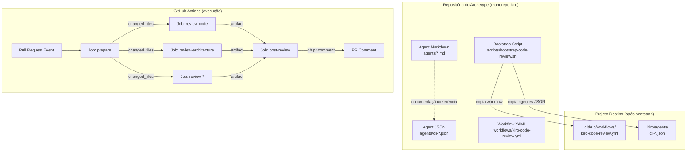
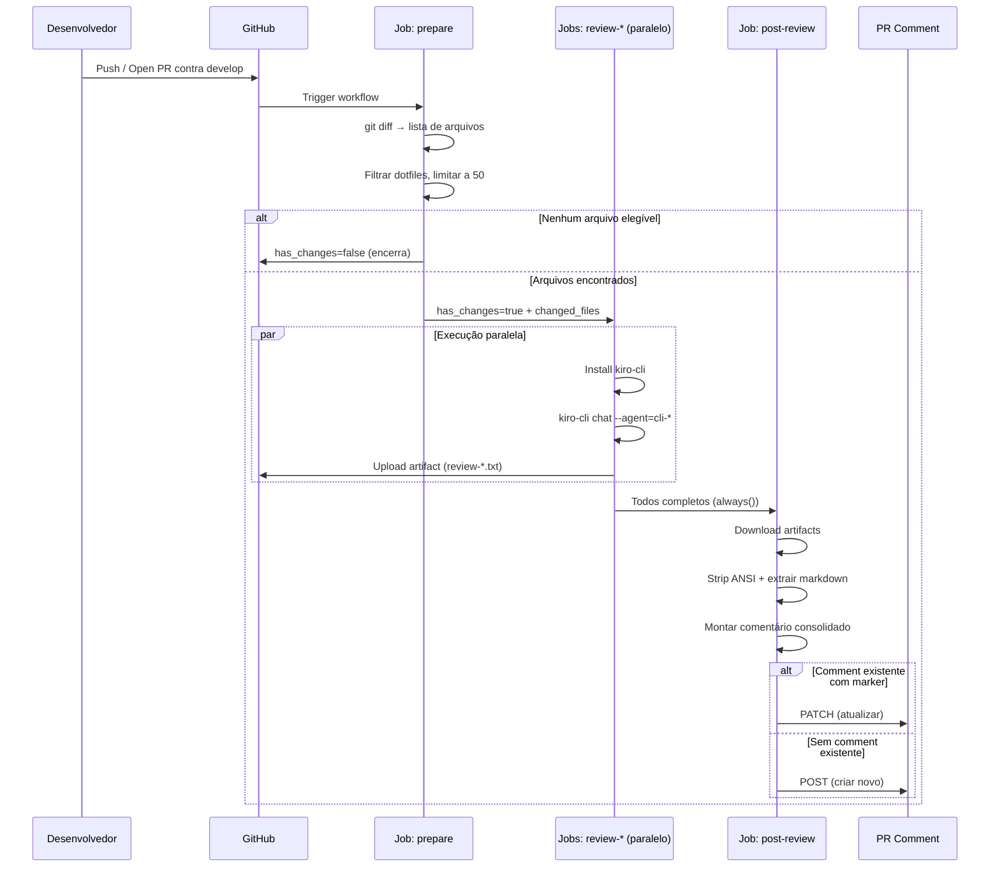
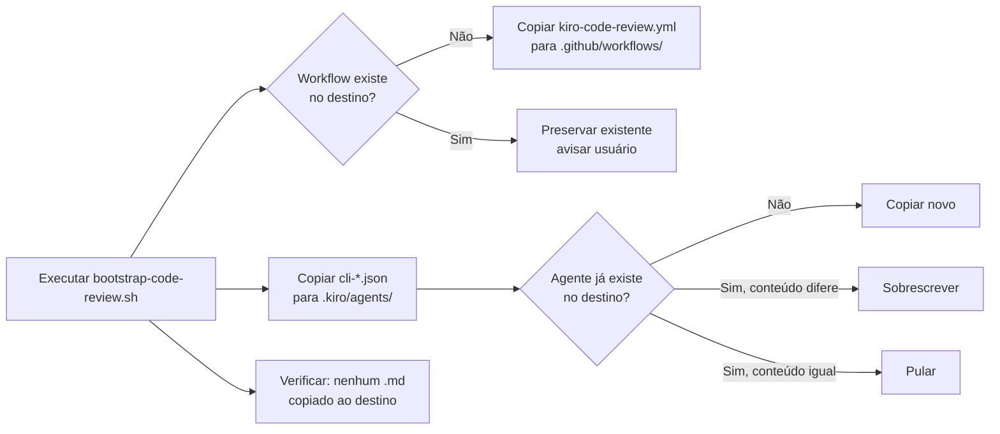

# Design Document: Code Review Automatizado via Kiro CLI

## Overview

Este design descreve a implementação de code review automatizado para Pull Requests usando **Kiro CLI em modo headless** com agentes especializados por archetype. Cada archetype (frontend-react, backend-csharp, bff-fastify) define seus próprios agentes de revisão que executam em paralelo via GitHub Actions, consolidando os resultados em um único comentário no PR.

### Princípios de Design

1. **Zero dependências externas no CI**: O workflow requer apenas `kiro-cli` (instalado via curl) e `gh` CLI (pré-instalado nos runners GitHub Actions). Nenhum Node.js, npm ou dependência adicional.
2. **Formato dual de agentes**: Markdown (.md) para documentação/revisão humana + JSON (.json) para execução CLI.
3. **Consolidação shell-based**: Processamento de resultados via bash puro (perl para ANSI strip, sed para extração de conteúdo).
4. **Idempotência**: O comentário no PR é atualizado (não duplicado) a cada push.
5. **Resiliência**: Falha de um agente não bloqueia os demais nem o pipeline.

### Escopo Explícito

Esta feature **NÃO inclui**:
- Lint (ESLint, dotnet format)
- Type check (tsc, dotnet build)
- Security scan de dependências (pnpm audit, dotnet list --vulnerable)
- Scripts de validação customizados (check-missing-tests.sh, etc.)

Essas responsabilidades pertencem aos pipelines de CI/CD existentes do time de arquitetura.

## Architecture

### Diagrama de Componentes



### Diagrama de Sequência do Workflow



### Diagrama de Bootstrap



## Components and Interfaces

### 1. Agent Markdown (Documentação)

Arquivo `.md` com frontmatter YAML que serve como documentação legível e fonte de verdade para o comportamento do agente.

**Localização**: `archetypes/{archetype}/agents/{specialty}-reviewer.md`

**Estrutura obrigatória**:
```markdown
---
name: "Nome do Agente"
description: "Descrição concisa do propósito do agente."
---

# Nome do Agente

## Papel
[Definição do papel do agente]

## Contexto
[Stack, ferramentas e contexto organizacional]

## O que revisar
[Checklist categorizado de itens a revisar]

## Formato de resposta
[Instruções de formatação do output]
```

### 2. Agent JSON (Execução CLI)

Arquivo `.json` compatível com `kiro-cli chat --agent=<name>` para execução headless.

**Localização no archetype**: `archetypes/{archetype}/agents/cli-{specialty}-reviewer.json`
**Localização no projeto destino**: `.kiro/agents/cli-{specialty}-reviewer.json`

**Interface**:
```typescript
interface AgentJSON {
  name: string;           // Identificador do agente (ex: "cli-code-reviewer")
  description: string;    // Descrição concisa
  instructions: string;   // System prompt completo (conteúdo do .md sem frontmatter)
}
```

### 3. Workflow YAML (Orquestração)

Arquivo GitHub Actions que orquestra a execução paralela dos agentes.

**Localização no archetype**: `archetypes/{archetype}/workflows/kiro-code-review.yml`
**Localização no projeto destino**: `.github/workflows/kiro-code-review.yml`

**Jobs**:
| Job | Propósito | Dependências |
|-----|-----------|--------------|
| `prepare` | Obtém lista de arquivos alterados | Nenhuma |
| `review-code` | Executa code-reviewer | `prepare` |
| `review-architecture` | Executa architecture-reviewer | `prepare` |
| `review-{specialty}` | Executa agente especializado | `prepare` |
| `post-review` | Consolida e publica comentário | Todos os review-* |

### 4. Bootstrap Script

Script bash que provisiona o workflow e agentes no projeto destino.

**Localização**: `archetypes/{archetype}/scripts/bootstrap-code-review.sh`

**Interface CLI**:
```bash
./bootstrap-code-review.sh [--force]
```

**Comportamento**:
- Sem `--force`: preserva `kiro-code-review.yml` existente
- Com `--force`: sobrescreve tudo

### 5. Agentes por Archetype

| Archetype | Agentes |
|-----------|---------|
| `frontend-react` | code-reviewer, architecture-reviewer, accessibility-reviewer, performance-reviewer |
| `backend-csharp` | code-reviewer, architecture-reviewer, security-reviewer, performance-reviewer |
| `bff-fastify` | code-reviewer, architecture-reviewer, api-contract-reviewer, performance-reviewer |

### 6. Comportamento de Aplicabilidade dos Agentes

Cada agente especializado possui um mecanismo de detecção de aplicabilidade baseado nos arquivos alterados no PR:

- **Se nenhum arquivo relevante à especialidade for detectado**: O agente confirma brevemente a não-aplicabilidade sem produzir feedback detalhado (ex: accessibility-reviewer em PR sem componentes UI).
- **Se arquivos relevantes à especialidade forem detectados**: O agente DEVE produzir revisão completa seguindo todas as suas instruções de "O que revisar" e "Formato de resposta" — não basta confirmar aplicabilidade parcial.

> **Regra (Req 5 AC7)**: A detecção de arquivos aplicáveis é condição suficiente para produção de revisão completa. Ou seja, se o agente identifica que há arquivos relevantes nos changed files, ele é obrigado a produzir a revisão detalhada. O prompt do workflow instrui isso explicitamente: "If no UI components were changed, confirm that briefly" (para accessibility) — o inverso implica revisão completa obrigatória.

## Data Models

### Agent JSON Schema

```json
{
  "$schema": "http://json-schema.org/draft-07/schema#",
  "title": "Kiro CLI Agent Definition",
  "type": "object",
  "required": ["name", "description", "instructions"],
  "properties": {
    "name": {
      "type": "string",
      "pattern": "^cli-[a-z]+-reviewer$",
      "description": "Identificador único do agente com prefixo cli-"
    },
    "description": {
      "type": "string",
      "minLength": 10,
      "maxLength": 200,
      "description": "Descrição concisa do propósito do agente"
    },
    "instructions": {
      "type": "string",
      "minLength": 100,
      "description": "System prompt completo do agente (conteúdo do markdown sem frontmatter)"
    }
  },
  "additionalProperties": false
}
```

### Workflow Structure (por archetype)

```yaml
# Estrutura lógica do workflow
name: "Kiro Code Review"
on:
  pull_request:
    branches: [develop]
    types: [opened, synchronize, reopened]
permissions:
  contents: read
  pull-requests: write
jobs:
  prepare:
    outputs: [has_changes, changed_files]
  review-{agent}:  # N jobs paralelos
    needs: [prepare]
    steps: [checkout, install-kiro-cli, run-agent, upload-artifact]
  post-review:
    needs: [prepare, ...review-agents]
    if: always() && has_changes
    steps: [checkout, download-artifacts, consolidate, post-comment]
```

### PR Comment Structure

```markdown
<!-- kiro-code-review-bot -->
## 🤖 Kiro Code Review

Revisão automática executada por N agentes especializados.

---

### {emoji} {Título do Agente}

<details>
<summary>Expandir revisão de {especialidade}</summary>

{conteúdo extraído do artifact}

</details>

[...repetir para cada agente...]

---
*Revisão automática por [Kiro CLI](https://kiro.dev) · agentes: {lista}*
```

### Agent Markdown Frontmatter Schema

```yaml
# Campos obrigatórios no frontmatter
name: string     # Nome legível do agente (pt-BR)
description: string  # Descrição em uma frase
```

### Mapeamento Agente → Emoji/Título (por archetype)

| Agente | Emoji | Título |
|--------|-------|--------|
| code-reviewer | 📝 | Qualidade de Código |
| architecture-reviewer | 🏗️ | Arquitetura |
| accessibility-reviewer | ♿ | Acessibilidade |
| performance-reviewer | ⚡ | Performance |
| security-reviewer | 🔒 | Segurança |
| api-contract-reviewer | 📋 | Contrato de API |

## Correctness Properties

*Uma propriedade é uma característica ou comportamento que deve ser verdadeiro em todas as execuções válidas de um sistema — essencialmente, uma declaração formal sobre o que o sistema deve fazer. Propriedades servem como ponte entre especificações legíveis para humanos e garantias de corretude verificáveis por máquina.*

### Property 1: Validação estrutural do Agent Markdown

*Para qualquer* Agent_Markdown válido, parsear o arquivo deve extrair com sucesso os campos `name` e `description` do frontmatter YAML, e o corpo deve conter as seções obrigatórias: "Papel", "Contexto", "O que revisar" e "Formato de resposta".

**Validates: Requirements 1.3**

### Property 2: Validação de schema do Agent JSON

*Para qualquer* objeto JSON gerado conforme o schema de Agent_JSON, a validação contra o JSON Schema deve passar, e os campos `name`, `description` e `instructions` devem estar presentes com tipos e constraints corretos (name com prefixo `cli-`, description entre 10-200 chars, instructions ≥ 100 chars).

**Validates: Requirements 1.4**

### Property 3: Filtragem de arquivos alterados

*Para qualquer* lista de nomes de arquivos (output de git diff), após aplicar a filtragem do job prepare, o resultado deve conter no máximo 50 arquivos e nenhum arquivo cujo caminho inicie com `.` (dotfile).

**Validates: Requirements 2.2**

### Property 4: Remoção completa de escape sequences ANSI

*Para qualquer* string contendo escape sequences ANSI arbitrárias, após aplicar a função de strip (perl regex), o resultado não deve conter nenhum escape sequence ANSI (padrão `\e[...m`, `\e]...\a`, `\e[?...`).

**Validates: Requirements 3.2**

### Property 5: Estrutura do comentário consolidado

*Para qualquer* conjunto de N resultados de agentes (incluindo resultados ausentes), o comentário consolidado deve: (a) iniciar com `<!-- kiro-code-review-bot -->`, (b) conter exatamente N seções `<details>`, (c) conter título "Kiro Code Review", (d) conter rodapé com lista de agentes, e (e) para cada agente sem resultado, exibir "Nenhum resultado disponível" na seção correspondente.

**Validates: Requirements 3.3, 3.4, 3.7, 6.4**

### Property 6: Bootstrap copia apenas JSON e preserva workflow existente

*Para qualquer* archetype com M agentes e qualquer estado do projeto destino, após executar o bootstrap: (a) todos os cli-*.json do archetype devem existir em `.kiro/agents/`, (b) nenhum arquivo `.md` de agente deve existir em `.kiro/agents/`, (c) se `kiro-code-review.yml` já existia no destino, seu conteúdo deve permanecer inalterado, e (d) arquivos cli-*.json customizados no destino que não existem no archetype devem ser preservados.

**Validates: Requirements 4.2, 4.3, 4.4, 4.5**

## Error Handling

### Falha de Agente Individual

| Cenário | Comportamento | Impacto |
|---------|--------------|---------|
| Kiro CLI não instala | Warning no workflow log | Artifact vazio, seção mostra fallback |
| Agente timeout | `KIRO_EXIT=$?` captura, warning emitido | Artifact parcial ou vazio |
| KIRO_API_KEY ausente/inválido | kiro-cli falha com auth error | Warning, artifact vazio |
| Agente retorna output inválido | Artifact salvo como-está | Consolidação exibe conteúdo raw |
| Upload de artifact falha | Warning emitido, job tratado como falho | Consolidação usa fallback "Nenhum resultado disponível" |

> **Nota**: Falha no upload de artifact (após execução bem-sucedida do agente) recebe o mesmo tratamento de erro de execução do agente — o workflow emite `::warning::` e continua sem bloquear o pipeline (Req 2 AC8).

### Falha de Consolidação

| Cenário | Comportamento |
|---------|--------------|
| Nenhum artifact disponível | Comment com todas as seções mostrando fallback |
| `gh` CLI não disponível | Fallback impossível — step falha mas não bloqueia PR |
| Comment body > 65535 chars (limite GitHub) | Truncar conteúdo mais extenso |
| API do GitHub rate limited | Uma retry automática; se persistir, erro no log |
| Falha ao criar/atualizar PR comment | Uma retry automática; se persistir, erro no log do workflow |

> **Padrão de Retry para PR Comment (Req 3 AC8)**: Quando a criação ou atualização do PR comment falha por erro de API (HTTP 5xx, timeout, rate limit), o workflow realiza **uma única tentativa adicional** (retry). Caso a segunda tentativa também falhe, o workflow emite um erro no log (`::error::`) sem bloquear o pipeline. Não há backoff exponencial — a retry é imediata.

### Falha de Bootstrap

| Cenário | Comportamento |
|---------|--------------|
| Diretório `.github/workflows` não existe | Criar automaticamente |
| Diretório `.kiro/agents` não existe | Criar automaticamente |
| Permissão negada no destino | Erro com mensagem clara |
| Archetype sem agentes cli-*.json | Warning, nenhum arquivo copiado |

### Padrão de Resiliência do Workflow

```yaml
# Cada job de agente segue este padrão:
run: |
  set -eo pipefail
  KIRO_EXIT=0
  kiro-cli chat ... > /tmp/review-*.txt 2>&1 || KIRO_EXIT=$?
  if [ $KIRO_EXIT -ne 0 ]; then
    echo "::warning::Agent exited with code $KIRO_EXIT"
  fi
# O artifact é uploaded independente do exit code
# Se o upload falhar, o job é tratado como falho (warning + continue)
```

O `post-review` usa `if: always()` e `continue-on-error: true` nos downloads de artifact, garantindo que a consolidação executa mesmo que agentes falhem.

### Padrão de Retry para Publicação de Comentário

```bash
# Retry com uma tentativa adicional para criação/atualização do PR comment
post_comment() {
  local attempt=1
  local max_attempts=2

  while [ $attempt -le $max_attempts ]; do
    if gh pr comment "$PR_NUMBER" --body-file /tmp/kiro-comment.md 2>/dev/null; then
      echo "Comment posted successfully on attempt $attempt"
      return 0
    fi
    echo "::warning::Comment post failed (attempt $attempt/$max_attempts)"
    attempt=$((attempt + 1))
  done

  echo "::error::Failed to post review comment after $max_attempts attempts"
  return 1
}
```

## Testing Strategy

### Testes Unitários (Example-Based)

| Componente | O que testar | Framework |
|------------|--------------|-----------|
| Bootstrap script | Cópia correta de arquivos, preservação de existentes | bats-core (bash testing) |
| Consolidation logic | Montagem de comment com inputs conhecidos | bats-core |
| Agent JSON | Validação contra schema com exemplos válidos/inválidos | ajv-cli |
| Workflow YAML | Lint de sintaxe, validação de estrutura | actionlint |

### Testes de Propriedade (Property-Based)

**Framework**: fast-check (TypeScript) para lógica de filtragem e consolidação.

**Configuração**: Mínimo 100 iterações por propriedade.

| Property | Tag |
|----------|-----|
| Property 1 | Feature: archetype-code-review, Property 1: Agent Markdown structure validation |
| Property 2 | Feature: archetype-code-review, Property 2: Agent JSON schema validation |
| Property 3 | Feature: archetype-code-review, Property 3: File filtering invariant |
| Property 4 | Feature: archetype-code-review, Property 4: ANSI stripping completeness |
| Property 5 | Feature: archetype-code-review, Property 5: Consolidated comment structure |
| Property 6 | Feature: archetype-code-review, Property 6: Bootstrap file copy correctness |

### Testes de Integração

| Cenário | Abordagem |
|---------|-----------|
| Workflow completo com act (local runner) | `act pull_request` com mock de kiro-cli |
| Bootstrap end-to-end | Script em diretório temporário, validar resultado |
| Comment posting | Mock do `gh` CLI, verificar corpo do comment |

### Testes de Smoke / CI Validation

| Verificação | Frequência |
|-------------|------------|
| Cada archetype tem todos os agentes definidos (.md + .json) | CI em cada PR do monorepo |
| YAML do workflow é válido (actionlint) | CI em cada PR |
| Agent JSON válido contra schema (ajv) | CI em cada PR |
| Frontmatter dos .md possui campos obrigatórios (`name`, `description`) | CI em cada PR |
| Seções obrigatórias presentes no Agent Markdown (Papel, Contexto, O que revisar, Formato de resposta) | CI em cada PR |

> **Validação CI do Agent Markdown (Req 1 AC8)**: Um step de CI valida a estrutura de cada Agent_Markdown. A validação verifica: (1) presença de frontmatter YAML com campos `name` e `description`, e (2) existência das seções obrigatórias no corpo: "Papel", "Contexto", "O que revisar" e "Formato de resposta". Se qualquer validação falhar, o PR é bloqueado com mensagem de erro indicando qual arquivo e qual campo/seção está faltando.

### Matriz de Cobertura

| Requirement | Smoke | Unit | Property | Integration |
|-------------|-------|------|----------|-------------|
| 1 (Agentes) | ✅ (CI validation) | ✅ | ✅ (P1, P2) | - |
| 2 (Workflow) | ✅ | ✅ | ✅ (P3) | ✅ (act) |
| 3 (Consolidação) | - | ✅ (retry) | ✅ (P4, P5) | ✅ |
| 4 (Bootstrap) | - | ✅ | ✅ (P6) | ✅ |
| 5 (Prompt/Contexto) | ✅ | ✅ (applicability) | - | ✅ |
| 6 (Adaptabilidade) | ✅ | - | ✅ (P5) | - |
