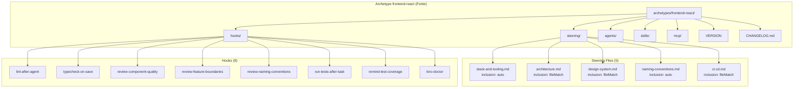
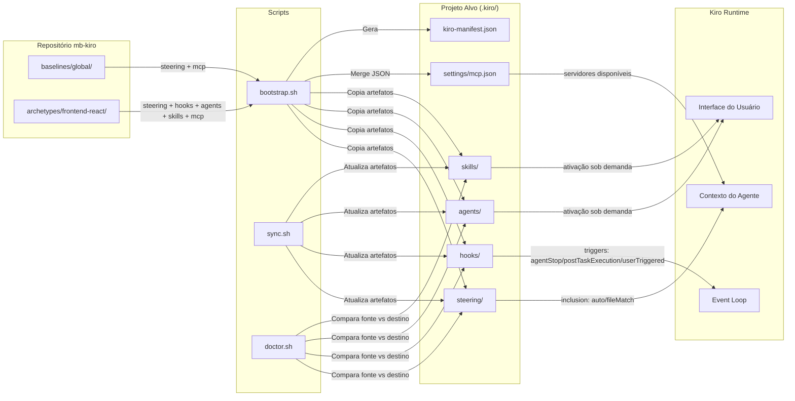

# Design Document — Archetype Frontend React

## Overview

Este design documenta a arquitetura e decisões técnicas do archetype `frontend-react` — o pacote de configuração Kiro para projetos frontend React/Next.js + TypeScript da MonteBravo. O archetype é um artefato declarativo composto exclusivamente por documentos markdown e JSON que, quando aplicados a um projeto via `bootstrap.sh`, fornecem ao Kiro todo o contexto necessário para orientar, revisar e gerar código conforme os padrões da organização.

O archetype opera em 5 categorias complementares:
1. **Steering Files** — Contexto técnico injetado nas interações do Kiro
2. **Hooks** — Automações disparadas por eventos do fluxo de desenvolvimento
3. **Agents** — Revisores especializados sob demanda
4. **Skills** — Geradores de código padronizado sob demanda
5. **MCP Config** — Servidores MCP específicos da stack

Versão atual: `0.1.1` | Versionamento semântico independente.

---

## Architecture

### Diagrama de Componentes do Archetype



### Diagrama de Fluxo de Dados



### Decisões Arquiteturais

| Decisão | Escolha | Justificativa |
|---------|---------|---------------|
| Formato de steering files | Markdown + YAML frontmatter | Legível por humanos, parseável por máquina, suporta metadados de inclusão |
| Formato de hooks | JSON (`.kiro.hook`) | Schema determinístico, validável, sem ambiguidade de parsing |
| Formato de agents e skills | Markdown + YAML frontmatter | Permite prompts longos e formatados com metadados estruturados |
| Inclusão seletiva de steering | `auto` / `fileMatch` / `manual` | Otimiza contexto do agente — injeta apenas o relevante para o arquivo em edição |
| Hooks com verificação condicional | Prompt `askAgent` com check prévio | Evita execuções desnecessárias — hooks silenciosos quando não há mudanças relevantes |
| Agents separados de hooks | Invocação sob demanda vs automática | Revisões profundas são caras — devem ser acionadas intencionalmente |
| Skills com `inclusion: manual` | Ativação explícita pelo desenvolvedor | Geração de código requer inputs do usuário — não pode ser automática |
| MCP merge no bootstrap | baseline + archetype | Archetype herda MCPs globais e adiciona os específicos da stack |
| Versionamento independente | Semver por archetype | Projetos consumidores atualizam de forma seletiva e rastreável |

---

## Components and Interfaces

### 1. Steering Files (5 arquivos)

Documentos markdown com frontmatter YAML que definem as diretrizes técnicas da stack. São a "memória organizacional" do Kiro — fornecem contexto para que o agente tome decisões alinhadas aos padrões.

| Arquivo | Inclusão | Padrão fileMatch | Temas Cobertos |
|---------|----------|------------------|----------------|
| `stack-and-tooling.md` | `auto` | — | Stack base, monorepo, ferramental, tecnologias descartadas |
| `architecture.md` | `fileMatch` | `**/modules/**, **/src/app/**` | Monolito modular, FSD, fronteiras, estado |
| `design-system.md` | `fileMatch` | `**/*.tsx, **/shared/ui/**, **/*.variants.ts` | Token-first, Base UI, Storybook, qualidade |
| `naming-conventions.md` | `auto` | — | Diretórios, arquivos, hooks, selectors, tipos |
| `ci-cd.md` | `fileMatch` | `**/.github/**, **/turbo.json, **/Dockerfile*` | Pipelines, deploy, orquestração |

**Estratégia de inclusão:**
- `auto`: injetado em **todas** as interações — usado para regras universais (stack, nomenclatura).
- `fileMatch`: injetado apenas quando o arquivo em edição corresponde ao padrão glob — usado para regras contextuais (arquitetura só quando editando módulos, CI/CD só quando editando pipelines).
- `manual`: usuário ativa explicitamente — não usado nos steering files do archetype, apenas em skills.

### 2. Hooks (8 arquivos)

Automações JSON que disparam ações baseadas em eventos do Kiro. Organizados em 3 categorias funcionais:

#### Categoria A: Qualidade de Código (2 hooks)

| Hook | Trigger | Ação | Comando |
|------|---------|------|---------|
| `lint-after-agent.kiro.hook` | `agentStop` | `askAgent` | `pnpm turbo lint --affected` |
| `typecheck-on-save.kiro.hook` | `agentStop` | `askAgent` | `npx tsc --noEmit --pretty` |

**Padrão:** Verificação condicional — o prompt instrui o agente a primeiro checar se houve escrita em `.ts`/`.tsx` dentro de `src/`. Se não houve, silêncio total. Se houve, executa o comando e reporta apenas erros.

#### Categoria B: Revisão Arquitetural (3 hooks)

| Hook | Trigger | Escopo de Revisão |
|------|---------|-------------------|
| `review-component-quality.kiro.hook` | `agentStop` | `.tsx` em `**/ui/` ou `**/components/` |
| `review-feature-boundaries.kiro.hook` | `agentStop` | `.ts`/`.tsx` em `src/modules/` |
| `review-naming-conventions.kiro.hook` | `agentStop` | Criação de `.ts`/`.tsx` em `src/` |

**Padrão:** Mesmo padrão condicional. Cada hook revisa um aspecto específico (acessibilidade+tipagem+tokens, fronteiras FSD, nomenclatura). Sugere correções quando encontra violações. Silencioso quando tudo está conforme.

#### Categoria C: Ciclo de Desenvolvimento (3 hooks)

| Hook | Trigger | Ação | Tipo |
|------|---------|------|------|
| `run-tests-after-task.kiro.hook` | `postTaskExecution` | `runCommand` | `npx vitest --run --reporter=verbose` |
| `remind-test-coverage.kiro.hook` | `postTaskExecution` | `askAgent` | Verifica cobertura de testes |
| `kiro-doctor.kiro.hook` | `userTriggered` | `askAgent` | Diagnóstico completo do projeto |

**Padrão run-tests:** Execução direta via `runCommand` — sem lógica condicional, roda sempre após task.
**Padrão remind-coverage:** Verifica mapeamento arquivo→teste segundo convenções (`.tsx` → `.test.tsx`, `.hook.ts` → `.hook.test.ts`, etc.).
**Padrão doctor:** Acionado manualmente. Gera relatório markdown com 8 seções comparando projeto vs archetype vs baseline.

### 3. Agents (4 arquivos)

Revisores especializados ativados sob demanda pelo desenvolvedor. Cada agent é um markdown com frontmatter que define escopo, critérios de revisão e formato de resposta.

| Agent | Especialidade | Formato de Output |
|-------|--------------|-------------------|
| `accessibility-reviewer.md` | WCAG 2.1 AA, semântica, ARIA, teclado, contraste | 5 campos: localização, problema, critério WCAG, correção, severidade |
| `architecture-reviewer.md` | Fronteiras, FSD, acoplamento, estado, anti-padrões | 5 campos: localização, problema, princípio violado, sugestão, impacto |
| `code-reviewer.md` | TypeScript, React, testes, nomenclatura, segurança | 3 níveis: bloqueante, importante, sugestão |
| `performance-reviewer.md` | Re-renders, memoização, bundle, RTK Query, virtualização | 5 campos: localização, problema, impacto, correção, como medir |

**Padrão de frontmatter:**
```yaml
---
name: "Nome Exibível em Português"
description: "Descrição da especialidade do agente (até ~200 chars)"
---
```

**Estrutura interna de cada agent:**
1. `## Papel` — Define a persona do agente
2. `## Contexto` — Stack e decisões arquiteturais relevantes
3. `## O que revisar` — Lista categorizada de critérios
4. `## Formato de resposta` — Como estruturar o feedback
5. `## Referências` — Steering files e documentação externa

### 4. Skills (7 arquivos)

Geradores de código padronizado ativados sob demanda. Cada skill define inputs esperados, regras de geração (com referências a steering files) e exemplos completos de output.

| Skill | Gera | Artefatos |
|-------|------|-----------|
| `generate-component.md` | Componente React | `.tsx`, `.test.tsx`, `.stories.tsx`, `.variants.ts` (opcional), `index.ts` |
| `generate-hook.md` | Custom hook | `use-*.hook.ts`, `use-*.hook.test.ts` |
| `generate-redux-slice.md` | Redux slice | `.slice.ts`, `.selectors.ts`, `.slice.test.ts`, `.selectors.test.ts`, `index.ts` |
| `generate-api-endpoint.md` | RTK Query endpoint | `.api.ts`, `.api.test.ts` |
| `generate-page.md` | Página React | `.page.tsx`, tratamento de 4 estados |
| `generate-module.md` | Módulo FSD completo | Estrutura `pages/`, `widgets/`, `features/`, `entities/`, `shared/`, `index.ts` |
| `generate-context-provider.md` | Context + Provider | `.context.tsx`, `.provider.tsx`, `.provider.test.tsx` |

**Padrão de frontmatter:**
```yaml
---
name: "Nome Exibível em Português"
description: "Descrição do que a skill gera"
inclusion: manual
---
```

**Estrutura interna de cada skill:**
1. `## Quando usar` — Condições de ativação
2. `## Inputs esperados` — Parâmetros do desenvolvedor
3. `## Regras de geração` — Nomenclatura, FSD, implementação, testes
4. `## Exemplo de output` — Código completo gerado como referência

### 5. MCP Config (1 arquivo)

Configuração JSON de servidores MCP específicos para desenvolvimento frontend.

```json
{
  "_comment": "MCPs específicos do archetype frontend-react.",
  "_version": "0.1.0",
  "mcpServers": {
    "chrome-devtools": {
      "_comment": "Chrome DevTools MCP — Controle e inspeção de Chrome ao vivo.",
      "command": "npx",
      "args": ["-y", "chrome-devtools-mcp@latest"],
      "disabled": false,
      "autoApprove": []
    }
  }
}
```

**Decisão:** Apenas `chrome-devtools` como MCP específico da stack frontend, pois permite inspeção de DOM, network e console diretamente do Kiro durante desenvolvimento.

### 6. Integração com Scripts de Automação

#### bootstrap.sh

O script `bootstrap.sh` aplica o archetype a um projeto novo:

1. Copia steering files para `.kiro/steering/` (exclui READMEs)
2. Copia hooks para `.kiro/hooks/`
3. Copia agents para `.kiro/agents/`
4. Copia skills para `.kiro/skills/`
5. Mergea `mcp.json` do archetype com baseline global em `.kiro/settings/mcp.json` (archetype tem precedência em caso de conflito)
6. Registra archetype no `kiro-manifest.json` com nome e versão

#### sync.sh

Atualiza artefatos do archetype em projetos existentes:
- Compara byte-a-byte os arquivos no projeto vs fonte no repositório
- Sobrescreve arquivos desatualizados, adiciona novos
- Atualiza `last_synced_at` no manifest

#### doctor.sh / kiro-doctor hook

Diagnostica conformidade do projeto com o archetype:
- Compara artefatos presentes no projeto vs esperados pelo archetype
- Identifica steering files ausentes, hooks desabilitados, skills faltantes
- Gera relatório com indicadores visuais (✅ ⚠️ ❌)

---

## Data Models

### Steering File Schema

```yaml
---
inclusion: auto | fileMatch | manual
fileMatchPattern: "glob1, glob2, ..."  # Obrigatório quando inclusion: fileMatch
---

# Título do Steering File

> **Steering File | Archetype: frontend-react | Versão: X.Y.Z**

## Seção 1
...

## Referências
- [Link](url)

---
*Versão: X.Y.Z | Última revisão: YYYY-MM | Próxima revisão: TODO*
```

### Hook Schema

```json
{
  "enabled": true,
  "name": "Nome Exibível",
  "description": "Descrição do que o hook faz",
  "version": "1" | "2",
  "when": {
    "type": "agentStop" | "postTaskExecution" | "userTriggered"
  },
  "then": {
    "type": "askAgent" | "runCommand",
    "prompt": "string (quando askAgent)",
    "command": "string (quando runCommand)"
  },
  "workspaceFolderName": "string (opcional — filtra por workspace)",
  "shortName": "string (opcional — identificador curto)"
}
```

**Campos opcionais:**
- `workspaceFolderName`: Restringe execução a um workspace específico no monorepo
- `shortName`: Identificador curto para referência rápida

**Versões:**
- `"1"`: Schema básico (usado em hooks simples como `run-tests-after-task`)
- `"2"`: Schema com suporte a verificação condicional no prompt (usado em hooks `agentStop`)

### Agent Schema

```markdown
---
name: "string — Nome exibível em português"
description: "string — Especialidade do agente (até ~200 chars)"
---

# Título do Agent

## Papel
## Contexto
## O que revisar
## Formato de resposta
## Referências
```

### Skill Schema

```markdown
---
name: "string — Nome exibível em português"
description: "string — O que a skill gera"
inclusion: manual
---

# Título da Skill

## Quando usar
## Inputs esperados
## Regras de geração
## Exemplo de output
```

### MCP Config Schema

```json
{
  "_comment": "string — Identificação do propósito",
  "_version": "MAJOR.MINOR.PATCH",
  "mcpServers": {
    "<server-name>": {
      "_comment": "string não-vazia — funcionalidade e pré-requisitos",
      "command": "string — executável",
      "args": ["string — argumentos"],
      "disabled": false,
      "autoApprove": []
    }
  }
}
```

**Regras:**
- `autoApprove` sempre `[]` — segurança: toda operação MCP requer aprovação explícita
- `_comment` obrigatório em cada servidor — documentação inline
- `_version` segue semver — rastreabilidade de mudanças

### VERSION File

```
MAJOR.MINOR.PATCH
```

- Sem prefixo `v`, sem espaços, sem trailing newline
- Regex: `^(0|[1-9][0-9]*)\.(0|[1-9][0-9]*)\.(0|[1-9][0-9]*)$`

### CHANGELOG.md

```markdown
# Changelog

## X.Y.Z (YYYY-MM-DD)

### Funcionalidades
- Entrada descritiva

### Correções
- Entrada descritiva
```

**Seções válidas (em ordem):** Funcionalidades, Correções, Documentação, Refatoração, Manutenção, Performance, CI/CD.

### Estrutura de Diretórios

```
archetypes/frontend-react/
├── agents/
│   ├── README.md
│   ├── accessibility-reviewer.md
│   ├── architecture-reviewer.md
│   ├── code-reviewer.md
│   └── performance-reviewer.md
├── hooks/
│   ├── README.md
│   ├── kiro-doctor.kiro.hook
│   ├── lint-after-agent.kiro.hook
│   ├── remind-test-coverage.kiro.hook
│   ├── review-component-quality.kiro.hook
│   ├── review-feature-boundaries.kiro.hook
│   ├── review-naming-conventions.kiro.hook
│   ├── run-tests-after-task.kiro.hook
│   └── typecheck-on-save.kiro.hook
├── mcp/
│   └── mcp.json
├── skills/
│   ├── README.md
│   ├── generate-api-endpoint.md
│   ├── generate-component.md
│   ├── generate-context-provider.md
│   ├── generate-hook.md
│   ├── generate-module.md
│   ├── generate-page.md
│   └── generate-redux-slice.md
├── steering/
│   ├── README.md
│   ├── architecture.md
│   ├── ci-cd.md
│   ├── design-system.md
│   ├── naming-conventions.md
│   └── stack-and-tooling.md
├── CHANGELOG.md
└── VERSION
```

---

## Correctness Properties

*Uma propriedade é uma característica ou comportamento que deve ser verdadeiro em todas as execuções válidas de um sistema — essencialmente, uma afirmação formal sobre o que o sistema deve fazer. Propriedades servem como ponte entre especificações legíveis por humanos e garantias de correção verificáveis por máquina.*

### Property 1: Completude estrutural do archetype

*Para qualquer* estrutura de archetype válida, cada diretório de categoria (`steering/`, `hooks/`, `agents/`, `skills/`, `mcp/`) SHALL conter ao menos 1 artefato funcional além do `README.md`, e um `README.md` de documentação.

**Validates: Requirements 1.1, 1.2, 1.3, 1.4, 1.5, 1.8, 1.9**

### Property 2: Formato de versão semântica

*Para qualquer* conteúdo do arquivo `VERSION`, a validação SHALL aceitar se e somente se a string seguir o formato `MAJOR.MINOR.PATCH` onde cada segmento é um inteiro não-negativo sem zeros à esquerda, sem prefixo `v`, sem espaços e sem quebra de linha ao final.

**Validates: Requirements 1.6, 10.1, 10.2**

### Property 3: Frontmatter de steering files

*Para qualquer* steering file do archetype, o frontmatter YAML SHALL conter o campo `inclusion` com valor exatamente `auto`, `fileMatch` ou `manual`, e QUANDO `inclusion` é `fileMatch`, o campo `fileMatchPattern` SHALL estar presente com um valor string não-vazio contendo padrões glob separados por vírgula.

**Validates: Requirements 2.6, 2.7, 2.8, 2.9, 2.10**

### Property 4: Hooks habilitados por padrão

*Para qualquer* arquivo `.kiro.hook` no diretório `hooks/` do archetype, o campo `enabled` SHALL ser `true`.

**Validates: Requirements 3.2, 3.4, 4.4, 5.1, 5.2**

### Property 5: Frontmatter de agents

*Para qualquer* arquivo `.md` no diretório `agents/` (excluindo `README.md`), o frontmatter YAML SHALL conter os campos `name` (string não-vazia) e `description` (string não-vazia), e o corpo SHALL conter uma seção `## Referências`.

**Validates: Requirements 7.5, 7.6**

### Property 6: Frontmatter de skills

*Para qualquer* arquivo `.md` no diretório `skills/` (excluindo `README.md`), o frontmatter YAML SHALL conter exatamente os campos `name` (string não-vazia), `description` (string não-vazia) e `inclusion` com valor `"manual"`.

**Validates: Requirements 8.8**

### Property 7: Schema de configuração MCP

*Para qualquer* objeto JSON `mcp.json` válido do archetype, ele SHALL conter: um campo `_comment` (string não-vazia), um campo `_version` (semver válido), e um campo `mcpServers` (objeto com ao menos 1 servidor onde cada servidor possui `_comment` string não-vazia, `disabled` booleano, e `autoApprove` como array vazio).

**Validates: Requirements 9.1, 9.2, 9.3, 9.4**

### Property 8: Formato de changelog

*Para qualquer* arquivo `CHANGELOG.md` válido do archetype, a primeira entrada SHALL seguir o formato `## MAJOR.MINOR.PATCH (YYYY-MM-DD)`, a versão SHALL corresponder ao conteúdo do `VERSION` file, e cada seção de agrupamento SHALL usar exclusivamente um dos 7 nomes válidos: Funcionalidades, Correções, Documentação, Refatoração, Manutenção, Performance, CI/CD.

**Validates: Requirements 1.7, 10.3, 10.4**

### Property 9: Precedência de version bump

*Para qualquer* conjunto de mudanças em uma release que se enquadram em múltiplas categorias de incremento, a função de cálculo de bump SHALL retornar apenas o incremento de maior precedência (MAJOR > MINOR > PATCH).

**Validates: Requirements 10.8**

---

## Error Handling

### Erros de Estrutura (detectados pelo doctor)

| Cenário | Detecção | Ação |
|---------|----------|------|
| Steering file ausente | `doctor.sh` / hook kiro-doctor | Reporta ❌ + instrui sync |
| Hook desabilitado | `doctor.sh` / hook kiro-doctor | Reporta ⚠️ + sugere reabilitar |
| Skill ausente | `doctor.sh` / hook kiro-doctor | Reporta ❌ + instrui sync |
| Agent ausente | `doctor.sh` / hook kiro-doctor | Reporta ❌ + instrui sync |
| MCP server ausente | `doctor.sh` / hook kiro-doctor | Reporta ⚠️ + sugere merge |
| VERSION inválido | Validação do release hook | Bloqueia release + reporta formato |
| CHANGELOG sem entrada | Validação do release hook | Bloqueia release + instrui criar |
| Frontmatter inválido | Kiro runtime (falha silenciosa) | Steering não é injetado no contexto |

### Erros de Bootstrap

| Cenário | Comportamento |
|---------|---------------|
| Archetype não encontrado | Exit 1 + lista archetypes válidos |
| Target não existe | Exit 1 + mensagem de erro |
| Manifest já existe (sem --force) | Pergunta ao usuário se deseja continuar |
| Arquivo já existe no destino | Skip + WARNING (sem --force) ou sobrescreve (com --force) |
| jq indisponível | Gera manifest via heredoc, sem validação JSON |

### Erros de Hooks em Runtime

| Cenário | Comportamento |
|---------|---------------|
| Comando de lint falha (exit ≠ 0) | Hook reporta erros ao usuário |
| Comando de typecheck falha | Hook reporta erros de tipo ao usuário |
| Nenhum arquivo relevante editado | Hook silencioso — não produz saída |
| Vitest falha após task | Resultados exibidos ao desenvolvedor |

---

## Testing Strategy

### Abordagem

O archetype frontend-react é um pacote de configuração declarativo (documentos + JSON). A estratégia de testes foca em **validação estrutural e de schema** dos artefatos, não em lógica algorítmica complexa. Property-based testing é aplicável para validações de formato que devem ser universalmente verdadeiras.

### Testes de Propriedade (property-based)

**Biblioteca:** bats-core com funções auxiliares de geração aleatória (padrão do repositório mb-kiro).

**Configuração:**
- Mínimo 100 iterações por property test
- Cada property test referencia a propriedade do design document
- Tag format: **Feature: archetype-frontend-react, Property {number}: {property_text}**

| Property | Foco | Iterações |
|----------|------|-----------|
| 1 - Completude estrutural | Diretórios e artefatos obrigatórios | 100 |
| 2 - Formato semver | Validação de strings VERSION | 100 |
| 3 - Frontmatter steering | Validação YAML frontmatter | 100 |
| 4 - Hooks habilitados | Campo enabled em todos os hooks | 100 |
| 5 - Frontmatter agents | Campos name e description | 100 |
| 6 - Frontmatter skills | Campos name, description, inclusion | 100 |
| 7 - Schema MCP | Validação de mcp.json | 100 |
| 8 - Formato changelog | Estrutura e seções válidas | 100 |
| 9 - Precedência bump | Lógica MAJOR > MINOR > PATCH | 100 |

### Testes Unitários (example-based)

Focam em verificações específicas que não justificam geração aleatória:

| Cenário | O que verifica |
|---------|----------------|
| Steering files existem | 5 arquivos presentes com nomes corretos |
| Conteúdo de stack-and-tooling | Seções obrigatórias: stack base, monorepo, descartadas |
| Conteúdo de architecture | Seções: monolito modular, FSD, fronteiras, estado |
| Conteúdo de design-system | Seções: token-first, Base UI, Storybook, qualidade |
| Conteúdo de naming-conventions | Tabela com ≥10 sufixos mapeados |
| Conteúdo de ci-cd | Seções: pipelines, deploy, estágios |
| Hook lint executa pnpm turbo | Prompt contém comando específico |
| Hook typecheck executa tsc | Prompt contém comando específico |
| Hook doctor gera 8 seções | Prompt lista as 8 seções exatas |
| Agent accessibility cobre WCAG | Seções: semântica, ARIA, teclado, contraste, formulários, imagens |
| Agent architecture cobre FSD | Seções: fronteiras, FSD, estado, anti-padrões |
| Skill component gera 4+ artefatos | Documenta .tsx, .test.tsx, .stories.tsx, index.ts |
| MCP chrome-devtools configurado | Campos command, args, disabled, autoApprove corretos |

### Testes de Integração

| Cenário | O que verifica |
|---------|----------------|
| Bootstrap aplica archetype completo | Todos os artefatos copiados para `.kiro/` do projeto alvo |
| Sync atualiza archetype | Steering desatualizado é sobrescrito |
| Doctor detecta artefatos ausentes | Relatório marca como ❌ steering ou hook faltante |
| Doctor passa com projeto completo | Relatório mostra ✅ em todas as categorias |

### Estrutura de Testes

```
tests/
├── unit/
│   ├── test_archetype_steering.bats
│   ├── test_archetype_hooks.bats
│   ├── test_archetype_agents.bats
│   ├── test_archetype_skills.bats
│   └── test_archetype_mcp.bats
├── properties/
│   ├── prop_archetype_structure.bats
│   ├── prop_semver.bats
│   ├── prop_frontmatter_steering.bats
│   ├── prop_hooks_enabled.bats
│   ├── prop_frontmatter_agents.bats
│   ├── prop_frontmatter_skills.bats
│   ├── prop_mcp_schema.bats
│   ├── prop_changelog_format.bats
│   └── prop_version_bump.bats
└── integration/
    ├── test_bootstrap_frontend.bats
    ├── test_sync_frontend.bats
    └── test_doctor_frontend.bats
```
