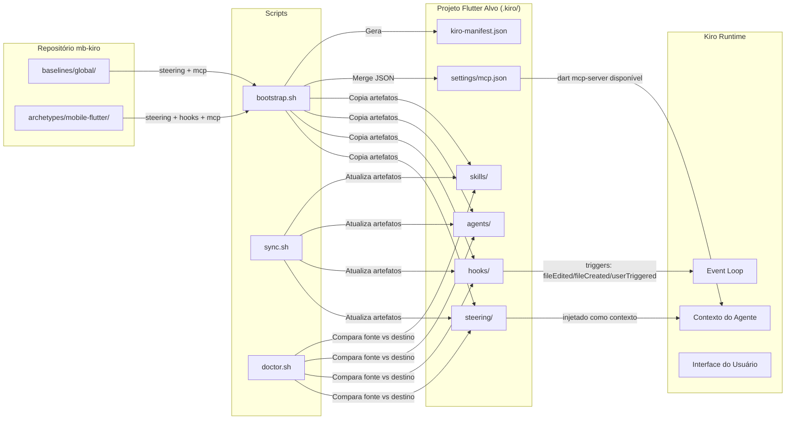
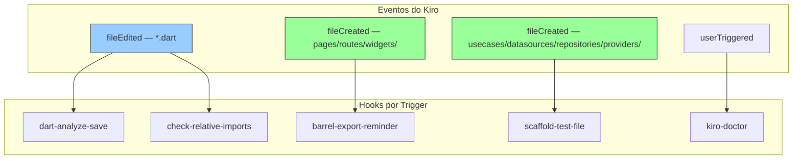
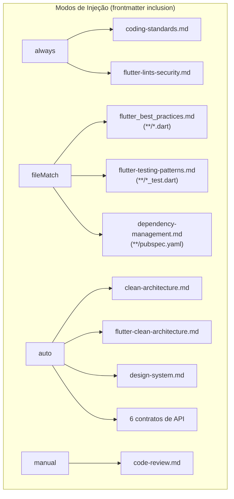

# Design Document — Archetype Mobile Flutter

## Overview

Este design documenta a arquitetura e decisões técnicas do archetype `mobile-flutter` — o pacote de configuração Kiro para projetos mobile com Flutter + Dart (Clean Architecture + Riverpod) da MonteBravo. O archetype é um artefato declarativo composto por documentos markdown e JSON que, quando aplicados a um projeto via `bootstrap.sh`, fornecem ao Kiro todo o contexto necessário para orientar, revisar e gerar código conforme os padrões arquiteturais do projeto `mb-customer-app-mobile`.

O archetype opera em 5 categorias complementares:
1. **Steering Files** — Contexto técnico injetado nas interações do Kiro (15 + README)
2. **Hooks** — Automações disparadas por eventos do fluxo de desenvolvimento (5 hooks)
3. **Agents** — Placeholder para revisores especializados (não implementados)
4. **Skills** — Placeholder para geradores de código (não implementados)
5. **MCP Config** — Configuração do Dart MCP Server funcional

**Diferenciais em relação aos demais archetypes:**
- 15 steering files (vs 4-5 nos outros) — inclui 6 contratos de API e padrões Flutter específicos
- Steering files COM frontmatter YAML (`inclusion: always/fileMatch/auto/manual`) — diferente do backend-csharp e bff-fastify que usam blockquote
- Hooks com triggers `fileEdited` e `fileCreated` (vs `agentStop`/`preToolUse`/`postToolUse` nos outros archetypes)
- Servidor MCP funcional (dart mcp-server) — diferente de `mcpServers: {}` nos outros
- NÃO possui VERSION nem CHANGELOG — archetype sem versionamento formal
- Skills e agents VAZIOS (apenas READMEs) — estrutura pronta sem código
- Steering files de contratos de API — categoria exclusiva deste archetype

Versão informal: `0.1.0` (referenciada nos READMEs) | Sem versionamento formal independente.

---

## Architecture

### Diagrama de Componentes do Archetype

```mermaid
graph TB
    subgraph "Archetype mobile-flutter (Fonte)"
        AR[archetypes/mobile-flutter/]
        ST[steering/]
        HK[hooks/]
        AG[agents/]
        SK[skills/]
        MCP[mcp/]
        AR --> ST
        AR --> HK
        AR --> AG
        AR --> SK
        AR --> MCP
    end

    subgraph "Steering Files (15 + README)"
        direction LR
        subgraph "Padrões Técnicos (9)"
            ST1[coding-standards.md]
            ST2[flutter_best_practices.md]
            ST3[clean-architecture.md]
            ST4[flutter-clean-architecture.md]
            ST5[flutter-lints-security.md]
            ST6[flutter-testing-patterns.md]
            ST7[dependency-management.md]
            ST8[design-system.md]
            ST9[code-review.md]
        end
        subgraph "Contratos de API (6)"
            API1[auth-api.md]
            API2[forgot-password-api.md]
            API3[home-api.md]
            API4[notifications-api.md]
            API5[profile-api.md]
            API6[settings-api.md]
        end
    end

    subgraph "Hooks (5)"
        H1[dart-analyze-save]
        H2[check-relative-imports]
        H3[barrel-export-reminder]
        H4[scaffold-test-file]
        H5[kiro-doctor]
    end

    ST --> ST1 & ST2 & ST3 & ST4 & ST5 & ST6 & ST7 & ST8 & ST9
    ST --> API1 & API2 & API3 & API4 & API5 & API6
    HK --> H1 & H2 & H3 & H4 & H5
```



### Diagrama de Fluxo de Dados



### Diagrama de Triggers dos Hooks



> **Nota:** Os triggers `fileEdited` (azul) e `fileCreated` (verde) são exclusivos deste archetype — os demais archetypes usam `agentStop`/`preToolUse`/`postToolUse` para revisões. A razão é que projetos Flutter se beneficiam de feedback imediato por arquivo (análise estática, imports) e scaffolding proativo no momento da criação, enquanto projetos backend precisam de revisão consolidada ao final de uma sessão.

### Diagrama de Injeção de Steering Files



### Decisões Arquiteturais

| Decisão | Escolha | Justificativa |
|---------|---------|---------------|
| Formato de steering files | Frontmatter YAML com `inclusion` | Steering files do mobile-flutter usam frontmatter para controlar quando são carregados pelo Kiro — `always` para regras universais, `fileMatch` para contexto por extensão, `auto` para contexto semântico, `manual` para sob demanda. Diferente do backend-csharp (blockquote sem frontmatter) |
| 15 steering files (vs 4-5) | Maior granularidade + contratos de API | Projetos mobile Flutter têm mais dimensões (UI, navegação, state management, design system, 6 APIs consumidas) que backends puros. Cada steering tem escopo focado para reduzir contexto irrelevante |
| 6 contratos de API como steering | Documentação inline para o agente | O app mobile consome 6 microserviços backend — ter os contratos como steering permite ao Kiro gerar DataSources, Models e error handling corretos sem precisar acessar documentação externa |
| Hooks fileEdited (vs agentStop) | Feedback imediato por arquivo | `dart analyze` e verificação de imports devem rodar no arquivo salvo — feedback instantâneo sem esperar o fim da sessão. Custo zero (runCommand) vs custo de agente (askAgent) |
| Hooks fileCreated (vs preToolUse) | Scaffolding proativo na criação | Quando um novo arquivo é criado em usecases/datasources/etc., o scaffolding de teste deve acontecer imediatamente — não faz sentido esperar o fim da sessão. O trigger `fileCreated` captura o momento exato |
| MCP com dart mcp-server funcional | Dart SDK oferece MCP server nativo | Diferente de .NET e Node.js, o ecossistema Dart disponibiliza `dart mcp-server` nativamente — análise estática, completions e refactoring diretamente acessíveis ao Kiro |
| Sem VERSION/CHANGELOG | Archetype extraído recentemente | O archetype foi extraído do `mb-customer-app-mobile` e ainda não passou por ciclos de release formais — versionamento será implementado quando estabilizar |
| Skills/agents vazios | Estrutura pronta sem código morto | Skills requerem design de prompts e validação com equipe Flutter. A estrutura existe para adições futuras sem breaking changes |
| Hooks askAgent para scaffolding | Ações inteligentes requerem raciocínio | Barrel export reminder e scaffold test file precisam navegar a árvore de diretórios, ler pubspec.yaml e tomar decisões — impossível com `runCommand` |
| Hooks runCommand para lint | Execução determinística sem agente | `dart analyze` e grep de imports são comandos puros — executam rápido, sem consumir créditos de agente, resultado binário (erros ou não) |
| Steering `code-review.md` manual | Revisão sob demanda, não automática | Code review é pesado e envolve checklist extenso — carregar automaticamente poluiria o contexto. Ativado explicitamente quando o dev solicita |
| Steering APIs com `inclusion: auto` | Carregamento contextual inteligente | Contratos de API são relevantes apenas quando o dev está trabalhando em integração — `auto` permite ao Kiro decidir quando injetar |

---

## Components and Interfaces

### 1. Steering Files (15 + README)

Documentos markdown com frontmatter YAML que definem as diretrizes técnicas da stack Flutter/Dart. São o contexto técnico do Kiro — fornecem regras, padrões e contratos para que o agente tome decisões alinhadas à arquitetura do projeto.

#### 1.1 Steering Files de Padrões Técnicos (9)

| Arquivo | Inclusion | Temas Cobertos |
|---------|-----------|----------------|
| `coding-standards.md` | `always` | Clean Architecture (domain sem Flutter/imports externos, data depende apenas de domain, presentation depende apenas de domain), Riverpod (ref.watch em build, ref.read para callbacks, estado imutável com copyWith), go_router (rotas em routes.dart, sem strings hardcoded), política de comentários (inglês, breves, apenas intenção), performance (sem computação em build, ListView.builder, select), tabela de anti-patterns |
| `flutter_best_practices.md` | `fileMatch: **/*.dart` | Imports absolutos `package:` obrigatórios, ordenação por grupo, uso de `const`, proibição de `!` (preferir null-safe), nomenclatura (PascalCase classes, camelCase variáveis, snake_case arquivos, _prefixed privados, sufixo Provider/UseCase), clean code (SRP, max ~30 linhas, sem magic numbers, imutabilidade, sem print), Design System obrigatório, widgets max ~100 linhas, SOLID em Flutter, mock data sources com latência |
| `clean-architecture.md` | `auto` | Dependency rule (presentation → domain ← data), estrutura de camadas com diretórios, 12 passos para criar feature (package, pubspec, analysis_options, barrel, camadas, routes, registro, workspace, testes), Entity vs Model, Use Case pattern, Repository pattern, Riverpod provider organization, barrel exports, critérios para novo package |
| `flutter-clean-architecture.md` | `auto` | Organização por feature (não por camada global), estrutura padrão de módulo, regras de dependência em tabela, diagrama Mermaid de fluxo |
| `flutter-lints-security.md` | `always` | flutter_lints em dev_dependencies, regras extras (always_use_package_imports, avoid_print, prefer_const_constructors, etc.), segurança (nunca commitar tokens, variáveis de ambiente, flavors) |
| `flutter-testing-patterns.md` | `fileMatch: **/*_test.dart, **/test/**/*.dart` | Mocks centralizados em test/mocks/ (proibido inline), fixtures em test/fixtures/, estrutura espelhando lib/, nomenclatura (mock_<class>.dart, <context>_fixtures.dart, <file>_test.dart), padrões por camada (use case, repository, provider, widget), mocktail via core_dev exclusivamente |
| `dependency-management.md` | `fileMatch: **/pubspec.yaml` | Core_Package (centraliza runtime deps), Core_Dev_Package (centraliza dev deps), procedimento para adicionar dependência, utilities compartilhadas, barrel files obrigatórios |
| `design-system.md` | `auto` | Package ds_monte_bravo_mobile, golden rule (nunca criar genérico em feature), workflow de lookup, protocolo de componente não encontrado (Atomic Design: Atom/Molecule/Organism), prefixo Mb, tabela de localização, proibições |
| `code-review.md` | `manual` | Checklist de revisão (Architecture, Dart Quality, Riverpod, Naming, go_router, Widgets, Testing, Performance), política de incerteza, formato de output (File, Line, Severity, Issue, Fix) |

#### 1.2 Steering Files de Contratos de API (6)

| Arquivo | Inclusion | Serviço | Endpoints |
|---------|-----------|---------|-----------|
| `auth-api.md` | `auto` | Auth Service | POST /auth/login, POST /auth/signup, POST /auth/logout, GET /auth/me, POST /auth/validate-token |
| `forgot-password-api.md` | `auto` | Auth Service | POST api/auth/forgot-password, POST api/auth/verify-otp |
| `home-api.md` | `auto` | Home Service | GET api/home/balance, GET api/home/notices |
| `notifications-api.md` | `auto` | Notifications Service | GET api/notifications, POST api/notifications/{id}/read, POST api/notifications/{id}/delete |
| `profile-api.md` | `auto` | Profile Service | GET api/profile |
| `settings-api.md` | `auto` | Settings Service | GET api/settings, GET api/settings/communication-prefs, POST api/settings/communication-prefs |

**Diferença dos demais archetypes:** Contratos de API como steering files são exclusivos deste archetype. Não existem nos archetypes backend-csharp nem bff-fastify. Eles refletem o requisito do app mobile de consumir múltiplos microserviços e gerar DataSources/Models/error handling aderentes ao contrato.

**Nota de aviso nos contratos:** Todos os contratos (exceto `auth-api.md` que tem URLs reais) incluem nota indicando que são baseados em mocks atuais e devem ser atualizados quando o backend confirmar o contrato final.

**Formato de frontmatter (todos os steering files):**
```yaml
---
inclusion: always | fileMatch | auto | manual
name: "identificador-kebab" (para auto/manual)
description: "Quando carregar este steering" (para auto/manual)
fileMatchPattern: "glob" | ["glob1", "glob2"] (para fileMatch)
---
```

### 2. Hooks (5 arquivos)

Automações JSON que disparam ações baseadas em eventos do Kiro. Organizados em 3 categorias funcionais:

#### Categoria A: Qualidade de Código — runCommand (2 hooks)

| Hook | Trigger | Patterns | Comando |
|------|---------|----------|---------|
| `dart-analyze-save.kiro.hook` | `fileEdited` | `["**/*.dart"]` | `dart analyze "$KIRO_FILE_PATH"` |
| `check-relative-imports.kiro.hook` | `fileEdited` | `["**/*.dart"]` | `grep -n` imports relativos + mensagem de erro |

**Padrão:** Execução determinística via `runCommand`. Roda no arquivo salvo, resultado imediato no terminal. Não consome créditos de agente. `dart-analyze-save` exibe erros/warnings do analyzer; `check-relative-imports` detecta `import '../'` ou `import './'` e instrui usar `package:`.

#### Categoria B: Organização de Código — askAgent (2 hooks)

| Hook | Trigger | Patterns | Ação |
|------|---------|----------|------|
| `barrel-export-reminder.kiro.hook` | `fileCreated` | `["**/lib/**/pages/*.dart", "**/lib/**/routes/*.dart", "**/lib/**/widgets/*.dart"]` | askAgent — lembra de exportar no barrel |
| `scaffold-test-file.kiro.hook` | `fileCreated` | `["**/lib/**/usecases/*.dart", "**/lib/**/datasources/*.dart", "**/lib/**/repositories/*.dart", "**/lib/**/providers/*.dart"]` | askAgent — cria test file + mock + barrel |

**Padrão barrel-export-reminder:** Acionado na criação de arquivo público (page/route/widget). O prompt instrui o agente a: encontrar package root via pubspec.yaml, identificar barrel file em `lib/<package_name>.dart`, verificar se já exporta, e se não, lembrar o dev com mensagem clara. **NÃO modifica automaticamente** — apenas lembra.

**Padrão scaffold-test-file:** Acionado na criação de código testável (usecase/datasource/repository/provider). O prompt instrui o agente a: espelhar path lib/ → test/, criar test file com imports corretos (core_dev, flutter_test, source, mocks barrel), criar Mock class centralizada, atualizar test/mocks/mocks.dart barrel. Segue regras estritas: imports absolutos, mocktail via core_dev, nomenclatura padronizada.

**Justificativa askAgent (vs runCommand):** Ambos os hooks requerem raciocínio do agente — navegar diretórios, ler pubspec.yaml, determinar package name, tomar decisões condicionais. Impossível com um comando shell puro.

#### Categoria C: Diagnóstico — userTriggered (1 hook)

| Hook | Trigger | Ação |
|------|---------|------|
| `kiro-doctor.kiro.hook` | `userTriggered` | askAgent — diagnóstico completo |

**Padrão doctor:** Acionado manualmente pelo desenvolvedor. Gera relatório markdown `kiro-doctor-report.md` com 8 seções: Resumo (✅ ⚠️ ❌), Steering, Hooks, MCP Servers, Skills, Specs, Arquitetura, Recomendações. Compara projeto vs archetype vs baseline.

### 3. Agents (0 funcionais — placeholder)

O diretório `agents/` contém apenas um `README.md` documentando 3 agents candidatos futuros:

| Agent Planejado | Especialidade | Status |
|-----------------|--------------|--------|
| Revisão de arquitetura Clean Architecture | Validar dependency rule e organização de camadas | Não implementado |
| Revisão de acessibilidade mobile | Validar padrões de acessibilidade Flutter | Não implementado |
| Revisão de performance Flutter | Detectar problemas de performance em widgets | Não implementado |

**Decisão:** Manter estrutura com README documentando a intenção futura. A estrutura está pronta para adições sem breaking changes.

### 4. Skills (0 funcionais — placeholder)

O diretório `skills/` contém apenas um `README.md` documentando 5 skills candidatas futuras:

| Skill Planejada | Gera | Status |
|-----------------|------|--------|
| Gerar feature completa | Package Clean Architecture com todas as camadas | Não implementado |
| Gerar use case | Use case com interface, implementação e teste | Não implementado |
| Gerar datasource + mock | DataSource com mock centralizado | Não implementado |
| Gerar provider Riverpod | StateNotifier/AsyncNotifier com estados | Não implementado |
| Gerar página com rota | Page + GoRoute + registro no app_router | Não implementado |

**Decisão:** Skills requerem design de prompts e validação com a equipe Flutter. Diferente do backend-csharp (5 skills funcionais), o mobile-flutter prioriza steering files e hooks no primeiro release.

### 5. MCP Config (1 arquivo — com servidor funcional)

Configuração JSON com o Dart MCP Server ativo:

```json
{
  "_comment": "MCPs específicos do archetype mobile-flutter. Mergeado com o baseline global no bootstrap.",
  "_version": "0.1.0",
  "mcpServers": {
    "dart": {
      "_comment": "Dart MCP Server — Análise estática, completions e refactoring para Dart/Flutter.",
      "command": "dart",
      "args": ["mcp-server"],
      "disabled": false,
      "autoApprove": []
    }
  }
}
```

**Decisão:** O Dart SDK oferece nativamente um MCP server (`dart mcp-server`) que fornece análise estática, completions e refactoring. Diferente dos archetypes backend-csharp e bff-fastify (que têm `mcpServers: {}` vazio), o mobile-flutter inclui esse servidor por padrão porque:
- É nativo do SDK (sem instalação extra)
- Complementa o hook `dart-analyze-save` com capacidades de refactoring
- Fornece completions Dart/Flutter diretamente ao Kiro

### 6. Integração com Scripts de Automação

#### bootstrap.sh

O script `bootstrap.sh` aplica o archetype a um projeto Flutter mobile novo:

1. Copia steering files para `.kiro/steering/` (exclui READMEs)
2. Copia hooks para `.kiro/hooks/`
3. Copia agents/ para `.kiro/agents/` (apenas README.md)
4. Copia skills/ para `.kiro/skills/` (apenas README.md)
5. Mergea `mcp.json` do archetype com baseline global em `.kiro/settings/mcp.json` (archetype tem dart server → resultado = baseline + dart)
6. Registra archetype no `kiro-manifest.json` com nome `mobile-flutter` e versão `0.1.0`

#### sync.sh

Atualiza artefatos do archetype em projetos existentes:
- Compara byte-a-byte os arquivos no projeto vs fonte no repositório
- Sobrescreve arquivos desatualizados, adiciona novos
- Atualiza `last_synced_at` no manifest

#### doctor.sh / kiro-doctor hook

Diagnostica conformidade do projeto com o archetype:
- Compara artefatos presentes vs esperados
- Valida steering files, hooks habilitados
- Verifica MCP servers configurados
- Gera relatório `kiro-doctor-report.md` com indicadores visuais (✅ ⚠️ ❌)

---

## Data Models

### Steering File Schema (mobile-flutter)

```markdown
---
inclusion: always | fileMatch | auto | manual
name: "identificador" (obrigatório para auto/manual)
description: "contexto de ativação" (obrigatório para auto/manual)
fileMatchPattern: "glob" | ["glob1", "glob2"] (obrigatório para fileMatch)
---

# Título do Steering File

Conteúdo markdown com regras, exemplos e tabelas...
```

**Regras do frontmatter:**
- `inclusion` — obrigatório, um de: `always`, `fileMatch`, `auto`, `manual`
- `name` — obrigatório quando `inclusion` é `auto` ou `manual`, string kebab-case
- `description` — obrigatório quando `inclusion` é `auto` ou `manual`, descreve quando carregar
- `fileMatchPattern` — obrigatório quando `inclusion` é `fileMatch`, glob string ou array de globs

**Diferença dos demais archetypes:** O backend-csharp e bff-fastify usam blockquote no topo (`> **Steering File | Archetype: ...`) sem frontmatter YAML. O mobile-flutter usa frontmatter porque foi extraído do `mb-customer-app-mobile` que já usava esse padrão.

### Hook Schema (mobile-flutter)

```json
{
  "enabled": true,
  "name": "string — Nome exibível",
  "description": "string — Descrição do que o hook faz",
  "version": "1",
  "when": {
    "type": "fileEdited" | "fileCreated" | "userTriggered",
    "patterns": ["glob1", "glob2"]
  },
  "then": {
    "type": "askAgent" | "runCommand",
    "prompt": "string (quando askAgent)",
    "command": "string (quando runCommand)"
  }
}
```

**Variantes por trigger type:**

| Trigger | Campos `when` | Ação típica | Hooks |
|---------|---------------|-------------|-------|
| `fileEdited` | `{ "type": "fileEdited", "patterns": [...] }` | `runCommand` | dart-analyze-save, check-relative-imports |
| `fileCreated` | `{ "type": "fileCreated", "patterns": [...] }` | `askAgent` | barrel-export-reminder, scaffold-test-file |
| `userTriggered` | `{ "type": "userTriggered" }` | `askAgent` | kiro-doctor |

**Diferenças do schema vs demais archetypes:**
- Todos os hooks usam `version: "1"` (vs `"1"` e `"2"` no backend-csharp)
- Campo `patterns` (array de globs) em vez de `toolTypes` (para fileEdited/fileCreated)
- Sem campo `toolTypes` — nenhum hook usa preToolUse/postToolUse
- Campo `description` presente em todos os hooks (descritivo em inglês)

### MCP Config Schema

```json
{
  "_comment": "string — propósito e menção ao merge com baseline",
  "_version": "MAJOR.MINOR.PATCH",
  "mcpServers": {
    "dart": {
      "_comment": "string — descrição do servidor",
      "command": "string — executável",
      "args": ["string — argumentos"],
      "disabled": false,
      "autoApprove": []
    }
  }
}
```

**Regras:**
- `_comment` obrigatório — documentação inline sobre merge com baseline
- `_version` segue semver — rastreabilidade de mudanças
- `mcpServers` deve conter ao menos a entrada `"dart"` com `command: "dart"`, `args: ["mcp-server"]`
- `disabled: false` — servidor ativo por padrão
- `autoApprove: []` — nenhuma ferramenta aprovada automaticamente

### Estrutura de Diretórios

```
archetypes/mobile-flutter/
├── agents/
│   └── README.md
├── hooks/
│   ├── README.md
│   ├── barrel-export-reminder.kiro.hook
│   ├── check-relative-imports.kiro.hook
│   ├── dart-analyze-save.kiro.hook
│   ├── kiro-doctor.kiro.hook
│   └── scaffold-test-file.kiro.hook
├── mcp/
│   └── mcp.json
├── skills/
│   └── README.md
├── steering/
│   ├── README.md
│   ├── auth-api.md
│   ├── clean-architecture.md
│   ├── code-review.md
│   ├── coding-standards.md
│   ├── dependency-management.md
│   ├── design-system.md
│   ├── flutter-clean-architecture.md
│   ├── flutter-lints-security.md
│   ├── flutter-testing-patterns.md
│   ├── flutter_best_practices.md
│   ├── forgot-password-api.md
│   ├── home-api.md
│   ├── notifications-api.md
│   ├── profile-api.md
│   └── settings-api.md
└── README.md
```

**Nota:** Diferente dos archetypes backend-csharp e bff-fastify, NÃO possui `VERSION` nem `CHANGELOG.md` na raiz.

---

## Correctness Properties

*Uma propriedade é uma característica ou comportamento que deve ser verdadeiro em todas as execuções válidas de um sistema — essencialmente, uma afirmação formal sobre o que o sistema deve fazer. Propriedades servem como ponte entre especificações legíveis por humanos e garantias de correção verificáveis por máquina.*

### Property 1: Completude estrutural do archetype

*Para qualquer* estrutura de archetype mobile-flutter válida, os diretórios `steering/`, `hooks/`, `agents/`, `skills/` e `mcp/` SHALL existir, e além disso: `steering/` SHALL conter exatamente 15 arquivos `.md` (excluindo README.md) com os nomes esperados (`coding-standards.md`, `flutter_best_practices.md`, `clean-architecture.md`, `flutter-clean-architecture.md`, `flutter-lints-security.md`, `flutter-testing-patterns.md`, `dependency-management.md`, `design-system.md`, `code-review.md`, `auth-api.md`, `forgot-password-api.md`, `home-api.md`, `notifications-api.md`, `profile-api.md`, `settings-api.md`), `hooks/` SHALL conter exatamente 5 arquivos `.kiro.hook`, `mcp/` SHALL conter um `mcp.json`, `agents/` SHALL conter apenas `README.md`, `skills/` SHALL conter apenas `README.md`, cada diretório de categoria SHALL conter um `README.md`, a raiz SHALL conter um `README.md`, e a raiz SHALL NÃO conter arquivo `VERSION` nem `CHANGELOG.md`.

**Validates: Requirements 1.1, 1.2, 1.3, 1.4, 1.5, 1.6, 1.7, 1.8, 11.2, 12.2, 13.1, 13.2**

### Property 2: Frontmatter YAML válido nos steering files

*Para qualquer* arquivo `.md` no diretório `steering/` do archetype mobile-flutter (excluindo `README.md`), o conteúdo SHALL iniciar com delimitadores `---` contendo frontmatter YAML válido que inclui obrigatoriamente o campo `inclusion` com valor pertencente ao conjunto `{always, fileMatch, auto, manual}`. Quando `inclusion` é `auto` ou `manual`, os campos `name` (string não-vazia) e `description` (string não-vazia) SHALL estar presentes. Quando `inclusion` é `fileMatch`, o campo `fileMatchPattern` (string ou array de strings) SHALL estar presente.

**Validates: Requirements 2.1, 2.2, 2.3, 2.4, 2.5, 2.6, 2.7, 2.8**

### Property 3: Mapeamento correto de inclusion por steering file

*Para qualquer* steering file do archetype mobile-flutter, o valor do campo `inclusion` no frontmatter SHALL corresponder ao mapeamento esperado: `coding-standards.md` e `flutter-lints-security.md` → `always`; `flutter_best_practices.md`, `flutter-testing-patterns.md` e `dependency-management.md` → `fileMatch`; `clean-architecture.md`, `flutter-clean-architecture.md`, `design-system.md`, `auth-api.md`, `forgot-password-api.md`, `home-api.md`, `notifications-api.md`, `profile-api.md` e `settings-api.md` → `auto`; `code-review.md` → `manual`.

**Validates: Requirements 14.1, 14.2, 14.3, 14.4, 14.5, 14.6**

### Property 4: Hooks habilitados e schema válido

*Para qualquer* arquivo `.kiro.hook` no diretório `hooks/` do archetype mobile-flutter, o conteúdo SHALL ser JSON válido contendo os campos obrigatórios: `enabled` (com valor `true`), `name` (string não-vazia), `description` (string não-vazia), `version` (string `"1"`), `when.type` (um de `fileEdited`, `fileCreated`, `userTriggered`) e `then.type` (um de `askAgent`, `runCommand`), com `then.prompt` (string não-vazia) presente quando `then.type` é `askAgent`, `then.command` (string não-vazia) presente quando `then.type` é `runCommand`, e `when.patterns` (array não-vazio de strings glob) presente quando `when.type` é `fileEdited` ou `fileCreated`.

**Validates: Requirements 5.1, 6.1, 7.1, 8.1, 9.1**

### Property 5: Schema de configuração MCP com servidor Dart

*Para qualquer* arquivo `mcp.json` válido do archetype mobile-flutter, ele SHALL conter: um campo `_comment` (string não-vazia), um campo `_version` (semver válido no formato `MAJOR.MINOR.PATCH`), e um objeto `mcpServers` contendo ao menos a entrada `"dart"` com campos `command` (valor `"dart"`), `args` (valor `["mcp-server"]`), `disabled` (valor `false`) e `autoApprove` (array vazio).

**Validates: Requirements 10.1, 10.2, 10.3**

### Property 6: Consistência de versão nos READMEs

*Para qualquer* arquivo `README.md` dentro do archetype mobile-flutter (raiz, steering/, hooks/, agents/, skills/), o conteúdo SHALL referenciar a mesma versão `0.1.0`, garantindo consistência interna entre todos os documentos do archetype.

**Validates: Requirements 13.3, 13.4**

---

## Error Handling

### Erros de Estrutura (detectados pelo doctor)

| Cenário | Detecção | Ação |
|---------|----------|------|
| Steering file ausente | `doctor.sh` / hook kiro-doctor | Reporta ❌ + instrui sync |
| Hook desabilitado | `doctor.sh` / hook kiro-doctor | Reporta ⚠️ + sugere reabilitar |
| MCP desalinhado com baseline | `doctor.sh` / hook kiro-doctor | Reporta ⚠️ + sugere merge |
| Dart MCP server `disabled: true` | `doctor.sh` / hook kiro-doctor | Reporta ⚠️ + sugere habilitar |
| Steering file sem frontmatter | Validação manual | Reporta formato inválido |
| Hook com JSON inválido | Kiro runtime | Hook ignorado silenciosamente |

### Erros de Bootstrap

| Cenário | Comportamento |
|---------|---------------|
| Archetype `mobile-flutter` não encontrado | Exit 1 + lista archetypes válidos |
| Target não existe | Exit 1 + mensagem de erro |
| Manifest já existe (sem --force) | Pergunta ao usuário se deseja continuar |
| Arquivo já existe no destino | Skip + WARNING (sem --force) ou sobrescreve (com --force) |
| jq indisponível | Gera manifest via heredoc, sem validação JSON |
| Dart SDK não instalado | MCP server `dart` disponível mas inoperante — hook doctor reporta |

### Erros de Hooks em Runtime

| Cenário | Comportamento |
|---------|---------------|
| `dart analyze` falha (Dart não instalado) | Hook reporta erro de execução |
| `dart analyze` encontra erros | Exibe erros/warnings ao desenvolvedor |
| `grep` encontra imports relativos | Exibe linhas + mensagem de correção |
| `grep` não encontra imports relativos | Exit 0 silencioso — sem output |
| Hook askAgent com arquivo inexistente no KIRO_FILE_PATH | Agente reporta que arquivo não foi encontrado |
| barrel-export-reminder: pubspec.yaml não encontrado | Agente reporta que package root não foi identificado |
| scaffold-test-file: test/ directory não existe | Agente cria diretório automaticamente |
| kiro-doctor: baselines/global/ não acessível | Agente pula comparação com baseline, reporta parcial |

---

## Testing Strategy

### Abordagem

O archetype mobile-flutter é um pacote de configuração declarativo (documentos markdown + JSON). A estratégia de testes foca em **validação estrutural, de schema e de formato** dos artefatos, não em lógica algorítmica complexa. Property-based testing é aplicável para validações de formato que devem ser universalmente verdadeiras.

### Testes de Propriedade (property-based)

**Biblioteca:** bats-core com funções auxiliares de geração aleatória (padrão do repositório mb-kiro).

**Configuração:**
- Mínimo 100 iterações por property test
- Cada property test referencia a propriedade do design document
- Tag format: **Feature: archetype-mobile-flutter, Property {number}: {property_text}**

**Properties implementadas:**

| Property | Tipo de Validação | Iterações |
|----------|-------------------|-----------|
| 1: Completude estrutural | Existência de diretórios/arquivos, contagens, ausências | 100 |
| 2: Frontmatter YAML válido | Parsing YAML, campos obrigatórios, valores válidos | 100 |
| 3: Mapeamento de inclusion | Valor correto por arquivo | 100 |
| 4: Hook schema válido | JSON parsing, campos obrigatórios, tipos corretos | 100 |
| 5: MCP config schema | JSON parsing, servidor dart, campos obrigatórios | 100 |
| 6: Consistência de versão | Regex match em todos os READMEs | 100 |

### Testes Unitários (example-based)

| Cenário | Tipo | Validação |
|---------|------|-----------|
| Contrato auth-api.md contém endpoints esperados | Example | Grep por POST /auth/login, POST /auth/signup, etc. |
| Contrato API (exceto auth) contém nota de aviso sobre mocks | Example | Grep por texto de warning |
| README raiz contém seção "Estrutura" com tree | Example | Grep por hierarquia de diretórios |
| Hook dart-analyze-save executa comando correto | Example | Verificar campo `then.command` |
| Hook check-relative-imports retorna exit 0 sem matches | Edge Case | Grep em arquivo Dart limpo |
| Hook barrel-export-reminder não modifica arquivos | Example | Verificar prompt contém "Do NOT modify" |
| Hook scaffold-test-file exige imports absolutos | Example | Verificar prompt contém regras de import |
| kiro-doctor gera relatório com 8 seções | Example | Verificar prompt menciona as 8 seções |
| agents/README.md lista 3 candidatos futuros | Example | Grep por candidatos |
| skills/README.md lista 5 candidatas futuras | Example | Grep por candidatas |

### Testes de Integração

| Cenário | Ferramenta | Validação |
|---------|------------|-----------|
| bootstrap.sh copia artefatos para projeto alvo | bats | Verificar todos os 15 steering + 5 hooks presentes no destino |
| bootstrap.sh mergea mcp.json com baseline | bats | Verificar settings/mcp.json contém dart + servidores do baseline |
| sync.sh atualiza steering desatualizados | bats | Modificar fonte, rodar sync, verificar destino atualizado |
| doctor.sh detecta steering ausentes | bats | Remover steering no destino, rodar doctor, verificar relatório |
| doctor.sh detecta hooks desabilitados | bats | Desabilitar hook no destino, rodar doctor, verificar ⚠️ |

### Ferramentas

- **bats-core**: Framework principal de testes para scripts bash e validações estruturais
- **yq**: Parsing de frontmatter YAML nos steering files
- **jq**: Validação de JSON em hooks e mcp.json
- **grep/awk**: Buscas de padrões em conteúdo markdown
- **diff**: Comparação byte-a-byte para testes de sync

### Execução

```bash
# Rodar todos os testes do archetype
bats tests/archetypes/mobile-flutter/

# Rodar apenas property tests
bats tests/archetypes/mobile-flutter/properties/

# Rodar apenas integration tests
bats tests/archetypes/mobile-flutter/integration/
```
