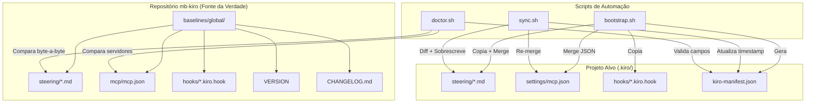
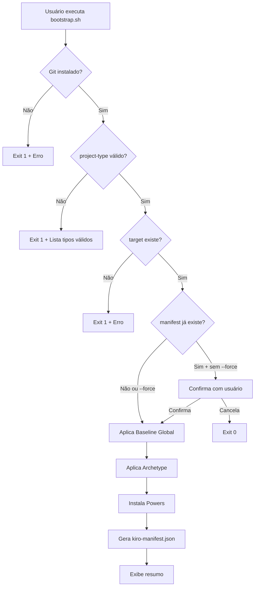
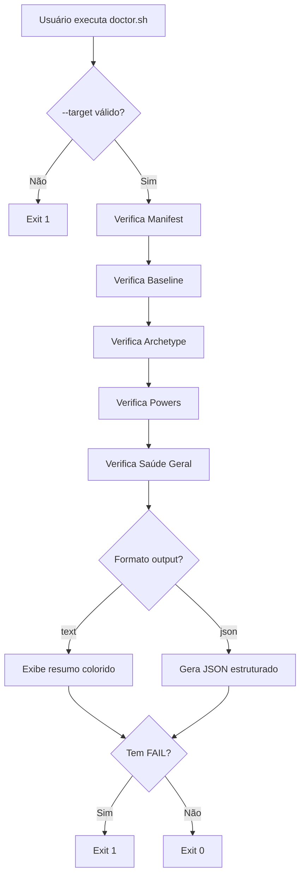

# Design Document — Baseline Global

## Overview

O Baseline Global é a configuração mínima obrigatória para todos os projetos da organização MonteBravo. Este design descreve a arquitetura, componentes, interfaces e modelos de dados que compõem o sistema de governança, distribuição e verificação do baseline.

O sistema opera em 3 modos principais:
1. **Bootstrap** — Aplicação inicial do baseline em projetos novos
2. **Sync** — Atualização incremental de projetos existentes
3. **Doctor** — Diagnóstico de conformidade

Todas as operações são implementadas como scripts bash idempotentes, com suporte a dry-run e output estruturado.

---

## Architecture

### Diagrama de Componentes



### Diagrama de Fluxo — Bootstrap



### Diagrama de Fluxo — Doctor



---

## Components and Interfaces

### 1. Artefatos do Baseline Global

| Componente | Localização | Formato | Propósito |
|---|---|---|---|
| Steering Files | `baselines/global/steering/*.md` | Markdown com YAML frontmatter | Diretrizes injetadas pelo Kiro |
| MCP Config | `baselines/global/mcp/mcp.json` | JSON | Servidores MCP homologados |
| Hooks | `baselines/global/hooks/*.kiro.hook` | JSON | Automações globais do Kiro |
| VERSION | `baselines/global/VERSION` | Texto (semver) | Versão atual do baseline |
| CHANGELOG | `baselines/global/CHANGELOG.md` | Markdown (Keep a Changelog) | Histórico de mudanças |

### 2. Scripts de Automação

#### bootstrap.sh

**Responsabilidades:**
- Validar pré-requisitos (git, jq)
- Copiar steering files do baseline para `.kiro/steering/`
- Copiar artefatos do archetype (steering, skills, hooks, agents)
- Mergear `mcp.json` (baseline + archetype, archetype tem precedência)
- Gerar `kiro-manifest.json`
- Suportar `--dry-run`, `--force`, `--powers`

**Interface CLI:**
```
bootstrap.sh --target <caminho> --project-type <tipo> [--powers <lista>] [--dry-run] [--force]
```

#### sync.sh

**Responsabilidades:**
- Ler `kiro-manifest.json` do projeto alvo
- Comparar byte-a-byte steering files (fonte vs destino)
- Sobrescrever arquivos desatualizados, adicionar novos
- Re-mergear `mcp.json` quando necessário
- Atualizar `baseline.last_synced_at` no manifest
- Suportar `--dry-run`, `--component`

**Interface CLI:**
```
sync.sh --target <caminho> [--component baseline|archetype|powers|all] [--dry-run]
```

#### doctor.sh

**Responsabilidades:**
- Validar existência e schema do `kiro-manifest.json`
- Comparar steering files com baseline (atualizado/desatualizado/ausente)
- Comparar MCP config com baseline
- Verificar artefatos do archetype
- Respeitar exceções documentadas no manifest
- Produzir relatório text ou JSON
- Exit code: 1 se FAIL, 0 caso contrário

**Interface CLI:**
```
doctor.sh --target <caminho> [--output text|json] [--verbose]
```

### 3. Hook Global (kiro-doctor.kiro.hook)

**Tipo:** `userTriggered`  
**Ação:** `askAgent` — instrui o Kiro a gerar relatório de conformidade  
**Output:** `kiro-doctor-report.md` na raiz do projeto  

O hook é uma alternativa in-IDE ao script `doctor.sh`, usando o agente Kiro para executar a análise e gerar o relatório em markdown.

---

## Data Models

### kiro-manifest.json

```json
{
  "_generated_by": "string — identifica o script que gerou",
  "_generated_at": "string — ISO 8601 UTC",
  "schema_version": "string — versão do schema do manifest",
  "project": {
    "name": "string — nome do projeto",
    "repository": "string — org/repo"
  },
  "baseline": {
    "version": "string — semver MAJOR.MINOR.PATCH",
    "source": "string — repositório fonte",
    "installed_at": "string — ISO 8601 UTC",
    "last_synced_at": "string — ISO 8601 UTC"
  },
  "archetype": {
    "name": "string — nome do archetype",
    "version": "string — semver",
    "installed_at": "string — ISO 8601 UTC"
  },
  "powers": [
    {
      "name": "string — nome do power",
      "version": "string — semver",
      "installed_at": "string — ISO 8601 UTC"
    }
  ],
  "exceptions": [
    {
      "rule": "string — formato: <componente>.<nome-da-regra>",
      "reason": "string — 20-500 caracteres",
      "approved_by": "string — identificador do mantenedor",
      "approved_at": "string — ISO 8601 UTC",
      "review_date": "string — ISO 8601 (max 90 dias de approved_at)"
    }
  ]
}
```

### mcp.json (Schema do Baseline)

```json
{
  "_comment": "string — propósito e origem",
  "_version": "string — semver MAJOR.MINOR.PATCH",
  "mcpServers": {
    "<nome-do-servidor>": {
      "_comment": "string — funcionalidade e método de autenticação",
      "url": "string (opcional — para servidores HTTP)",
      "command": "string (opcional — para servidores via processo)",
      "args": ["string"] ,
      "env": { "<VAR>": "string" },
      "disabled": "boolean",
      "autoApprove": []
    }
  }
}
```

**Regra de conexão:** Cada servidor DEVE ter `url` (HTTP) OU `command` + `args` (processo local). Não ambos.

### Steering File (YAML Frontmatter)

```yaml
---
inclusion: manual | auto | fileMatch
fileMatchPattern: "glob pattern"  # obrigatório quando inclusion: fileMatch
---
```

### Hook Global (.kiro.hook)

```json
{
  "enabled": true,
  "name": "string",
  "description": "string",
  "version": "string",
  "when": {
    "type": "userTriggered | fileEdited | fileCreated | promptSubmit"
  },
  "then": {
    "type": "askAgent | runCommand",
    "prompt": "string (quando askAgent)",
    "command": "string (quando runCommand)"
  }
}
```

### VERSION File

```
MAJOR.MINOR.PATCH
```

- Uma única linha, sem prefixo `v`, sem espaços, sem newline final
- Cada segmento é inteiro não-negativo sem zeros à esquerda
- Regex de validação: `^(0|[1-9][0-9]*)\.(0|[1-9][0-9]*)\.(0|[1-9][0-9]*)$`

### Relatório Doctor (JSON output)

```json
{
  "timestamp": "string — ISO 8601 UTC",
  "target": "string — caminho absoluto",
  "summary": {
    "passed": 0,
    "warned": 0,
    "failed": 0
  },
  "results": [
    {
      "status": "pass | warn | fail",
      "category": "manifest | baseline | archetype | powers | health",
      "message": "string",
      "details": "string (opcional, quando --verbose)"
    }
  ]
}
```

---

## Correctness Properties

*Uma propriedade é uma característica ou comportamento que deve ser verdadeiro em todas as execuções válidas de um sistema — essencialmente, uma afirmação formal sobre o que o sistema deve fazer. Propriedades servem como ponte entre especificações legíveis por humanos e garantias de correção verificáveis por máquina.*

### Property 1: Validação de formato semver

*Para qualquer* string, a função de validação de semver SHALL aceitar se e somente se a string seguir o formato `MAJOR.MINOR.PATCH` onde cada segmento é um inteiro não-negativo sem zeros à esquerda, sem prefixo `v`, sem espaços e sem quebra de linha.

**Validates: Requirements 1.4, 3.3, 8.1, 8.5**

### Property 2: Validação de frontmatter de steering file

*Para qualquer* conteúdo markdown, a função de validação de steering file SHALL aceitar se e somente se o arquivo contiver um bloco YAML frontmatter com o campo `inclusion` cujo valor é exatamente `manual`, `auto` ou `fileMatch`, e quando `inclusion` é `fileMatch`, o campo `fileMatchPattern` deve estar presente e não-vazio.

**Validates: Requirements 1.6, 1.7, 2.9**

### Property 3: Validação de schema mcp.json

*Para qualquer* objeto JSON, a função de validação de mcp.json SHALL aceitar se e somente se o objeto contiver: um campo `_comment` (string não-vazia), um campo `_version` (semver válido), e um campo `mcpServers` (objeto com ao menos 1 servidor onde cada servidor possui `_comment` string não-vazia, `disabled` booleano, `autoApprove` array vazio, e um campo de conexão `url` string OU `command` string com `args` array).

**Validates: Requirements 3.1, 3.2, 3.3, 3.4, 3.5, 3.6**

### Property 4: Merge de mcp.json preserva todos os servidores

*Para quaisquer* dois objetos mcp.json válidos (baseline e archetype), o merge SHALL produzir um objeto contendo todos os servidores de ambos, e quando uma chave existe em ambos, o valor do archetype tem precedência sobre o baseline.

**Validates: Requirements 4.3**

### Property 5: Dry-run não modifica filesystem

*Para qualquer* estado do filesystem e qualquer combinação válida de argumentos com `--dry-run`, a execução do script (bootstrap ou sync) SHALL não criar, modificar ou deletar nenhum arquivo no diretório alvo.

**Validates: Requirements 4.6, 5.6**

### Property 6: Sync torna destino idêntico ao fonte

*Para qualquer* conjunto de steering files no baseline e qualquer estado inicial do diretório destino, após a execução do sync (sem dry-run), cada steering file no destino SHALL ser byte-a-byte idêntico à versão correspondente no baseline, e todos os steering files do baseline SHALL existir no destino.

**Validates: Requirements 5.1, 5.2, 5.3**

### Property 7: Doctor classifica artefatos corretamente

*Para qualquer* combinação de estados de artefatos (presente e igual, presente e diferente, ausente) e *para qualquer* conjunto de exceções no manifest, o doctor SHALL classificar cada artefato como: PASS (presente e idêntico ao fonte), WARN (presente mas diferente), FAIL (ausente) — exceto quando coberto por exceção válida (reporta INFO) ou exceção expirada (reporta WARN).

**Validates: Requirements 6.1, 6.2, 6.3, 6.4, 6.7, 6.8, 6.10, 9.4, 9.5**

### Property 8: Doctor produz JSON válido com schema correto

*Para qualquer* estado de verificação (combinação de PASS, WARN, FAIL), quando `--output json` é informado, o doctor SHALL produzir JSON parseável contendo os campos `timestamp` (ISO 8601), `target` (string), `summary` (objeto com `passed`, `warned`, `failed` como inteiros cuja soma é igual ao comprimento de `results`), e `results` (array de objetos com `status`, `category`, `message`).

**Validates: Requirements 6.6**

### Property 9: Validação de schema de exceção

*Para qualquer* objeto de exceção, a validação SHALL aceitar se e somente se o objeto contiver: `rule` (string no formato `<componente>.<nome>`), `reason` (string com 20-500 caracteres), `approved_by` (string não-vazia), `approved_at` (data ISO 8601 válida), e `review_date` (data ISO 8601 cuja diferença para `approved_at` não excede 90 dias corridos).

**Validates: Requirements 9.1, 9.3**

### Property 10: Inputs inválidos resultam em falha

*Para qualquer* valor de `--project-type` que não corresponde a um archetype existente, ou *para qualquer* valor de `--component` que não é `baseline`, `archetype`, `powers` ou `all`, o script SHALL encerrar com exit code diferente de zero.

**Validates: Requirements 4.7, 5.9**

---

## Error Handling

### Categorias de Erro

| Categoria | Exemplos | Comportamento |
|---|---|---|
| Pré-requisito ausente | git não instalado, jq ausente | Exit 1 com mensagem descritiva |
| Input inválido | project-type desconhecido, component inválido | Exit 1 com lista de valores válidos |
| Target inacessível | Diretório não existe, sem permissão | Exit 1 com mensagem de erro |
| Manifest ausente (sync) | kiro-manifest.json não encontrado | Exit 1 + instrução para rodar bootstrap |
| Conflito de arquivo | Arquivo já existe (bootstrap sem --force) | Skip + WARNING no log |
| JSON inválido | mcp.json ou manifest com syntax error | FAIL no doctor, erro no bootstrap/sync |

### Padrões de Implementação

- `set -euo pipefail` em todos os scripts para falhar rápido em erros não tratados
- Funções de log coloridas: `log_info`, `log_success`, `log_warn`, `log_error`
- Códigos de saída consistentes: `0` = sucesso, `1` = falha
- jq como dependência soft (scripts funcionam sem jq, mas com funcionalidade reduzida)
- Mensagens de erro sempre indicam a ação corretiva (ex: "Execute bootstrap.sh primeiro")

### Degradação Graceful

Quando `jq` não está disponível:
- Bootstrap: gera manifest via heredoc (sem validação JSON)
- Sync: leitura limitada do manifest via grep/sed
- Doctor: reporta WARN sobre validação limitada

---

## Testing Strategy

### Abordagem Dual

Este projeto utiliza uma combinação de **testes unitários** (exemplo-based) e **testes baseados em propriedades** para garantir correção.

#### Testes Unitários (exemplo-based)

Focam em:
- Verificação de estrutura dos artefatos existentes (steering files, mcp.json, hooks)
- Cenários de integração end-to-end dos scripts (bootstrap → sync → doctor)
- Edge cases específicos (manifest ausente, diretório vazio, permissões)
- Validação de output (formato text e JSON do doctor)

#### Testes de Propriedade (property-based)

Focam em:
- Validações de formato/schema (semver, frontmatter, mcp.json, exceções)
- Lógica de merge JSON
- Classificação de artefatos pelo doctor
- Imutabilidade do dry-run
- Idempotência do sync (rodar duas vezes = rodar uma vez)

**Biblioteca:** [bats-core](https://github.com/bats-core/bats-core) para testes de shell + funções auxiliares para property-based testing com geração aleatória de inputs.

**Configuração:**
- Mínimo 100 iterações por property test
- Cada property test referencia a propriedade do design document
- Tag format: **Feature: baseline-global, Property {number}: {property_text}**

### Estrutura de Testes

```
tests/
├── unit/
│   ├── test_validate_semver.bats
│   ├── test_validate_frontmatter.bats
│   ├── test_validate_mcp_schema.bats
│   ├── test_validate_exception.bats
│   └── test_merge_mcp.bats
├── integration/
│   ├── test_bootstrap.bats
│   ├── test_sync.bats
│   └── test_doctor.bats
├── properties/
│   ├── prop_semver.bats
│   ├── prop_frontmatter.bats
│   ├── prop_mcp_schema.bats
│   ├── prop_merge_mcp.bats
│   ├── prop_sync_idempotent.bats
│   ├── prop_dry_run.bats
│   ├── prop_doctor_classify.bats
│   ├── prop_doctor_json.bats
│   ├── prop_exception_schema.bats
│   └── prop_invalid_inputs.bats
└── helpers/
    ├── generators.bash      # Geradores de dados aleatórios
    ├── setup.bash           # Setup/teardown de fixtures
    └── assertions.bash      # Assertions customizados
```

### Cobertura Esperada

| Componente | Tipo de Teste | Cobertura Alvo |
|---|---|---|
| Validação de semver | Property | 100 iterações |
| Validação de frontmatter | Property | 100 iterações |
| Validação de mcp.json schema | Property | 100 iterações |
| Merge de mcp.json | Property | 100 iterações |
| Classificação do doctor | Property | 100 iterações |
| Dry-run imutabilidade | Property | 100 iterações |
| Validação de exceções | Property | 100 iterações |
| Bootstrap end-to-end | Integration | 5-10 cenários |
| Sync end-to-end | Integration | 5-10 cenários |
| Doctor end-to-end | Integration | 5-10 cenários |
