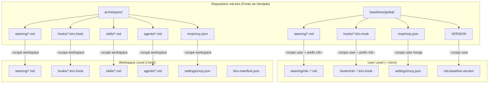
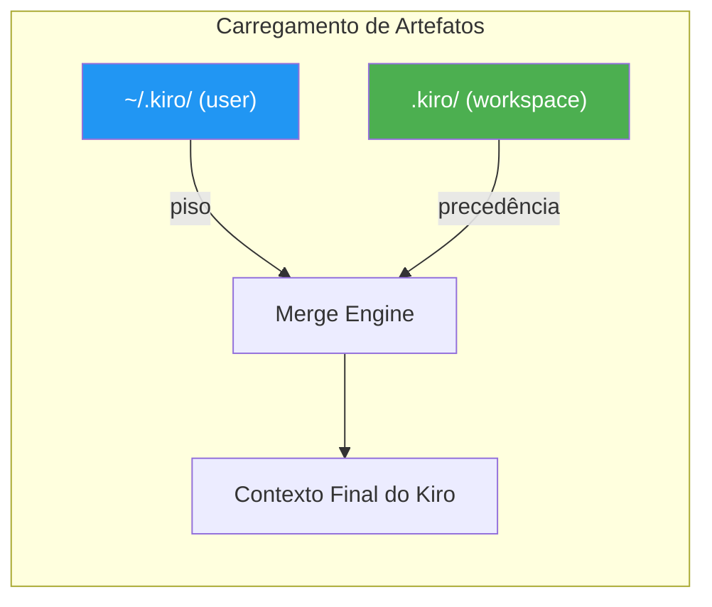
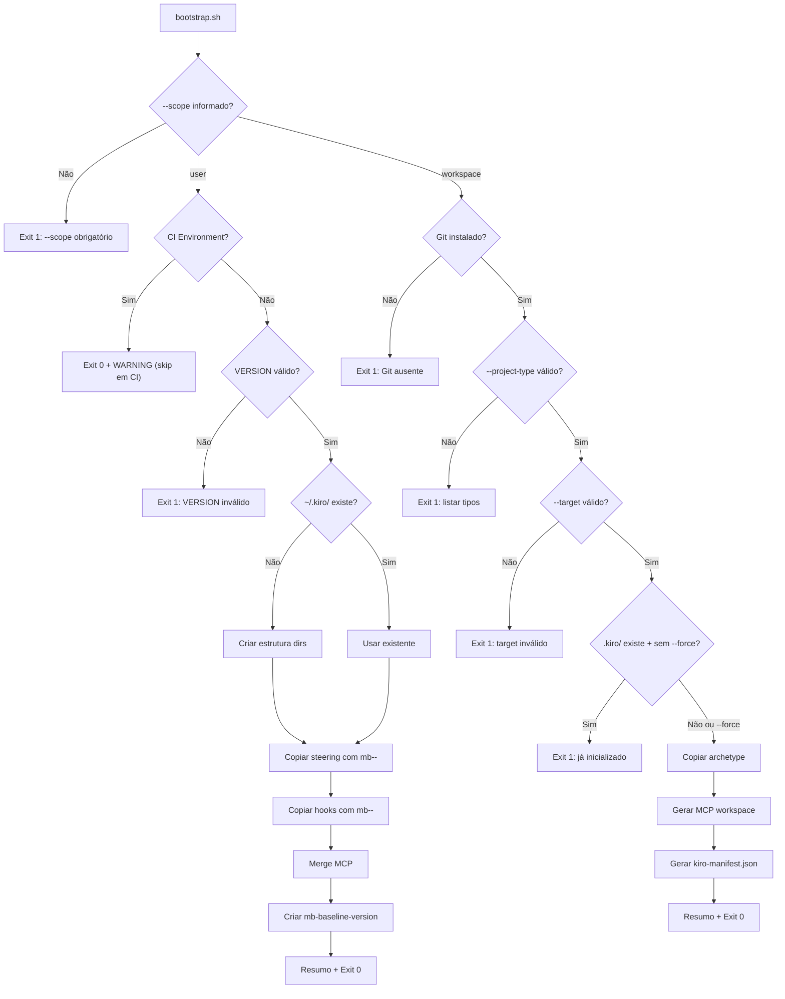
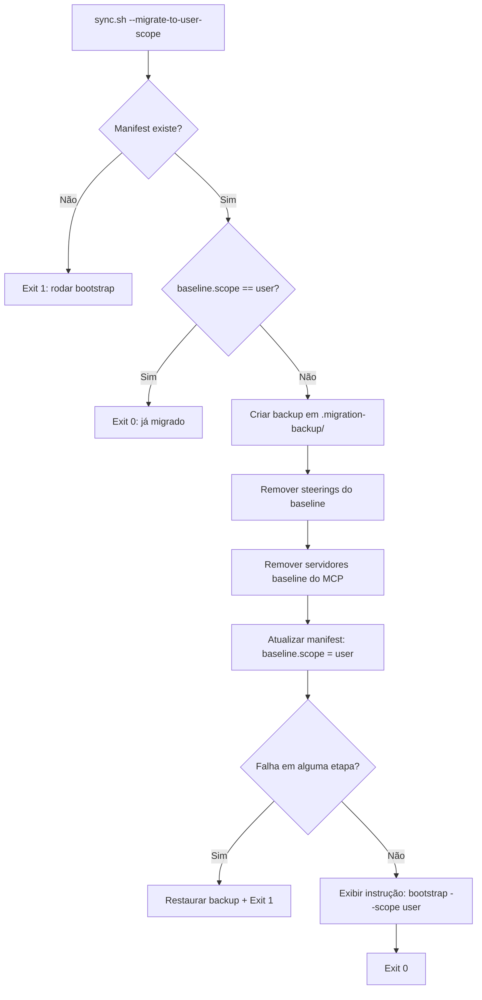

# Design Document — Baseline User Scope

## Overview

Esta feature refatora a distribuição do baseline global, separando-o em dois escopos distintos:

1. **Escopo User (`~/.kiro/`)** — Artefatos organizacionais universais (baseline), instalados uma vez por máquina, compartilhados entre todos os projetos do desenvolvedor.
2. **Escopo Workspace (`.kiro/`)** — Artefatos específicos de stack/projeto (archetype), commitados no repositório.

O Kiro já aplica precedência nativa: `user config < workspace`. Isso significa que o baseline serve como "piso" organizacional e o archetype do workspace pode sobrescrever qualquer diretriz quando necessário.

A separação elimina duplicações em workspaces multi-root, simplifica atualizações (um `sync --scope user` atualiza todos os projetos de uma vez) e mantém compatibilidade total com projetos no modelo legado.

---

## Architecture

### Diagrama de Componentes — Modelo Dual Scope



### Diagrama de Precedência do Kiro



**Regra:** Se um steering file `architecture.md` existe no workspace e `mb--architecture.md` existe no user-level, o Kiro usa apenas o do workspace.

### Diagrama de Fluxo — Bootstrap com Scope



### Diagrama de Fluxo — Migração



---

## Components and Interfaces

### 1. Scripts de Automação — Nova Interface CLI

#### bootstrap.sh (v2)

**Interface CLI atualizada:**
```
bootstrap.sh --scope user [--dry-run] [--force]
bootstrap.sh --scope workspace --target <caminho> --project-type <tipo> [--powers <lista>] [--dry-run] [--force]
```

**Comportamento por scope:**

| Scope | Destino | Artefatos Instalados | Requer --target | Requer --project-type |
|---|---|---|---|---|
| `user` | `~/.kiro/` | Baseline (steering, hooks, MCP) | Não | Não |
| `workspace` | `<projeto>/.kiro/` | Archetype (steering, skills, hooks, agents, MCP) | Sim | Sim |

#### sync.sh (v2)

**Interface CLI atualizada:**
```
sync.sh --scope user [--dry-run]
sync.sh --scope workspace --target <caminho> [--dry-run]
sync.sh --target <caminho> --migrate-to-user-scope [--dry-run]
```

**Notas:**
- Sem `--scope` + com manifest legado: comportamento antigo (retrocompatível)
- `--migrate-to-user-scope`: operação única de transição

#### doctor.sh (v2)

**Interface CLI atualizada:**
```
doctor.sh --scope user [--output text|json] [--verbose]
doctor.sh --scope workspace --target <caminho> [--output text|json] [--verbose]
doctor.sh --target <caminho> [--output text|json] [--verbose]
```

**Notas:**
- Sem `--scope` + com `--target`: executa ambos escopos e consolida
- Em CI (`$CI=true`): pula verificação user-level automaticamente

### 2. Funções Internas Reutilizáveis

Os scripts compartilham lógica via `source` de um módulo `lib/common.sh`:

```bash
# lib/common.sh — funções compartilhadas entre scripts

# Detecção de CI
is_ci_environment()     # Retorna 0 se $CI == "true" (case-insensitive)

# Logging
log_info(), log_success(), log_warn(), log_error()

# Validação
validate_semver()       # Valida formato MAJOR.MINOR.PATCH
validate_scope()        # Valida --scope user|workspace
validate_target()       # Valida diretório existente

# Prefixo
add_prefix()            # "file.md" → "mb--file.md"
strip_prefix()          # "mb--file.md" → "file.md"
has_prefix()            # Retorna 0 se nome começa com "mb--"

# File operations
copy_with_prefix()      # Copia arquivo aplicando prefixo mb--
sync_file()             # Compara + copia se diferente
find_orphans()          # Lista arquivos com prefixo sem correspondente na fonte

# MCP merge
merge_mcp_servers()     # Merge JSON preservando servidores pessoais
remove_mcp_servers()    # Remove servidores por lista de chaves
```

### 3. Convenção de Prefixo

| Tipo de Artefato | Fonte (baseline) | Destino (user) |
|---|---|---|
| Steering | `engineering-principles.md` | `mb--engineering-principles.md` |
| Hook | `kiro-doctor.kiro.hook` | `mb--kiro-doctor.kiro.hook` |
| MCP | chave `aws-docs` em mcpServers | chave `aws-docs` (sem prefixo, compartilha namespace) |

**Transformação de nome:**
```
fonte:   baselines/global/steering/security-baseline.md
destino: ~/.kiro/steering/mb--security-baseline.md

fonte:   baselines/global/hooks/kiro-doctor.kiro.hook
destino: ~/.kiro/hooks/mb--kiro-doctor.kiro.hook
```

**Regra de correspondência (para sync/doctor):**
```
arquivo_instalado = "mb--" + arquivo_fonte
arquivo_fonte     = strip("mb--", arquivo_instalado)
```

---

## Data Models

### kiro-manifest.json (v2 — Modelo Novo)

```json
{
  "_generated_by": "bootstrap.sh --scope workspace",
  "_generated_at": "2026-08-03T12:00:00Z",
  "schema_version": "2.0.0",
  "project": {
    "name": "string — nome do projeto",
    "repository": "string — org/repo"
  },
  "baseline": {
    "scope": "user",
    "source": "github.com/montebravo/mb-kiro"
  },
  "archetype": {
    "name": "string — ex: backend-csharp",
    "version": "string — semver",
    "installed_at": "string — ISO 8601 UTC",
    "last_synced_at": "string — ISO 8601 UTC"
  },
  "powers": [
    {
      "name": "string — nome do power",
      "version": "string — semver",
      "installed_at": "string — ISO 8601 UTC"
    }
  ],
  "exceptions": []
}
```

**Diferenças vs v1:**
- `baseline.scope: "user"` substitui `baseline.version` (versão agora em `~/.kiro/mb-baseline-version`)
- Sem `baseline.installed_at` / `baseline.last_synced_at` (sync é no escopo user)
- `schema_version: "2.0.0"` para identificar modelo novo

### kiro-manifest.json (v1 — Modelo Legado, retrocompatível)

```json
{
  "schema_version": "1.0.0",
  "baseline": {
    "version": "1.0.0",
    "source": "...",
    "installed_at": "...",
    "last_synced_at": "..."
  },
  "archetype": { ... },
  "powers": [...],
  "exceptions": [...]
}
```

**Detecção de modelo:** Se `baseline.scope` não existe → modelo legado.

### ~/.kiro/mb-baseline-version

```
1.2.0
```

- Formato idêntico ao `baselines/global/VERSION`
- Uma linha, semver, sem prefixo `v`, sem newline final
- Criado/atualizado por `bootstrap --scope user` e `sync --scope user`

### Relatório Doctor — JSON com Scope

```json
{
  "timestamp": "2026-08-03T12:00:00Z",
  "scope": "user | workspace | both",
  "target": "~/.kiro | /path/to/project",
  "summary": {
    "passed": 5,
    "warned": 1,
    "failed": 0,
    "info": 2
  },
  "results": [
    {
      "check": "steering/mb--engineering-principles.md",
      "status": "pass | warn | fail | info",
      "detail": "Presente e idêntico à fonte"
    }
  ]
}
```

### Estrutura do Backup de Migração

```
<projeto>/.kiro/.migration-backup/
└── baseline/
    ├── steering/
    │   ├── engineering-principles.md
    │   └── security-baseline.md
    ├── hooks/
    │   └── kiro-doctor.kiro.hook
    └── mcp-servers-removed.json   # chaves removidas do mcp.json
```

---

## Algorithms

### Algoritmo: Merge MCP (user-level)

```
FUNCTION merge_mcp_to_user(baseline_mcp, user_mcp):
    user_servers = user_mcp.mcpServers OR {}
    baseline_servers = baseline_mcp.mcpServers

    FOR EACH (key, config) IN baseline_servers:
        IF key EXISTS IN user_servers:
            log_warn("Atualizando servidor: {key}")
        user_servers[key] = config

    user_mcp.mcpServers = user_servers
    WRITE user_mcp
```

### Algoritmo: Limpeza de Órfãos (user-level)

```
FUNCTION clean_orphans(user_dir, baseline_dir, prefix):
    installed_files = LIST files IN user_dir WHERE name STARTS WITH prefix
    source_files = LIST files IN baseline_dir (exceto README.md)

    FOR EACH installed IN installed_files:
        original_name = STRIP prefix FROM installed.name
        IF original_name NOT IN source_files:
            REMOVE installed
            log_info("Removido órfão: {original_name}")
```

### Algoritmo: Detecção de Override (doctor)

```
FUNCTION detect_overrides(workspace_dir, user_dir, prefix):
    workspace_files = LIST files IN workspace_dir/steering/
    user_baseline_files = LIST files IN user_dir/steering/ WHERE name STARTS WITH prefix

    FOR EACH ws_file IN workspace_files:
        expected_user = prefix + ws_file.name
        IF expected_user EXISTS IN user_baseline_files:
            report_info("Workspace override: {ws_file} sobrescreve baseline {expected_user}")
```

### Algoritmo: Migração (--migrate-to-user-scope)

```
FUNCTION migrate_to_user_scope(project_dir, baseline_dir):
    manifest = READ project_dir/kiro-manifest.json

    IF manifest.baseline.scope == "user":
        RETURN "Já migrado"

    # 1. Backup
    backup_dir = project_dir/.kiro/.migration-backup/baseline/
    COPY baseline steerings do workspace → backup_dir/steering/
    COPY baseline hooks do workspace → backup_dir/hooks/

    TRY:
        # 2. Remover steerings do baseline
        FOR EACH file IN baseline_dir/steering/ (exceto README):
            target = project_dir/.kiro/steering/{file.name}
            IF target EXISTS:
                REMOVE target

        # 3. Remover servidores baseline do MCP workspace
        workspace_mcp = READ project_dir/.kiro/settings/mcp.json
        baseline_mcp = READ baseline_dir/mcp/mcp.json
        FOR EACH key IN baseline_mcp.mcpServers:
            REMOVE key FROM workspace_mcp.mcpServers
        WRITE workspace_mcp

        # 4. Atualizar manifest
        manifest.baseline = { "scope": "user", "source": "..." }
        DELETE manifest.baseline.version
        DELETE manifest.baseline.installed_at
        DELETE manifest.baseline.last_synced_at
        manifest.schema_version = "2.0.0"
        WRITE manifest

    CATCH error:
        RESTORE from backup_dir
        EXIT 1

    # 5. Instrução pós-migração
    IF NOT EXISTS ~/.kiro/mb-baseline-version:
        log_info("Execute: bootstrap.sh --scope user")
```

---

## Correctness Properties

### Property 1: Prefixo preserva isolamento de arquivos pessoais

*Para qualquer* operação de bootstrap, sync ou limpeza de órfãos no escopo user, *para qualquer* conjunto de arquivos em `~/.kiro/steering/` e `~/.kiro/hooks/`, a operação SHALL não modificar, renomear ou remover nenhum arquivo cujo nome não inicie com o prefixo `mb--`.

**Validates: Requirements 3.4**

### Property 2: Sync user torna destino idêntico ao fonte (com prefixo)

*Para qualquer* conjunto de steering files e hooks no baseline e *para qualquer* estado inicial de `~/.kiro/`, após a execução de `sync --scope user` (sem dry-run): (a) cada arquivo do baseline SHALL ter correspondente `mb--<nome>` em `~/.kiro/` com conteúdo byte-a-byte idêntico, (b) nenhum arquivo com prefixo `mb--` SHALL existir em `~/.kiro/` sem correspondente no baseline.

**Validates: Requirements 4.1, 4.2, 4.3, 4.8, 12.1, 12.2, 12.3**

### Property 3: Dry-run não modifica filesystem em nenhum escopo

*Para qualquer* estado do filesystem e *para qualquer* combinação válida de argumentos com `--dry-run`, a execução dos scripts (bootstrap, sync, ou migrate) SHALL não criar, modificar ou deletar nenhum arquivo em `~/.kiro/` ou no diretório alvo.

**Validates: Requirements 1.8, 2.5, 4.6, 5.6, 11.6**

### Property 4: Migração é atômica (rollback em falha)

*Para qualquer* estado válido de um projeto legado, se a migração (`--migrate-to-user-scope`) falhar em qualquer etapa intermediária, o estado do Workspace_Kiro_Dir SHALL ser restaurado ao estado anterior à migração (byte-a-byte idêntico ao backup).

**Validates: Requirements 11.1, 11.7**

### Property 5: Migração é idempotente

*Para qualquer* projeto que já possui `baseline.scope: "user"` no manifest, executar `--migrate-to-user-scope` SHALL encerrar com exit code 0 sem modificar nenhum arquivo.

**Validates: Requirements 11.8**

### Property 6: CI não acessa ~/.kiro/ em escopo workspace

*Para qualquer* execução em CI_Environment (`$CI=true`) com `--scope workspace`, os scripts SHALL não ler, escrever ou verificar nenhum caminho dentro de `~/.kiro/`.

**Validates: Requirements 10.1, 10.2, 10.4, 10.5**

### Property 7: Bootstrap workspace não instala baseline

*Para qualquer* execução de `bootstrap.sh --scope workspace`, o script SHALL não copiar nenhum arquivo de `baselines/global/` para o Workspace_Kiro_Dir, e o `mcp.json` gerado SHALL não conter servidores definidos em `baselines/global/mcp/mcp.json` (exceto se também definidos no archetype).

**Validates: Requirements 2.1, 2.2**

### Property 8: MCP merge preserva servidores pessoais

*Para qualquer* estado de `~/.kiro/settings/mcp.json` contendo N servidores pessoais (não presentes no baseline), após merge MCP do baseline, o arquivo resultante SHALL conter pelo menos N servidores com chaves idênticas às originais pessoais.

**Validates: Requirements 1.3, 4.5**

### Property 9: Doctor classifica corretamente por escopo

*Para qualquer* combinação de estados de artefatos em `~/.kiro/` e `.kiro/`, o doctor SHALL classificar artefatos com prefixo `mb--` como responsabilidade do escopo user, e artefatos sem prefixo como responsabilidade do escopo workspace (exceto em modelo legado).

**Validates: Requirements 6.2, 6.3, 7.1, 7.2**

### Property 10: Compatibilidade retroativa preserva modelo legado

*Para qualquer* projeto com manifest v1 (sem campo `baseline.scope`), o `sync` sem `--scope` SHALL comportar-se identicamente ao comportamento original (baseline + archetype no workspace), e o `doctor` SHALL verificar todos os artefatos no workspace.

**Validates: Requirements 8.1, 8.2**

---

## Error Handling

### Categorias de Erro — User Scope

| Categoria | Exemplos | Comportamento |
|---|---|---|
| VERSION inválido | Arquivo ausente ou formato errado | Exit 1 com mensagem descritiva (Req 1.9) |
| User dir ausente (sync) | `~/.kiro/` não existe | Exit 1 + instrução: rodar bootstrap (Req 4.9) |
| Baseline dir ausente | `baselines/global/` não encontrado | Exit 1 + mensagem (Req 4.10) |
| Arquivo com prefixo existente | Bootstrap sem --force | Skip + WARNING (Req 1.7) |
| Falha de permissão (limpeza) | rm falha em arquivo órfão | Erro + continua + exit 1 no final (Req 12.6) |

### Categorias de Erro — Workspace Scope

| Categoria | Exemplos | Comportamento |
|---|---|---|
| --scope ausente (bootstrap) | Nenhum scope informado | Exit 1 + lista valores válidos (Req 2.7) |
| --target ausente/inválido | Path não existe ou não é dir | Exit 1 + mensagem (Req 2.8) |
| --project-type inválido | Archetype inexistente | Exit 1 + lista tipos válidos (Req 2.4) |
| .kiro/ já existe (sem --force) | Workspace já inicializado | Exit 1 + sugestão sync ou --force (Req 2.9) |
| Manifest ausente (sync/doctor) | kiro-manifest.json não encontrado | Exit 1 + instrução bootstrap (Req 5.3) |

### Categorias de Erro — Migração

| Categoria | Exemplos | Comportamento |
|---|---|---|
| Manifest ausente | Projeto não inicializado | Exit 1 + instrução bootstrap (Req 11.9) |
| Já migrado | baseline.scope == "user" | Exit 0 + mensagem informativa (Req 11.8) |
| Falha intermediária | Erro ao remover arquivo ou atualizar JSON | Rollback do backup + Exit 1 (Req 11.7) |

### Padrões de Implementação

- `set -euo pipefail` em todos os scripts
- Funções de log coloridas compartilhadas via `lib/common.sh`
- Detecção de CI via: `[[ "${CI:-false}" =~ ^[Tt][Rr][Uu][Ee]$ ]]`
- `jq` como dependência soft (fallback via grep/sed para operações simples)
- Trap para cleanup em caso de interrupção (SIGINT/SIGTERM) durante migração

---

## Testing Strategy

### Abordagem

Testes implementados com **bats-core** para shell scripts, complementados com testes de propriedade.

### Estrutura de Testes (adições)

```
tests/
├── unit/
│   ├── test_prefix_operations.bats      # add_prefix, strip_prefix, has_prefix
│   ├── test_scope_validation.bats       # validate_scope, is_ci_environment
│   └── test_merge_mcp_user.bats         # merge_mcp_to_user (preserva pessoais)
├── integration/
│   ├── test_bootstrap_user_scope.bats   # Bootstrap --scope user
│   ├── test_bootstrap_workspace.bats    # Bootstrap --scope workspace
│   ├── test_sync_user_scope.bats        # Sync --scope user + orphans
│   ├── test_sync_workspace.bats         # Sync --scope workspace
│   ├── test_doctor_user_scope.bats      # Doctor --scope user
│   ├── test_doctor_workspace.bats       # Doctor --scope workspace
│   ├── test_migration.bats             # --migrate-to-user-scope
│   ├── test_legacy_compat.bats         # Projetos no modelo legado
│   └── test_ci_environment.bats        # Comportamento em CI
├── properties/
│   ├── prop_prefix_isolation.bats       # Property 1
│   ├── prop_sync_user_convergence.bats  # Property 2
│   ├── prop_dry_run_immutable.bats      # Property 3
│   ├── prop_migration_atomic.bats       # Property 4
│   ├── prop_migration_idempotent.bats   # Property 5
│   ├── prop_ci_no_user_access.bats      # Property 6
│   ├── prop_workspace_no_baseline.bats  # Property 7
│   ├── prop_mcp_preserve_personal.bats  # Property 8
│   ├── prop_doctor_scope_classify.bats  # Property 9
│   └── prop_legacy_compat.bats          # Property 10
└── helpers/
    ├── generators.bash                  # Geradores (steering, hooks, mcp)
    ├── setup.bash                       # Setup/teardown com temp dirs
    ├── assertions.bash                  # Assertions customizados
    └── fixtures/
        ├── baseline/                    # Fixture: baselines/global simulado
        ├── archetype/                   # Fixture: archetype simulado
        ├── user-kiro/                   # Fixture: ~/.kiro/ simulado
        └── workspace-kiro/              # Fixture: .kiro/ simulado
```

### Cobertura Esperada

| Componente | Tipo de Teste | Cobertura Alvo |
|---|---|---|
| Operações de prefixo | Unit + Property | 100 iterações |
| Bootstrap --scope user | Integration | 8 cenários |
| Bootstrap --scope workspace | Integration | 8 cenários |
| Sync --scope user (+ orphans) | Integration + Property | 100 iterações |
| Sync --scope workspace | Integration | 6 cenários |
| Doctor --scope user | Integration | 7 cenários |
| Doctor --scope workspace | Integration | 8 cenários |
| Migração --migrate-to-user-scope | Integration + Property | 100 iterações |
| Compatibilidade retroativa | Integration | 6 cenários |
| CI Environment | Integration | 5 cenários |
| MCP merge preserva pessoais | Property | 100 iterações |
| Dry-run imutabilidade | Property | 100 iterações |

### Isolamento de Testes

Todos os testes usam diretórios temporários para simular `~/.kiro/` e `.kiro/`:
```bash
setup() {
  TEST_USER_KIRO=$(mktemp -d)
  TEST_WORKSPACE=$(mktemp -d)
  export HOME_OVERRIDE="${TEST_USER_KIRO}"
  # Scripts usam $HOME_OVERRIDE ou $HOME para ~
}

teardown() {
  rm -rf "${TEST_USER_KIRO}" "${TEST_WORKSPACE}"
}
```
