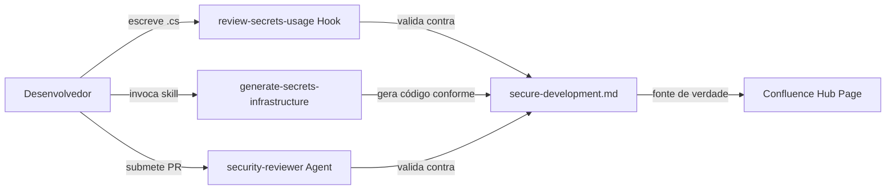
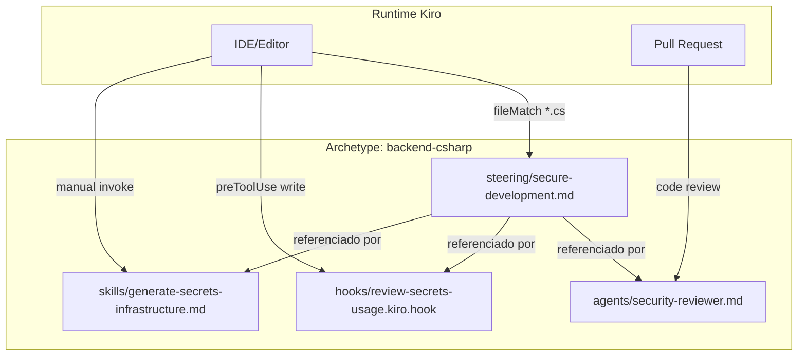

# Design Document

## Overview

Este design detalha a criação de artefatos Kiro para desenvolvimento seguro no archetype `backend-csharp`. A solução consiste em quatro artefatos interconectados — steering file, agent update, hook e skill — que funcionam como um sistema coeso onde o steering file é a fonte de verdade (single source of truth) para padrões de segurança.

### Objetivos

1. Codificar as práticas do hub "Desenvolvimento Seguro" do Confluence em artefatos prescritivos Kiro
2. Fornecer orientação em tempo de escrita via hook de validação de secrets
3. Gerar boilerplate compliant via skill dedicada
4. Reforçar validação em code review via seção dedicada no security reviewer agent
5. Garantir consistência entre todos os artefatos via referência centralizada ao steering file

### Fluxo de Interação



---

## Architecture

### Visão de Componentes

O sistema segue uma arquitetura hub-and-spoke onde o steering file é o hub central:



### Princípios de Design

1. **Single Source of Truth**: O steering file define os padrões; agent, hook e skill referenciam-no por caminho relativo em vez de duplicar definições.
2. **Defesa em Profundidade**: Três camadas de validação — tempo real (hook), geração (skill), e revisão (agent).
3. **Fail-Safe**: O hook opera em modo preToolUse (antes da escrita) para prevenir código não-compliance antes que entre no repositório.
4. **Progressividade**: Steering provê contexto passivo; hook provê validação ativa; skill provê geração assistida.

### Decisões de Design

| Decisão | Rationale |
|---|---|
| Hook em `preToolUse` (não `fileEdited`) | Intercepta antes da escrita, permitindo correção antes de materializar o código |
| Skill com modo `manual` | Geração de infraestrutura de secrets é uma ação deliberada, não automática |
| Steering com `fileMatch: **/*.cs,**/*.csproj,**/*.sln` | Injeção ampla para que qualquer arquivo C# receba contexto de segurança |
| Agent referencia steering por path relativo | Permite que updates no steering se propaguem sem editar o agent |
| Versionamento semântico no steering | Permite rastrear mudanças e comunicar breaking changes aos devs |

---

## Components and Interfaces

### 1. Steering File (`secure-development.md`)

**Localização**: `archetypes/backend-csharp/steering/secure-development.md`

**Frontmatter**:
```yaml
---
inclusion: fileMatch
fileMatchPattern: "**/*.cs,**/*.csproj,**/*.sln"
---
```

**Estrutura de Seções**:

| Seção | Conteúdo | Tipo |
|---|---|---|
| Header + Versão | Identificação `Steering File | Archetype: backend-csharp | Versão: 1.0.0` | Metadata |
| Secrets Management | Padrões obrigatórios, proibidos, aprovados; SecretsManagerCache, RdsAuthInterceptor, IRSA, VPC Endpoint | Regras prescritivas + exemplos de código |
| Input Validation | FluentValidation, max length 2000, ranges numéricos, whitelist | Regras prescritivas + exemplos |
| Security Headers | HSTS (31536000s), X-Content-Type-Options, X-Frame-Options, CORS | Tabela de configuração |
| CORS Configuration | Políticas restritivas, origens explícitas, sem AllowAnyOrigin com credentials | Regras + anti-patterns |
| Secure Logging | Serilog, exclusão de valores sensíveis, metadata permitida | Regras + exemplos |
| Data Protection | Criptografia em repouso e trânsito, decimal para dinheiro, PII handling | Regras |
| Dependency Awareness (SCA) | Snyk como gate de pipeline, responsabilidade do time de segurança | Informativo |
| References | Link para Confluence hub page | Metadata |

**Interface com outros artefatos**: Os demais artefatos referenciam o steering file pelo caminho relativo `../steering/secure-development.md` para manter consistência sem duplicação.

### 2. Security Reviewer Agent Update (`security-reviewer.md`)

**Localização**: `archetypes/backend-csharp/agents/security-reviewer.md`

**Alteração**: Adição de seção dedicada "Gestão de Secrets" (Secrets Management) dentro de "O que revisar", contendo:

| Sub-regra | Severidade | O que valida |
|---|---|---|
| SecretsManagerCache singleton | Critical | Registro correto no DI |
| Resolução por friendly name | High | Sem uso de ARN completo |
| RdsAuthInterceptor em DbContext | High | Padrão de rotação de credenciais |
| Hardcoded secrets | Critical | Strings literais com patterns de secrets |
| Secret exposure em logs/responses | Critical | Valores sensíveis em ILogger ou responses |
| Environment variables para secrets | High | `Environment.GetEnvironmentVariable` para secrets |

**Referência ao Steering**: A seção inclui nota explícita `Referência: steering/secure-development.md § Secrets Management`.

### 3. Hook de Validação (`review-secrets-usage.kiro.hook`)

**Localização**: `archetypes/backend-csharp/hooks/review-secrets-usage.kiro.hook`

**Formato**: JSON seguindo o padrão dos hooks existentes.

**Estrutura**:
```json
{
  "enabled": true,
  "name": "Revisar Uso de Secrets",
  "version": "1",
  "description": "...",
  "when": {
    "type": "preToolUse",
    "toolTypes": ["write"]
  },
  "then": {
    "type": "askAgent",
    "prompt": "..."
  }
}
```

**Lógica de Trigger**: O prompt instrui o agente a verificar se o arquivo sendo escrito:
1. É um arquivo `.cs`
2. Contém ao menos um dos patterns de trigger: `AmazonSecretsManagerClient`, `SecretsManagerCache`, `Environment.GetEnvironmentVariable`, `arn:aws:secretsmanager:`, `ConnectionString`, `Password=`, `ApiKey`, `Secret`, `Token`

**Validações executadas** (se trigger ativar):
- Instanciação direta de `AmazonSecretsManagerClient` (deve usar DI)
- String literals com prefixo ARN do Secrets Manager
- String literals com formato de connection string
- `Environment.GetEnvironmentVariable` com nomes contendo `PASSWORD`, `SECRET`, `TOKEN`, `API_KEY`, `CONNECTION_STRING`, `CREDENTIAL`

**Comportamento**:
- Se nenhum pattern detectado: permitir operação sem comentário
- Se violations detectadas: listar cada uma com sugestão de correção antes de permitir

### 4. Skill de Geração (`generate-secrets-infrastructure.md`)

**Localização**: `archetypes/backend-csharp/skills/generate-secrets-infrastructure.md`

**Frontmatter**:
```yaml
---
name: "Gerar Infraestrutura de Secrets"
description: "Gera boilerplate para integração com AWS Secrets Manager: DI, typed accessor, RdsAuthInterceptor e DbContext rotation-aware."
inclusion: manual
---
```

**Inputs esperados**:
- Nome do serviço (obrigatório)
- TTL do cache em segundos (default: 3600, range: 60-86400)
- Opção de database context (boolean, default: false)
- Nome do secret no Secrets Manager (obrigatório)

**Outputs gerados**:

| Componente | Localização | Descrição |
|---|---|---|
| `ISecretsProvider` interface | Domain/Abstractions/ | Interface de abstração |
| `SecretsManagerProvider` | Infrastructure/Security/ | Implementação com cache singleton |
| DI Registration | Infrastructure/DependencyInjection/ | Extension method para registrar no DI |
| Typed Secret Accessor | Infrastructure/Security/ | Classe tipada para desserializar secrets |
| `RdsAuthInterceptor` (opcional) | Infrastructure/Persistence/ | Interceptor para rotação de credenciais DB |
| DbContext config (opcional) | Infrastructure/Persistence/ | Configuração com resolução dinâmica |

**Dependências de pacotes**: Apenas `AWSSDK.SecretsManager` e `AWSSDK.SecretsManager.Caching`.

---

## Data Models

Este feature não introduz modelos de dados persistidos. Os "dados" são os próprios artefatos Kiro (arquivos markdown e JSON) e seus metadados.

### Modelo de Metadados do Steering File

```
┌─────────────────────────────────────────────┐
│ secure-development.md                        │
├─────────────────────────────────────────────┤
│ frontmatter:                                 │
│   inclusion: fileMatch                       │
│   fileMatchPattern: **/*.cs,**/*.csproj,...   │
├─────────────────────────────────────────────┤
│ header:                                      │
│   archetype: backend-csharp                  │
│   versão: X.Y.Z (semver)                    │
├─────────────────────────────────────────────┤
│ sections:                                    │
│   - Secrets Management                       │
│     - prohibited_patterns[]                  │
│     - approved_providers[]                   │
│     - validation_rules[]                     │
│   - Input Validation                         │
│   - Security Headers                         │
│   - CORS Configuration                       │
│   - Secure Logging                           │
│   - Data Protection                          │
│   - Dependency Awareness (SCA)               │
│   - References                               │
└─────────────────────────────────────────────┘
```

### Modelo de Hook (JSON Schema)

```json
{
  "enabled": "boolean",
  "name": "string (pt-BR)",
  "version": "string (semver-like)",
  "description": "string (pt-BR, descrição do propósito)",
  "when": {
    "type": "preToolUse",
    "toolTypes": ["write"]
  },
  "then": {
    "type": "askAgent",
    "prompt": "string (instruções para o agente)"
  }
}
```

### Modelo de Skill (Frontmatter + Markdown)

```yaml
---
name: "string (pt-BR)"
description: "string (pt-BR)"
inclusion: manual
---
```

---

## Error Handling

Como os artefatos são configurações estáticas (markdown/JSON), o "error handling" se aplica ao comportamento prescrito nos artefatos:

### Hook - Cenários de Erro

| Cenário | Comportamento Esperado |
|---|---|
| Arquivo não é `.cs` | Hook permite operação sem comentário |
| Arquivo `.cs` sem patterns de trigger | Hook permite operação sem comentário |
| Arquivo `.cs` com violations | Hook lista violations + sugestões, permite operação |
| Arquivo ambíguo (variable chamada `Token` em contexto não-secret) | Hook pode reportar falso positivo; prompt instrui a considerar contexto |

### Skill - Cenários de Erro no Código Gerado

| Cenário | Comportamento no Código Gerado |
|---|---|
| Network error ao resolver secret | Throw `SecretResolutionException` com razão; manter cache anterior se disponível |
| Access denied no Secrets Manager | Throw `SecretAccessDeniedException`; não expor valor do secret na mensagem |
| Secret não encontrado | Throw `SecretNotFoundException`; logar apenas o friendly name |
| Falha de autenticação DB (28P01/28000) | RdsAuthInterceptor invalida cache + single retry; se retry falhar, propagar exceção |
| TTL fora do range permitido | Validação na configuração; throw `ArgumentOutOfRangeException` no startup |

### Agent - Severidades

| Tipo de Finding | Severidade |
|---|---|
| Hardcoded secret | Critical |
| Secret em log/response | Critical |
| Instanciação direta sem DI | High |
| ARN completo em vez de friendly name | High |
| Environment variable para secrets | High |
| DbContext sem RdsAuthInterceptor | Medium |

---

## Testing Strategy

### Justificativa: PBT Não Aplicável

Property-based testing **não se aplica** a esta feature porque:

1. **Artefatos declarativos**: Os deliverables são arquivos markdown e JSON de configuração — não existe código com funções que recebem inputs variados e produzem outputs verificáveis.
2. **Sem input space variado**: Steering files, hooks e skills são estáticos; não há "para todo input X, propriedade P(X) é verdadeira".
3. **Validação é estrutural**: A verificação correta destes artefatos envolve checklist de presença (seções existem, patterns estão listados), não propriedades universais.

### Abordagem de Testes Recomendada

#### 1. Testes de Estrutura e Presença (Schema Validation)

Verificar que cada artefato contém as seções e campos obrigatórios:

- **Steering file**: Frontmatter válido, header com versão semver, todas as 8 seções presentes, exemplos de código compiláveis
- **Hook**: JSON válido, campos `enabled`, `name`, `version`, `description`, `when.type`, `when.toolTypes`, `then.type`, `then.prompt` presentes
- **Skill**: Frontmatter com `name`, `description`, `inclusion: manual`; seções de inputs, regras e outputs presentes
- **Agent**: Seção "Gestão de Secrets" presente com as 6 sub-regras de validação

#### 2. Testes de Consistência Cross-Artefato

Verificar que os artefatos estão alinhados:

- Prohibited patterns no steering == prohibited patterns validados pelo hook == prohibited patterns rejeitados pelo agent
- Approved providers no steering == providers usados na geração da skill
- `fileMatchPattern` do steering == file types que o hook verifica

#### 3. Testes de Conteúdo (Example-Based)

Exemplos específicos para validar regras:

- Steering contém o padrão `SecretsManagerCache` com TTL default 3600s
- Hook prompt menciona todos os patterns de trigger listados no requirement
- Agent inclui severidades corretas (Critical para hardcoded, High para env vars)
- Skill gera código que usa apenas `AWSSDK.SecretsManager` e `AWSSDK.SecretsManager.Caching`

#### 4. Testes de Formato e Lint

- Markdown lint no steering file e skill
- JSON schema validation no hook
- Verificar que o hook JSON é parseable e segue o schema dos hooks existentes

### Ferramentas de Teste

| Ferramenta | Uso |
|---|---|
| JSON Schema validation | Validar hook format contra schema existente |
| Markdown linter (markdownlint) | Validar formatação dos .md |
| grep/regex assertions | Verificar presença de seções e patterns obrigatórios |
| Diff tool | Verificar consistência entre artefatos (prohibited patterns) |

---

## Referências

- [Desenvolvimento Seguro - Confluence Hub](https://montebravo.atlassian.net/wiki/spaces/MBI/pages/desenvolvimento-seguro)
- [RFC-002 - Padrão Steering File para backend](https://montebravo.atlassian.net/wiki/spaces/MBI/pages/192806913)
- [AWS Secrets Manager Caching - NuGet](https://www.nuget.org/packages/AWSSDK.SecretsManager.Caching)
- [OWASP Top 10:2021](https://owasp.org/Top10/)
- Steering existente: `data-governance.md`, `architecture.md`, `stack-and-tooling.md`
- Hooks existentes: `review-data-model.kiro.hook`, `review-endpoint-quality.kiro.hook`
