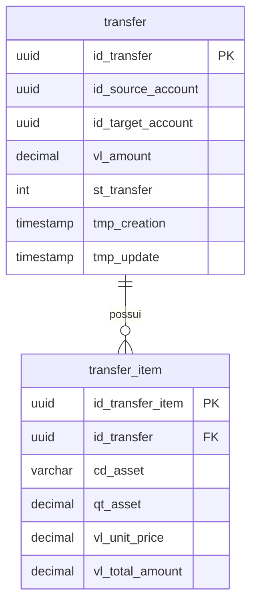

# Gerar Modelo de Dados

## Quando usar

Quando o desenvolvedor precisar modelar um novo domínio de dados ou adicionar entidades a um domínio existente, garantindo conformidade com os padrões do chapter de dados da Monte Bravo.

## Inputs esperados

- **Nome do domínio/bounded context** (obrigatório): nome em PascalCase (ex.: `Transfers`, `Portfolio`).
- **Lista de entidades** (obrigatório): cada entidade com seus atributos, incluindo:
  - Nome do atributo (em inglês, PascalCase para C#)
  - Natureza (prefixo: `id`, `nm`, `cd`, `ds`, `dt`, `hr`, `tmp`, `vl`, `qt`, `pc`, `st`, `nu`, `in`)
  - Tipo C# (`Guid`, `string`, `decimal`, `int`, `DateTime`, etc.)
  - Conceito em pt-BR (para o `HasComment`)
- **Relacionamentos** (obrigatório): cardinalidade entre entidades (1:1, 1:N, N:N).
- **Regras de negócio** (opcional): regras específicas para documentar nos comments.

## Regras de geração

### Referências obrigatórias

- **Steering:** `data-governance.md` — regras de nomenclatura e prefixos de natureza.
- **Steering:** `naming-conventions.md` — convenções gerais de código.
- **Steering:** `architecture.md` — padrão de camadas e persistência.

### Nomenclatura (duas camadas)

| Camada | Convenção |
|---|---|
| C# (Entity) | `PascalCase` — propriedades, classes, enums |
| Banco (Configuration) | `snake_case` com prefixo de natureza — tabelas e colunas |

### Tabela de naturezas (prefixos obrigatórios)

| Prefixo | Significado | Usar quando |
|---|---|---|
| `nm` | Nome | Valores que nomeiam |
| `cd` | Código | Códigos numéricos ou string |
| `ds` | Descrição | Valores descritivos longos |
| `dt` | Data | Valores de data (sem hora) |
| `hr` | Hora | Valores de hora (sem data) |
| `tmp` | Timestamp | Data e hora combinados |
| `vl` | Valor | Valores monetários |
| `qt` | Quantidade | Valores quantitativos |
| `pc` | Percentual | Valores percentuais |
| `id` | Identificador | IDs sistêmicos, PKs, FKs |
| `st` | Situação/Status | Status com até 9 valores distintos |
| `nu` | Número | Numéricos não decimais |
| `in` | Indicador | Valores discretos (flags, enums curtos) |

### Regras obrigatórias

1. **Tabelas**: `snake_case`, singular, inglês.
2. **Colunas**: `{prefixo_natureza}_{nome}` em `snake_case`.
3. **HasComment()**: obrigatório em pt-BR para TODA tabela e TODA coluna.
4. **Campos de auditoria**: `tmp_creation` (NOT NULL) e `tmp_update` (NULL) em toda tabela.
5. **Valores monetários**: `decimal` com `HasPrecision(18, 8)`.
6. **Chave primária**: explícita com `HasName("pk_{tabela}")`.
7. **Foreign keys**: explícitas com `HasConstraintName("fk_{origem}_{destino}")`.
8. **Índices**: nomeados com `HasDatabaseName("ix_{tabela}_{coluna(s)}")`.
9. **Normalização**: 3ª Forma Normal (3FN).
10. **Entidades**: com comportamento (factory methods, validações), nunca anêmicas.

## Outputs gerados

### 1. Entidades de domínio (C#)

Localização: `src/{ServiceName}.Domain/{Domain}/Entities/{Entity}.cs`

```csharp
public class Transfer : BaseEntity, IAuditableEntity
{
    public Guid Id { get; private set; }
    public Guid SourceAccountId { get; private set; }
    public Guid TargetAccountId { get; private set; }
    public decimal Amount { get; private set; }
    public TransferStatus Status { get; private set; }
    public DateTime CreatedAt { get; set; }
    public DateTime? UpdatedAt { get; set; }

    public ICollection<TransferItem> Items { get; private set; } = new List<TransferItem>();

    private Transfer() { }

    public static Transfer Create(Guid sourceAccountId, Guid targetAccountId, decimal amount)
    {
        if (sourceAccountId == Guid.Empty)
            throw new TransfersDomainException("Conta de origem é obrigatória.");
        if (targetAccountId == Guid.Empty)
            throw new TransfersDomainException("Conta de destino é obrigatória.");
        if (amount <= 0)
            throw new TransfersDomainException("Valor da transferência deve ser maior que zero.");
        if (sourceAccountId == targetAccountId)
            throw new TransfersDomainException("Conta de origem e destino não podem ser iguais.");

        return new Transfer
        {
            Id = Guid.NewGuid(),
            SourceAccountId = sourceAccountId,
            TargetAccountId = targetAccountId,
            Amount = amount,
            Status = TransferStatus.Pending
        };
    }
}
```

### 2. Entity Configuration (EF Core)

Localização: `src/{ServiceName}.Infrastructure/Persistence/Configurations/{Entity}Configuration.cs`

```csharp
public class TransferConfiguration : IEntityTypeConfiguration<Transfer>
{
    public void Configure(EntityTypeBuilder<Transfer> builder)
    {
        builder.ToTable("transfer")
            .HasComment("Transferência financeira entre contas de clientes. Representa a movimentação de ativos ou valores entre duas contas dentro da plataforma.");

        builder.HasKey(t => t.Id)
            .HasName("pk_transfer");

        builder.Property(t => t.Id)
            .HasColumnName("id_transfer")
            .HasComment("Identificador único da transferência");

        builder.Property(t => t.SourceAccountId)
            .HasColumnName("id_source_account")
            .IsRequired()
            .HasComment("Identificador da conta de origem da transferência");

        builder.Property(t => t.TargetAccountId)
            .HasColumnName("id_target_account")
            .IsRequired()
            .HasComment("Identificador da conta de destino da transferência");

        builder.Property(t => t.Amount)
            .HasColumnName("vl_amount")
            .HasPrecision(18, 8)
            .HasComment("Valor total da transferência em reais");

        builder.Property(t => t.Status)
            .HasColumnName("st_transfer")
            .HasConversion<int>()
            .HasComment("Situação da transferência: 1=Pendente, 2=Aprovada, 3=Executada, 4=Cancelada");

        builder.Property(t => t.CreatedAt)
            .HasColumnName("tmp_creation")
            .IsRequired()
            .HasComment("Data e hora da criação do registro");

        builder.Property(t => t.UpdatedAt)
            .HasColumnName("tmp_update")
            .HasComment("Data e hora da última atualização do registro");

        // Foreign Keys
        builder.HasMany(t => t.Items)
            .WithOne(i => i.Transfer)
            .HasForeignKey(i => i.TransferId)
            .HasConstraintName("fk_transfer_item_transfer");

        // Índices
        builder.HasIndex(t => t.SourceAccountId)
            .HasDatabaseName("ix_transfer_id_source_account");

        builder.HasIndex(t => t.TargetAccountId)
            .HasDatabaseName("ix_transfer_id_target_account");

        builder.HasIndex(t => new { t.SourceAccountId, t.Status })
            .HasDatabaseName("ix_transfer_id_source_account_st_transfer");
    }
}
```

### 3. Migration

Executar o comando:

```bash
dotnet ef migrations add Create{Domain}Tables --project src/{ServiceName}.Infrastructure --startup-project src/{ServiceName}.Api
```

### 4. Script DDL (para o DBA)

Localização: `docs/database/{domain}/ddl.sql`

Gerar DDL com:
- `CREATE TABLE` com tipos corretos
- `COMMENT ON TABLE` com conceito em pt-BR
- `COMMENT ON COLUMN` com conceito em pt-BR
- Constraints (PK, FK, UK)
- Índices

```sql
-- Tabela: transfer
-- Conceito: Transferência financeira entre contas de clientes.
CREATE TABLE transfer (
    id_transfer         UUID            NOT NULL,
    id_source_account   UUID            NOT NULL,
    id_target_account   UUID            NOT NULL,
    vl_amount           DECIMAL(18,8)   NOT NULL,
    st_transfer         INTEGER         NOT NULL,
    tmp_creation        TIMESTAMP       NOT NULL,
    tmp_update          TIMESTAMP       NULL,

    CONSTRAINT pk_transfer PRIMARY KEY (id_transfer)
);

COMMENT ON TABLE transfer IS 'Transferência financeira entre contas de clientes.';
COMMENT ON COLUMN transfer.id_transfer IS 'Identificador único da transferência';
-- ... demais colunas

CREATE INDEX ix_transfer_id_source_account ON transfer (id_source_account);
CREATE INDEX ix_transfer_id_target_account ON transfer (id_target_account);
```

### 5. Dicionário de Dados (Markdown)

Localização: `docs/database/{domain}/data-dictionary.md`

| Entidade | Atributo | Natureza | Tipo | Conceito | Constraint |
|---|---|---|---|---|---|
| transfer | id_transfer | id | UUID | Identificador único da transferência | PK |
| transfer | id_source_account | id | UUID | Identificador da conta de origem | NOT NULL |
| transfer | vl_amount | vl | DECIMAL(18,8) | Valor total da transferência em reais | NOT NULL |
| transfer | st_transfer | st | INTEGER | Situação: 1=Pendente, 2=Aprovada, 3=Executada, 4=Cancelada | NOT NULL |
| transfer | tmp_creation | tmp | TIMESTAMP | Data e hora da criação do registro | NOT NULL |
| transfer | tmp_update | tmp | TIMESTAMP | Data e hora da última atualização | — |

### 6. Diagrama ER (Mermaid)

Localização: `docs/database/{domain}/er-diagram.md`



## Checklist pós-geração

Após gerar o modelo, verificar:

- [ ] Todas as tabelas em `snake_case`, singular, inglês
- [ ] Todas as colunas com prefixo de natureza correto
- [ ] `HasComment()` em pt-BR para todas as tabelas
- [ ] `HasComment()` em pt-BR para todas as colunas
- [ ] Campos `tmp_creation` e `tmp_update` presentes
- [ ] Valores monetários com `HasPrecision(18, 8)`
- [ ] Chaves PK com `HasName("pk_{tabela}")`
- [ ] Foreign keys com `HasConstraintName("fk_{origem}_{destino}")`
- [ ] Índices com `HasDatabaseName("ix_{tabela}_{coluna}")`
- [ ] Modelo em 3FN
- [ ] Entidades com comportamento (não anêmicas)
- [ ] DDL gerado para o DBA
- [ ] Dicionário de dados gerado
- [ ] Diagrama ER gerado

## Próximo passo

Após a geração, lembrar o desenvolvedor de usar a skill `generate-validation-package` para montar o pacote completo de submissão ao chapter de dados.
