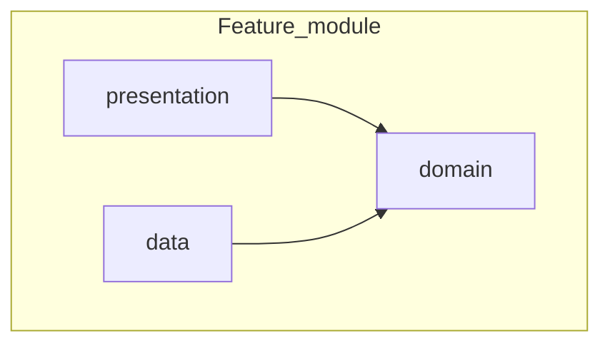

# Clean architecture and feature modularization

## Organize by feature, not by a global layer

Standard structure of a module:

```text
feature_name/
├── data/
├── domain/
└── presentation/
```

- **data**: datasources (remote/local), DTOs, repository implementations.
- **domain**: entities, contracts (abstract repositories), use cases — **no** Flutter/UI or IO details.
- **presentation**: feature pages, widgets, state (e.g. Riverpod), UI ↔ use case mapping.

## Dependency rules

| Layer        | May depend on |
|--------------|---------------|
| presentation | domain (and shared UI packages allowed by the project) |
| data         | domain |
| domain       | pure Dart only / minimal agreed types — **no** `flutter`, `dio`, etc. |

- **presentation must not know data**: do not import concrete repository implementations or datasources in the UI.
- **data implements** the contracts defined in **domain** (e.g. `abstract class LoginRepository`).

## Dependency flow



IO (HTTP, database, platform channels) lives in **data**. **domain** stays stable and easy to test.
